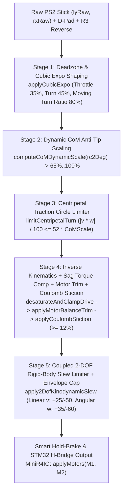

# คู่มือการใช้งานระบบหุ่นยนต์ MATRIX Mini R4 (Arduino UNO R4 WiFi)

ยินดีต้อนรับสู่คู่มือการใช้งานและเอกสารทางวิศวกรรมฉบับสมบูรณ์สำหรับแพลตฟอร์มหุ่นยนต์ **MATRIX Mini R4** ที่ทำงานร่วมกับบอร์ดไมโครคอนโทรลเลอร์ **Arduino UNO R4 WiFi** เอกสารฉบับนี้จัดทำขึ้นโดยละเอียดและใช้ภาษาไทยที่เข้าใจง่าย เหมาะสำหรับทั้งผู้เริ่มต้นที่ยังไม่เคยใช้งานแพลตฟอร์มนี้มาก่อน นักเรียน นักศึกษา ครูผู้สอน นักแข่งหุ่นยนต์ ไปจนถึงวิศวกรและนักพัฒนาระบบสมองกลฝังตัว

---

## สารบัญ (Table of Contents)

1. [บทนำและภาพรวมของระบบ (Introduction & Overview)](#1-บทนำและภาพรวมของระบบ-introduction--overview)
   - แพลตฟอร์ม MATRIX Mini R4 คืออะไร
   - ข้อควรระวังและคำชี้แจงความแตกต่างเรื่องชื่อ "MATRIX"
   - จุดเด่นทางวิศวกรรม ฟิสิกส์การขับเคลื่อน และระบบความปลอดภัยของเฟิร์มแวร์
2. [รายการอุปกรณ์ที่ต้องใช้ (Hardware Prerequisites Checklist)](#2-รายการอุปกรณ์ที่ต้องใช้-hardware-prerequisites-checklist)
3. [ผังพินและการต่อสายวงจรอย่างละเอียด (Complete Pinout & Wiring Guide)](#3-ผังพินและการต่อสายวงจรอย่างละเอียด-complete-pinout--wiring-guide)
   - ตารางความสัมพันธ์ของพินทั้งหมด (Pinout Mapping Table)
   - แผนผังการต่อสายคอนโทรลเลอร์ไร้สาย PS2 / MJ2
   - การต่อมอเตอร์ขับเคลื่อนและเซอร์โวมอเตอร์
   - ข้อควรระวังด้านความปลอดภัยทางไฟฟ้าและคำอธิบายระดับแรงดันแบตเตอรี่
4. [การติดตั้งโปรแกรมและเตรียมสภาพแวดล้อม (PlatformIO Installation & Setup)](#4-การติดตั้งโปรแกรมและเตรียมสภาพแวดล้อม-platformio-installation--setup)
   - การติดตั้ง Visual Studio Code และส่วนขยาย PlatformIO IDE
   - การเปิดโปรเจกต์และการโหลด Toolchain อัตโนมัติ
   - การเรียกใช้งาน PlatformIO ผ่าน Terminal และ CLI
5. [คู่มือการคอมไพล์ ทดสอบ และอัปโหลดโปรแกรม (Build, Test & Upload Step-by-Step)](#5-คู่มือการคอมไพล์-ทดสอบ-และอัปโหลดโปรแกรม-build-test--upload-step-by-step)
   - 5.1 การรันแบบทดสอบอัตโนมัติบนเครื่องโฮสต์ (`pio test -e native` — ครบ 40 รายการ 11 หมวดหมู่)
   - 5.2 การคอมไพล์โค้ดสำหรับฮาร์ดแวร์ (`pio run -e uno_r4_wifi`)
   - 5.3 การอัปโหลดเฟิร์มแวร์ลงบอร์ด (`pio run -e uno_r4_wifi --target upload`)
   - 5.4 ทางลัดเข้าสู่โหมดอัปโหลด Bootloader (Upload Bootloader Mode Shortcut)
   - 5.5 การเปิด Serial Monitor เพื่อดูข้อมูลการทำงานแบบเรียลไทม์
   - 5.6 การวิเคราะห์โค้ดเชิงสถิต (`pio check` / `cppcheck`)
6. [คู่มือการควบคุมหุ่นยนต์และโหมดแข่งขันอัตโนมัติ (Robot Operation & Competition Manual)](#6-คู่มือการควบคุมหุ่นยนต์และโหมดแข่งขันอัตโนมัติ-robot-operation--competition-manual)
   - 6.1 แผนผังและตารางการควบคุมด้วยจอยสติ๊ก PS2 / MJ2 Wireless
   - 6.2 การควบคุมด้วยปุ่มกดบนบอร์ด Carrier Shield (Hardware Buttons)
   - 6.3 คำสั่งควบคุมผ่าน Serial Monitor (USB Keyboard Control) และรูปแบบข้อความ Telemetry
   - 6.4 คู่มือการใช้งานโหมดอัตโนมัติ (Autonomous Mode & MATRIXblock R4 Integration)
   - 6.5 การอ่านค่าหน้าจอ OLED และความหมายของไฟ RGB LED
   - 6.6 ระบบบันทึกการตั้งค่าถาวรลงหน่วยความจำ EEPROM (CRC-16-CCITT Persistent Config)
7. [สถาปัตยกรรมโค้ด แบบจำลองฟิสิกส์ และการทำงานภายใน (Code Architecture & Engineering Details)](#7-สถาปัตยกรรมโค้ด-แบบจำลองฟิสิกส์-และการทำงานภายใน-code-architecture--engineering-details)
   - 7.1 [แผนผังรอบการทำงานลูปควบคุมหลัก 40 Hz (25 ms Cycle Diagram)](#71-แผนผังรอบการทำงานลูปควบคุมหลัก-40-hz-25-ms-cycle-diagram)
   - 7.2 [คำอธิบายโครงสร้างและหน้าที่ของทุกไฟล์ในโปรเจกต์อย่างละเอียด (Exhaustive File-by-File Breakdown - 36 ไฟล์)](#72-คำอธิบายโครงสร้างและหน้าที่ของทุกไฟล์ในโปรเจกต์อย่างละเอียด-exhaustive-file-by-file-breakdown---36-ไฟล์)
     - [กลุ่มที่ 1: ไฟล์ระดับรากของโปรเจกต์ (Project Root Files - 4 ไฟล์)](#กลุ่มที่-1-ไฟล์ระดับรากของโปรเจกต์-project-root-files---4-ไฟล์)
     - [กลุ่มที่ 2: โฟลเดอร์การตั้งค่า Visual Studio Code (.vscode/ - 4 ไฟล์)](#กลุ่มที่-2-โฟลเดอร์การตั้งค่า-visual-studio-code-vscode---4-ไฟล์)
     - [กลุ่มที่ 3: ไฟล์ส่วนหัวและการประกาศฟังก์ชัน (include/ - 9 ไฟล์)](#กลุ่มที่-3-ไฟล์ส่วนหัวและการประกาศฟังก์ชัน-include---9-ไฟล์)
     - [กลุ่มที่ 4: ซอร์สโค้ดการทำงานหลัก (src/ - 8 ไฟล์)](#กลุ่มที่-4-ซอร์สโค้ดการทำงานหลัก-src---8-ไฟล์)
     - [กลุ่มที่ 5: โฟลเดอร์ไลบรารีส่วนตัว (lib/ - 1 ไฟล์)](#กลุ่มที่-5-โฟลเดอร์ไลบรารีส่วนตัว-lib---1-ไฟล์)
     - [กลุ่มที่ 6: ระบบการทดสอบอัตโนมัติ (test/ - 2 ไฟล์)](#กลุ่มที่-6-ระบบการทดสอบอัตโนมัติ-test---2-ไฟล์)
   - 7.3 [เจาะลึกแบบจำลองฟิสิกส์จลนพลศาสตร์และไฟฟ้ากล 5 ขั้นตอน (5-Stage Physics Kinodynamic Pipeline)](#73-เจาะลึกแบบจำลองฟิสิกส์จลนพลศาสตร์และไฟฟ้ากล-5-ขั้นตอน-5-stage-physics-kinodynamic-pipeline)
   - 7.4 [ตารางอ้างอิงพารามิเตอร์ทางวิศวกรรมทั้งหมดใน `include/config.h`](#74-ตารางอ้างอิงพารามิเตอร์ทางวิศวกรรมทั้งหมดใน-includeconfigh)
8. [การแก้ปัญหาที่พบบ่อยและคำถามที่พบบ่อย (Troubleshooting & FAQ)](#8-การแก้ปัญหาที่พบบ่อยและคำถามที่พบบ่อย-troubleshooting--faq)
   - ปัญหาที่ 1: เสียบ USB แล้วมอเตอร์และเซอร์โวไม่ทำงาน
   - ปัญหาที่ 2: คอมพิวเตอร์ตรวจไม่พบพอร์ต COM หรืออัปโหลดไม่เข้า
   - ปัญหาที่ 3: จอยสติ๊ก PS2 ไม่เชื่อมต่อ หรือค้างที่หน้าจอ `WAIT PS2`
   - ปัญหาที่ 4: มอเตอร์หมุนกลับทิศ หรือหุ่นยนต์วิ่งสลับทาง
   - ปัญหาที่ 5: หุ่นยนต์วิ่งทางตรงแล้วกินซ้ายหรือกินขวา (วิธีจูน Motor Balance Trim)
   - ปัญหาที่ 6: การตั้งค่าระบบป้องกันไฟตก (`kEnableBatterySagThrottle`) และอาการชะลอความเร็วเมื่อแบตอ่อน
   - ปัญหาที่ 7: โหมด Auto หยุดทำงานเองก่อนจบสคริปต์ (ระบบตรวจจับล้อติดขัด Encoder Stall Protection)
   - ปัญหาที่ 8: หน้าจอ OLED ดับ หรือมืดสนิท
9. [สรุปการยกระดับความปลอดภัยและความเสถียรล่าสุด (Security & Stability Hardening Summary)](#9-สรุปการยกระดับความปลอดภัยและความเสถียรล่าสุด-security--stability-hardening-summary)

---

## 1. บทนำและภาพรวมของระบบ (Introduction & Overview)

### แพลตฟอร์ม MATRIX Mini R4 คืออะไร
**MATRIX Mini R4** คือแพลตฟอร์มหุ่นยนต์ขับเคลื่อน 2 ล้อแบบดิฟเฟอเรนเชียล (Differential Drive Mobile Robot) ระดับมืออาชีพที่ออกแบบมาสำหรับการศึกษา STEM กิจกรรมการแข่งขันหุ่นยนต์ และการทดลองด้านระบบควบคุมอัตโนมัติ

ระบบนี้ทำงานด้วยสถาปัตยกรรมประมวลผลคู่ (Dual-Processor Architecture) ประกอบด้วย:
1. **บอร์ดประมวลผลหลัก (Main MCU)**: **Arduino UNO R4 WiFi** ขับเคลื่อนด้วยชิปไมโครคอนโทรลเลอร์ 32-bit Renesas RA4M1 (ARM Cortex-M4 ความเร็ว 48 MHz, หน่วยความจำแรม SRAM 32 KB, หน่วยความจำโปรแกรมแฟลช Flash 256 KB, และหน่วยความจำข้อมูล Data Flash 8 KB สำหรับจำลอง EEPROM) ทำหน้าที่ประมวลผลลอจิกการเคลื่อนที่ แบบจำลองฟิสิกส์จลนพลศาสตร์ รับคำสั่งจากรีโมท รันโหมดอัตโนมัติ (Auto Mode) ตรวจจับสถานะความปลอดภัย และควบคุมการแสดงผล
2. **บอร์ดขยายและขับกำลัง (Carrier Shield & Co-processor)**: **MATRIX Mini R4 Carrier Shield** ซึ่งติดตั้งประกบเข้ากับบอร์ด Arduino โดยบนบอร์ดนี้มีชิปไมโครคอนโทรลเลอร์ร่วม **STM32 (`MMLower`)** ทำหน้าที่ควบคุมชุดขับกำลังสูงโดยเฉพาะ ได้แก่ ช่องต่อมอเตอร์เกียร์กระแสตรง DC Motor 4 ช่อง (M1 ถึง M4 พร้อมระบบอ่านค่า Encoder และ PID/Gyro DriveDC) และช่องต่อเซอร์โวมอเตอร์ RC Servo 4 ช่อง (RC1 ถึง RC4) ผ่านการสื่อสารอนุกรม SoftwareSerial บนพิน D8 (RX) และ D9 (TX) ที่ความเร็ว 57,600 baud

```
+-------------------------------------------------------------------+
|                     Arduino UNO R4 WiFi                           |
| (Renesas RA4M1 32-bit Cortex-M4 @ 48MHz, 32KB RAM, 256KB Flash)   |
|                                                                   |
|   - Non-blocking 40 Hz Control Loop Scheduler (25 ms cadence)     |
|   - Deterministic Bit-Bang SPI PS2 Driver (~1.4 ms)               |
|   - 5-Stage Physics Kinodynamic & Electromechanical Pipeline      |
|   - 5-Stage Packet Validation & Failsafe State Machine            |
|   - MATRIXblock R4 Drop-In Autonomous Mode + Stall Protection     |
|   - EEPROM Config Storage with CRC-16-CCITT Integrity Check       |
|   - Adaptive Battery Sag Monitor & Live Stability Index (0-100%)  |
+---------------------------------+---------------------------------+
                                  | UART (D8/D9 @ 57600 baud)
                                  v
+-------------------------------------------------------------------+
|                  MATRIX Mini R4 Carrier Shield                    |
|                (Dedicated STM32 Co-processor)                     |
|                                                                   |
|   - 4x DC Motor H-Bridge Drivers (M1: ล้อซ้าย, M2: ล้อขวา)         |
|   - Smart Electromagnetic Hold-Brake & Encoder Feedback           |
|   - 4x Hardware PWM RC Servo Outputs (RC1..RC4, 0°..180°)         |
|   - Onboard I2C SSD1306 128x32 OLED Display (Wire1 @ 400 kHz)     |
|   - 2x WS2812B Addressable RGB LEDs (Pin D7)                      |
|   - 1x Piezo Buzzer (Pin D6)                                      |
|   - 2x User Buttons: BTN_UP (ID 2), BTN_DOWN (ID 1)               |
|   - Battery Voltage ADC Sensing (DC 9V-18V / LiPo 2S-4S)          |
+-------------------------------------------------------------------+
```

---

### ข้อควรระวังและคำชี้แจงความแตกต่างเรื่องชื่อ "MATRIX"
เพื่อป้องกันความสับสนสำหรับผู้เริ่มต้นใช้งาน มีข้อควรระวังสำคัญ 2 ประการเกี่ยวกับคำว่า **"MATRIX"**:

1. **แบรนด์ MATRIX Robotics**: คำว่า "MATRIX" ในชื่อโปรเจกต์นี้ หมายถึงชื่อทางการค้าของผู้ผลิตชุดหุ่นยนต์เพื่อการศึกษา **MATRIX Robotics** ซึ่งเป็นผู้ผลิตบอร์ดขยาย Mini R4 Carrier Shield โครงสร้างโลหะอลูมิเนียม มอเตอร์ และชิ้นส่วนกลไกต่างๆ
2. **หน้าจอ LED Matrix บนบอร์ด Arduino**: บนตัวบอร์ด Arduino UNO R4 WiFi จะมีหน้าจอแสดงผลหลอดไฟ LED สีแดงขนาด 12x8 ดวง (96 เม็ด) ติดตั้งอยู่บนหน้าบอร์ด ซึ่งในคู่มือของ Arduino มักเรียกว่า "12x8 LED Matrix"
   > **ข้อสำคัญ**: เฟิร์มแวร์ของหุ่นยนต์ตัวนี้ **ไม่ได้ใช้** จอไฟสีแดง 12x8 LED Matrix บนหน้าบอร์ด Arduino ในการแสดงข้อมูลหลัก แต่จะใช้หน้าจอ **OLED สีขาวขนาด 0.91 นิ้ว ความละเอียด 128x32 พิกเซล (ชิป SSD1306)** ที่ติดตั้งอยู่บนบอร์ด MATRIX Mini R4 Carrier Shield โดยตรง เพื่อให้สามารถแสดงข้อความ ตัวเลข แถบความคืบหน้า และกราฟิกสถานะได้อย่างละเอียด คมชัด และอ่านง่าย

---

### จุดเด่นทางวิศวกรรม ฟิสิกส์การขับเคลื่อน และระบบความปลอดภัยของเฟิร์มแวร์
เฟิร์มแวร์ชุดนี้ได้รับการออกแบบและปรับปรุงให้มีความเสถียร ความแม่นยำ และความปลอดภัยสูงสุดสำหรับงานหุ่นยนต์ระดับแข่งขัน (Deterministic Competition-Hardened Architecture):

- **ไดรเวอร์จอยสติ๊ก PS2 แบบ Deterministic Bit-Bang SPI (~1.4 ms)**: แก้ปัญหาคอขวดของไดรเวอร์เดิม (`PS2X::read_gamepad()`) ที่ใช้การวนลูปหน่วงเวลาแบบบล็อกการทำงาน (Blocking) นานถึง 150–240 ms เมื่อสัญญาณหลุด โดยไดรเวอร์ใหม่เข้าถึงรีจิสเตอร์พอร์ตฮาร์ดแวร์โดยตรง (`POSR`, `PORR`, `PIDR`) ทำให้การอ่านค่าจอยสติ๊กทำเสร็จสิ้นได้ในเวลาคงที่เพียง ~1.4 ms ต่อรอบ และเมื่อไม่ได้เสียบตัวรับจะตัดจบการโพรบภายใน ~0.8 ms โดยไม่กระทบต่อลูปควบคุม 40 Hz
- **แบบจำลองฟิสิกส์จลนพลศาสตร์และไฟฟ้ากล 5 ขั้นตอน (`computeKinodynamicDrive`)**:
  1. **Cubic Expo Input Shaping (`applyCubicExpo`)**: ปรับโค้งคันเร่ง (`35%`) และโค้งการเลี้ยว (`45%`) ด้วยพหุนามกำลังสาม ลดความกระตุก (Jerk) บริเวณกึ่งกลางก้านโยกเพื่อการเล็งที่ละเอียด แต่ยังคงกำลังสูงสุด $\pm 100\%$ เมื่อโยกสุด
  2. **Centripetal Traction Circle Limiter (`limitCentripetalTurn`)**: จำกัดความเร่งหนีศูนย์กลางขณะเข้าโค้งความเร็วสูง ($|v \cdot \omega| / 100 \le 52$) ป้องกันล้อไถลหรือท้ายปัด โดยยังคงกำลังหมุนตัวอยู่กับที่ (Pivot Turn) เต็ม 100%
  3. **Dynamic Center-of-Mass (CoM) Anti-Tip Scaling (`computeCoMDynamicScale`)**: คำนวณความสูงจุดศูนย์ถ่วงจากมุมแขนยก `RC2` แบบเรียลไทม์ เมื่อยกแขนสูงขึ้น (`140° -> 0°`) ระบบจะลดอัตราเร่งและขีดจำกัดแรงเหวี่ยงเข้าโค้งลงตามสัดส่วน (`100% -> 65%`) ป้องกันหุ่นยนต์หน้าหงายหรือคะมำ
  4. **Coupled 2-DOF Rigid-Body Slew Limiter (`apply2DofKinodynamicSlew`)**: ควบคุมอัตราเร่งและอัตราเบรกแยกอิสระในพิกัดความเร็วเชิงเส้น ($v$) และความเร็วเชิงมุม ($\omega$) แบบเลขจำนวนเต็มสองเท่า (Zero-Rounding Loss) ช่วยรักษาความโค้งของเส้นทาง ($\omega / v$) ขณะเร่งหรือเบรกไม่ให้เพี้ยน
  5. **Coulomb Static Friction Feedforward (`applyCoulombStiction`)**: ชดเชยแรงเสียดทานสถิตของชุดเกียร์มอเตอร์ (`12%`) ทันทีที่มีคำสั่งเคลื่อนที่ ทำให้ล้อเริ่มหมุนตอบสนองทันทีโดยไม่มีช่วงบอด (Deadband Lag)
- **ระบบเบรกแม่เหล็กไฟฟ้าอัจฉริยะ (Smart Electromagnetic Hold-Brake)**: เมื่อหุ่นยนต์หยุดนิ่งที่ความเร็ว `(0, 0)` ระบบจะสั่งล็อกเพลาด้วย H-Bridge Brake (`setBrake(true)`) โดยอัตโนมัติ (แสดงสัญลักษณ์ `H` บนหน้าจอ OLED) ป้องกันหุ่นไหลบนทางลาดหรือถูกคู่ต่อสู้ดันเคลื่อนที่
- **ฟีเจอร์ช่วยแข่งขันระดับโปร (Competition Shortcuts)**:
  - **สลับด้านหน้า-หลังทันที (`R3` / คีย์ `b`)**: เปลี่ยนให้ฝั่งชุดมือจับ (`RC1`/`RC2`) กลายเป็นด้านหน้าของการขับขี่ได้ในคลิกเดียว
  - **หมุนตัวละเอียด Micro-Turn (`D-Pad ◄/►`)**: แตะปุ่มทิศทางซ้าย/ขวาขณะปล่อยก้านโยกเพื่อหมุนจัดแนวเข้าหาชิ้นงานด้วยกำลังคงที่ `±26%`
  - **จูนสมดุลล้อซ้าย-ขวา (`Start + ◄/►/L3` หรือคีย์ `,`/`.`/`0`)**: ปรับชดเชยล้อซ้าย/ขวาทีละ `±1%` (ในช่วง `-15%` ถึง `+15%`) เพื่อให้หุ่นวิ่งตรงสนิท พร้อมบันทึกลง EEPROM ทันที
  - **ปุ่มเดียวสลับท่าชุดเซอร์โวหยิบ/วาง (`Circle ○` / คีย์ `q`)**: สลับ `RC1` และ `RC2` ระหว่างท่าวางปล่อย (`145°, 140°`) และท่าถือยกเก็บ (`75°, 70°`)
  - **ระบบกวาดมุมสมูทเฉพาะแขนยก `RC2` (`L3` / คีย์ `y`)**: กวาดมุม `RC2` อย่างนุ่มนวลที่ `6° / 25 ms` (`240°/s`) เพื่อลดแรงกระชากของแขนยก ในขณะที่เซอร์โว `RC1`, `RC3`, `RC4` ทำงานด้วยความเร็วสูงสุดทันที 100%
- **โหมดอัตโนมัติ MATRIXblock R4 แบบวางโค้ดได้ทันที (`src/auto_block_code.cpp`)**:
  - คัดลอกโค้ด C++ จากโปรแกรม **MATRIXblock R4** มาวางทับได้โดยตรง รองรับทั้ง `MiniR4.DriveDC`, `MiniR4.RC1..RC4`, `MiniR4.PS2`, `MiniR4.I2C1..I2C4.MJ5`
  - เริ่มโหมด Auto ได้ 3 ช่องทาง: กดปุ่ม **Triangle (△)** บนจอย, กดปุ่ม **`BTN_UP` บนบอร์ดค้าง 1.2 วินาที** (ไม่ต้องใช้จอย PS2), หรือพิมพ์ **`g`** ใน Serial Monitor
  - กดปุ่ม **Cross (✖)** บนจอย, กดปุ่มบนบอร์ด, หรือพิมพ์ `x`/`!` เพื่อ **ตัดจังหวะหยุดโหมด Auto ได้ทันทีทุกจุด** แม้กำลังอยู่ใน `delay()` หรือบล็อก `DriveDC.MoveDegs()`
  - มีระบบ **Encoder Wheel Stall Protection** ตรวจจับล้อติดกำแพงขณะรัน `DriveDC` หากล้อหมุนไปไม่ได้ถึง `3°` นานเกิน `1.6 วินาที` จะสั่งหยุดและตัดกลับโหมด Manual อัตโนมัติเพื่อป้องกันมอเตอร์ไหม้
- **ระบบบันทึกค่าตั้งต้นถาวรลง EEPROM พร้อม CRC-16-CCITT**: จดจำทิศทางมอเตอร์ (`f1`/`f2`), โหมดสมูท `RC2` (`L3`/`y`), และค่าจูนสมดุลล้อ (`Trim`) ลงในหน่วยความจำ Data Flash ที่แอดเดรสปลอดภัย `0x80` (ไม่ชนกับข้อมูลแคลิเบรต IMU ของไลบรารี `MatrixMiniR4`) ส่วนโหมดความเร็วต่ำ Precision (`Select`/`z`) จะเริ่มที่ `100%` เสมอทุกครั้งที่เปิดเครื่องเพื่อความปลอดภัยในการแข่งขัน
- **ระบบตรวจสอบแพ็กเก็ตข้อมูล 5 ชั้น (5-Stage Packet Validation)**: กรองสัญญาณรบกวนคลื่นวิทยุ 2.4GHz ได้อย่างเด็ดขาด (ตรวจ Mode `0x73` + Sync `0x5A`, ปุ่ม D-Pad ตรงข้ามกัน, ปุ่มเรขาคณิต 4 ปุ่มพร้อมกัน, สายลอย `0xFF`, และสายช็อตกราวด์ `0x00`)
- **ระบบติดตามพลังงานและป้องกันไฟตก (Adaptive Battery Stabilizer)**: รองรับทั้งแบตเตอรี่ LiPo 2S, 3S, 4S และหม้อแปลง DC 9V–18V มีตัวกรอง Dual-Alpha Asymmetric EMA (ลงเร็ว 35% ขึ้นช้า 8%) พร้อมระบบชดเชยแรงบิด (Torque Compensation สูงสุด 115%) และกลไกป้องกันไฟกระชากย้อนกลับตอนเบรก (Regen Spike Guard)
- **ดัชนีวัดความเสถียรของระบบแบบเรียลไทม์ (Live Stability Index 0–100%)**: ประมวลผลสถานะความปลอดภัย 4 ด้าน (Link, Power, Comm, Timing) แสดงผลบนหน้าจอ OLED ทันที
- **ระบบเฝ้าระวังฮาร์ดแวร์ Watchdog Timer (3000 ms)** และ **ทางลัดเข้าสู่โหมดอัปโหลด Bootloader (กด `BTN_UP + BTN_DOWN` ค้าง 2.5 วินาที หรือพิมพ์ `'u'`)**

---

## 2. รายการอุปกรณ์ที่ต้องใช้ (Hardware Prerequisites Checklist)

ก่อนเริ่มต้นประกอบและใช้งานหุ่นยนต์ โปรดตรวจสอบรายการอุปกรณ์ตามตารางด้านล่างให้ครบถ้วน:

| ลำดับ | รายการอุปกรณ์ | สเปก / คุณสมบัติ | จำนวน | หน้าที่การทำงาน |
| :---: | :--- | :--- | :---: | :--- |
| 1 | **Arduino UNO R4 WiFi** | ไมโครคอนโทรลเลอร์ Renesas RA4M1 32-bit Cortex-M4 @ 48 MHz, 32KB SRAM, 256KB Flash, 8KB Data Flash (EEPROM) | 1 บอร์ด | บอร์ดประมวลผลหลัก ควบคุมลอจิก คำนวณจลนพลศาสตร์ รันโหมด Auto และประมวลผลความปลอดภัย |
| 2 | **MATRIX Mini R4 Carrier Shield** | บอร์ดเสริมขับมอเตอร์พร้อมชิป STM32 Coprocessor (`MMLower`), วงจร Regulators, ช่องต่อ I/O | 1 บอร์ด | รับคำสั่งจากบอร์ดหลักไปขับมอเตอร์กำลังสูง เซอร์โว อ่าน Encoder/IMU ควบคุมจอแสดงผล และไฟสถานะ |
| 3 | **มอเตอร์เกียร์ขับเคลื่อน DC** | มอเตอร์กระแสตรง 5V DC Gear Motor (พร้อม Encoder ในตัว) | 2 ตัว | มอเตอร์ขับเคลื่อนล้อ:<br>- `M1`: ล้อซ้าย (Left Drive)<br>- `M2`: ล้อขวา (Right Drive) |
| 4 | **เซอร์โวมอเตอร์ (RC Servos)** | ไมโครเซอร์โว หรือสแตนดาร์ดเซอร์โว 5V (PWM Signal 0°–180°) | 1–4 ตัว | ควบคุมกลไกเสริม:<br>- `RC1`: อุปกรณ์เสริม / มือจับ (Aux/Gripper)<br>- `RC2`: ก้านยกปรับระดับ (Arm Lifter)<br>- `RC3`: แขนหน้าซ้าย (Front Left Arm)<br>- `RC4`: แขนหน้าขวา (Front Right Arm) |
| 5 | **ชุดจอยสติ๊กไร้สาย PS2 / MJ2** | จอยไร้สาย 2.4GHz สไตล์ DualShock พร้อมตัวรับสัญญาณ Receiver และถ่าน AAA 2 ก้อน | 1 ชุด | อุปกรณ์บังคับหุ่นยนต์ระยะไกลผ่านคลื่นวิทยุ 2.4GHz |
| 6 | **สายสัญญาณตัวรับจอยสติ๊ก** | สาย 4-pin (D2) และสาย 2-pin (D3) มาตรฐาน MATRIX | 2 เส้น | เชื่อมต่อสัญญาณระหว่างตัวรับจอยสติ๊กไร้สายเข้ากับบอร์ด Carrier Shield |
| 7 | **หน้าจอแสดงผล OLED** | จอ OLED Monochrome 0.91 นิ้ว 128x32 พิกเซล ชิปไดรเวอร์ SSD1306 (บัส `Wire1`) | 1 ชิ้น | ติดตั้งบนบอร์ด Carrier Shield แสดงสถานะ แรงดันแบตเตอรี่ กำลังขับ และโหมดการทำงาน |
| 8 | **หลอดไฟแสดงสถานะ RGB** | หลอด LED RGB แบบโปรแกรมได้ชนิด WS2812B | 2 ดวง | ติดตั้งอยู่บนบอร์ด Carrier Shield (พิน D7) แสดงสถานะการเชื่อมต่อและข้อผิดพลาด |
| 9 | **ลำโพงส่งเสียงเตือน** | Piezo Buzzer ความถี่สูง | 1 ตัว | ติดตั้งอยู่บนบอร์ด Carrier Shield (พิน D6) ส่งเสียงบี๊บยืนยันและเสียงเตือนภัย |
| 10 | **แหล่งจ่ายพลังงานภายนอก** | - แบตเตอรี่ LiPo 2S (7.4V), 3S (11.1V), หรือ 4S (14.8V) หรือ<br>- สวิตชิ่งอะแดปเตอร์ DC 9V–18V (กระแส ≥ 2A) | 1 ชุด | จ่ายกระแสไฟฟ้ากำลังสูงเลี้ยงมอเตอร์ เซอร์โว และวงจรคอนโทรลเลอร์ทั้งหมด |
| 11 | **สายเชื่อมต่อคอมพิวเตอร์** | สาย USB Type-C คุณภาพสูง (รองรับทั้งชาร์จไฟและส่งข้อมูล Data) | 1 เส้น | ใช้สำหรับคอมไพล์ อัปโหลดโปรแกรม และสื่อสารผ่าน Serial Monitor |

---

## 3. ผังพินและการต่อสายวงจรอย่างละเอียด (Complete Pinout & Wiring Guide)

### ตารางความสัมพันธ์ของพินทั้งหมด (Pinout Mapping Table)

บอร์ด MATRIX Mini R4 Carrier Shield ได้จัดสรรทรัพยากรพินของ Arduino UNO R4 WiFi ไว้อย่างเป็นระบบ ดังนี้:

| พินบน UNO R4 | โหมดการทำงาน | สัญญาณ / โมดูลที่เชื่อมต่อ | คำอธิบายรายละเอียด |
| :---: | :---: | :--- | :--- |
| **D2 (Port)** | GPIO | **DIGITAL 2 Connector** | ช่องเสียบ 4 พินสำหรับตัวรับ PS2: เชื่อมต่อไปยัง D4 (CMD) และ D5 (DAT) พร้อมสายไฟ 5V/GND |
| **D3 (Port)** | GPIO | **DIGITAL 3 Connector** | ช่องเสียบ 2 พินสำหรับตัวรับ PS2: เชื่อมต่อไปยัง D11 (CLK) และ D12 (ATT/CS) |
| **D4** | OUTPUT | **PS2 CMD (Command)** | ส่งคำสั่ง Master-Out-Slave-In (MOSI) จาก Arduino ไปยังตัวรับสัญญาณ PS2 |
| **D5** | INPUT_PULLUP | **PS2 DAT (Data)** | รับข้อมูล Master-In-Slave-Out (MISO) จากตัวรับสัญญาณ PS2 กลับมายัง Arduino |
| **D6** | OUTPUT | **Piezo Buzzer** | ลำโพงส่งเสียงเตือนความถี่ต่างๆ (บี๊บเริ่มระบบ 1100 Hz, ยืนยัน 1400 Hz, เตือน 520 Hz, Bootloader 1500 Hz) |
| **D7** | OUTPUT | **WS2812B RGB LEDs** | สัญญาณควบคุมไฟแสดงสถานะ LED RGB สองดวง (LED 1 และ LED 2) แบบต่อเรียงกัน |
| **D8** | INPUT | **STM32 UART RX** | รับข้อมูล Telemetry สถานะปุ่ม Encoder และแรงดันแบตเตอรี่จากชิป STM32 Coprocessor |
| **D9** | OUTPUT | **STM32 UART TX** | ส่งคำสั่งกำลังขับมอเตอร์ M1-M4, เบรก H-Bridge และองศาเซอร์โว RC1-RC4 ไปยังชิป STM32 |
| **D10** | - | *ไม่ได้ใช้งาน (Reserved)* | สงวนไว้สำหรับการขยายระบบในอนาคต |
| **D11** | OUTPUT | **PS2 CLK (Clock)** | สัญญาณนาฬิกา SPI ความถี่ประมาณ 62 kHz (Half-period 8 µs) ควบคุมจังหวะการรับส่งข้อมูลจอยสติ๊ก |
| **D12** | OUTPUT | **PS2 ATT / CS (Attention)** | สัญญาณเลือกอุปกรณ์ (Chip Select - Active LOW) เปิดการสื่อสารกับตัวรับจอยสติ๊ก |
| **D13** | OUTPUT | **Built-in LED** | ไฟ LED บนตัวบอร์ด Arduino UNO R4 WiFi |
| **A1 – A3** | ANALOG/GPIO | **Analog Expansion Ports** | พอร์ตเชื่อมต่อเซนเซอร์ภายนอกเพิ่มเติมของบอร์ด Carrier Shield |
| **Wire (I2C0)** | I2C (External) | **External I2C0 Port** | บัส I2C ภายนอกสำหรับเซนเซอร์เสริม (`MiniR4.I2C0`) |
| **Wire1 (I2C)**| I2C (Internal) | **OLED Display & I2C1..I2C4** | บัส I2C ภายในบนบอร์ด Carrier Shield ต่อเข้าจอ OLED (`0x3D` หรือ `0x3C`) และมัลติเพล็กเซอร์ `I2C1..I2C4` |
| **M1** | Motor Driver | **มอเตอร์ขับเคลื่อนล้อซ้าย** | ขับด้วย STM32 H-Bridge (`kMotorLeftReverseInit = false`, ปรับกลับทิศได้ด้วย `f1` และบันทึกลง EEPROM) |
| **M2** | Motor Driver | **มอเตอร์ขับเคลื่อนล้อขวา** | ขับด้วย STM32 H-Bridge (`kMotorRightReverseInit = true`, ปรับกลับทิศได้ด้วย `f2` และบันทึกลง EEPROM) |
| **M3, M4** | Motor Driver | **มอเตอร์เสริม** | ขับด้วย STM32 (เฟิร์มแวร์สั่งล็อกกำลังเป็น 0 เพื่อความปลอดภัยที่จุดเริ่มต้นและหลังจบโหมด Auto) |
| **RC1** | PWM Output | **เซอร์โวเสริม / มือจับ (Aux/Gripper)** | ควบคุมด้วย STM32 (ตอบสนองทันที 100%): ค่าเริ่มต้น `180°`, ปุ่ม `L2` = `180°` (กาง/เปิด), ปุ่ม `R2` = `0°` (หุบ/ปิด), ปุ่ม `Circle` = สลับท่าวาง `145°` / ท่าถือ `75°` |
| **RC2** | PWM Output | **เซอร์โวยกแขน (Arm Lifter)** | ควบคุมด้วย STM32: ค่าเริ่มต้น `90°`, ปรับมุมด้วย D-Pad ขึ้น/ลง ทีละ `10°` (`kRc2InvertDir = true`: กด UP ลดองศาเพื่อยื่น/ยกแขน, กด DOWN เพิ่มองศาเพื่อดึงกลับ), ปุ่ม `Circle` = สลับท่าวาง `140°` / ท่าถือ `70°`, รองรับโหมดกวาดมุมสมูท `240°/s` (เปิด/ปิดด้วย `L3` หรือ `y`) |
| **RC3** | PWM Output | **แขนหน้าซ้าย (Front Left)** | ควบคุมด้วย STM32 (ตอบสนองทันที 100%): ค่าเริ่มต้น `30°`, ปุ่ม `L1` = `30°` (ก้มลง), ปุ่ม `R1` = `140°` (ยกขึ้น), ปุ่ม `Square` = สลับดันพื้น `30°` / คืนค่าเดิม |
| **RC4** | PWM Output | **แขนหน้าขวา (Front Right)** | ควบคุมด้วย STM32 (ตอบสนองทันที 100%, ซิงก์ 1 เฟรมคู่ `RC3` และกลับทิศอัตโนมัติ `kRc4InvertDir = true`): ค่าเริ่มต้น `30°`, ปุ่ม `L1` = `30°` (ก้มลง), ปุ่ม `R1` = `140°` (ยกขึ้น), ปุ่ม `Square` = สลับดันพื้น `30°` / คืนค่าเดิม |
| **BTN_UP** | User Input | **ปุ่มกดด้านบน (ID 2)** | กดสั้น: ปลด ESTOP หรือหยุดโหมด Auto / กดค้างเดี่ยว 1.2s: เริ่มโหมด Auto / กดค้างคู่ `BTN_DOWN` 2.5s: เข้า Bootloader |
| **BTN_DOWN** | User Input | **ปุ่มกดด้านล่าง (ID 1)** | กดทันที (Rising-Edge 30 ms): สั่งหยุดฉุกเฉิน (ESTOP) ทันทีทั้งในโหมด Manual และ Auto โดยไม่ต้องรอปล่อยนิ้ว / กดค้างคู่ `BTN_UP` 2.5s: เข้า Bootloader |

---

### แผนผังการต่อสายคอนโทรลเลอร์ไร้สาย PS2 / MJ2
ตัวรับสัญญาณไร้สายจะมีหัวคอนเนกเตอร์ 2 ชุด ให้เสียบเข้ากับพอร์ตบนบอร์ด MATRIX Mini R4 Carrier Shield ตามแผนภาพด้านล่าง:

```
+--------------------------------------------------------------------------+
|                        ตัวรับสัญญาณไร้สาย (PS2 / MJ2)                      |
+--------------------------------------------------------------------------+
      |       |      |      |                         |             |
     DAT     CMD    5V     GND                       CLK           ATT
    (Data) (Command)                               (Clock)     (Attention)
      |       |      |      |                         |             |
      +-------+------+------+                         +------+------+
                 |                                           |
        [สายชุด 4 พิน]                              [สายชุด 2 พิน]
                 |                                           |
                 v                                           v
   +---------------------------+               +---------------------------+
   |   พอร์ต DIGITAL 2 (D2)     |               |   พอร์ต DIGITAL 3 (D3)     |
   |   บนบอร์ด Carrier Shield   |               |   บนบอร์ด Carrier Shield   |
   |                           |               |                           |
   |  - พิน DAT -> ขา D5       |               |  - พิน CLK -> ขา D11      |
   |  - พิน CMD -> ขา D4       |               |  - พิน ATT -> ขา D12      |
   |  - พิน 5V  -> ขา 5V       |               +---------------------------+
   |  - พิน GND -> ขา GND      |
   +---------------------------+
```

> **คำแนะนำสำหรับผู้เริ่มต้น**:
> - ช่องเสียบ **DIGITAL 2** จะเป็นช่องเสียบแบบ 4 ช่อง (สำหรับสายไฟ 4 เส้น)
> - ช่องเสียบ **DIGITAL 3** จะเป็นช่องเสียบแบบ 2 ช่อง (สำหรับสายไฟ 2 เส้น)
> - ตรวจสอบให้แน่ใจว่าเสียบหัวคอนเนกเตอร์สนิทและไม่สลับช่องเสียบ หากเสียบสลับช่อง ตัวรับสัญญาณจะไม่ได้รับไฟเลี้ยงและไฟสีแดงบนตัวรับจะไม่ติด

---

### การต่อมอเตอร์ขับเคลื่อนและเซอร์โวมอเตอร์

1. **มอเตอร์ขับเคลื่อนล้อ (Drive Motors)**:
   - เสียบสายมอเตอร์ล้อซ้ายเข้าที่พอร์ต **`M1`**
   - เสียบสายมอเตอร์ล้อขวาเข้าที่พอร์ต **`M2`**
   > *หมายเหตุ*: หากหลังจากประกอบเสร็จแล้วพบว่าหุ่นยนต์วิ่งถอยหลัง หรือเลี้ยวสลับฝั่ง สามารถแก้ไขได้ทันทีโดยการส่งคำสั่ง `f1` หรือ `f2` ผ่าน Serial Monitor (ระบบจะบันทึกลง EEPROM ให้อัตโนมัติ) โดยไม่ต้องรื้อถอดสายไฟใหม่
2. **เซอร์โวมอเตอร์ (RC Servos)**:
   - เสียบสายเซอร์โวเข้าที่พอร์ตแถว **`RC1` ถึง `RC4`** โดยหันสายสัญญาณ (สีขาวหรือสีส้ม) ให้ตรงกับสัญลักษณ์สัญญาณ PWM บนบอร์ด และสายกราวด์ (สีดำหรือสีน้ำตาล) เข้าขั้วลบ
   - **`RC1`**: เซอร์โวอุปกรณ์เสริม / มือจับชิ้นงาน (Auxiliary Servo / Gripper)
   - **`RC2`**: เซอร์โวยกแขนหรือปรับมุมเงย (Arm Lifter Servo)
   - **`RC3`**: แขนกลหน้าฝั่งซ้าย (Front Left Arm)
   - **`RC4`**: แขนกลหน้าฝั่งขวา (Front Right Arm)

---

### ข้อควรระวังด้านความปลอดภัยทางไฟฟ้าและคำอธิบายระดับแรงดันแบตเตอรี่
1. **ห้ามต่อขั้วแบตเตอรี่สลับขั้วเด็ดขาด**: แม้บอร์ดจะมีวงจรป้องกัน แต่แรงดันและกระแสปริมาณมหาศาลจากแบตเตอรี่ลิเธียมโพลิเมอร์ (LiPo) อาจทำให้ขั้วต่อหลอมละลายหรือวงจรควบคุมเสียหายได้
2. **ความแตกต่างระหว่างไฟ USB และไฟจากแบตเตอรี่ (สำคัญมาก!)**:
   - เมื่อเสียบเฉพาะ **สาย USB-C** เชื่อมต่อกับคอมพิวเตอร์: ไฟเลี้ยง 5V จากคอมพิวเตอร์จะจ่ายให้เฉพาะ **วงจรตรรกะ (Logic)** ของบอร์ด Arduino UNO R4, หน้าจอ OLED, หลอดไฟ LED และตัวรับจอยสติ๊กเท่านั้น
   - **มอเตอร์ขับเคลื่อน (M1-M4) และเซอร์โวมอเตอร์ (RC1-RC4) จะไม่ทำงานโดยเด็ดขาด** เนื่องจากวงจรภาคกำลังขับมอเตอร์ถูกออกแบบให้รับพลังงานจากช่องเสียบ DC Jack ภายนอกเท่านั้น
   - เมื่อเสียบเฉพาะสาย USB หน้าจอ OLED จะขึ้นข้อความแจ้งเตือนที่มุมขวาบนว่า **`USB`** และแรงดันจะอ่านได้ต่ำกว่า 5.5V ซึ่งถือเป็นสภาวะปกติ ไม่ใช่ความผิดพลาดของระบบ
   - **หากต้องการให้หุ่นยนต์วิ่งและเซอร์โวขยับ**: คุณ **ต้องเสียบแบตเตอรี่ LiPo หรือหม้อแปลงไฟ DC 9V–18V** เข้าที่ช่อง Power Jack ของบอร์ด Carrier Shield เสมอ!
3. **ความแตกต่างของระดับแรงดันตัดไฟและโหมดควบคุมกำลังแบตเตอรี่ (`BatteryStabilizer`)**:
   - **`kPowerCutoffVolt` (`6.0f` = 6.0V ใน `include/config.h`)**: คือ **ระดับแรงดันตัดไฟขั้นต่ำของชิปฮาร์ดแวร์ STM32 (Hardware Cutoff Floor)** ซึ่งส่งผ่านฟังก์ชัน `mmL.SetPowerParam(Config::kPowerFullVolt, Config::kPowerCutoffVolt, Config::kPowerAlarmVolt)` ใน `src/minir4_io.cpp` เพื่อตั้งให้ STM32 รองรับทั้งหม้อแปลง DC 9V และ LiPo 2S–4S โดยตั้งไว้ที่ `6.0V` ให้ต่ำกว่าเกณฑ์ฉุกเฉินของซอฟต์แวร์ (`6.4V`)
   - **`kBattEmergVoltMv` (`6400U` = 6.4V), `kBattCritVoltMv` (`6800U` = 6.8V), `kLowVoltWarnMv` (`7200U` = 7.2V)**: คือเกณฑ์แรงดันไฟตกของซอฟต์แวร์ `BatteryStabilizer` ใน `src/robot_logic.cpp` (ทำงานร่วมกับสัดส่วนแรงดันตกเทียบกับค่าไฟพัก `baselineMv_`: `83%` -> `Low`, `76%` -> `Critical`, `69%` -> `Emergency`) พร้อมระยะ Hysteresis **`350 mV` (`kBattHysteresisMv`)** และเวลาหน่วงฟื้นตัว **`1500 ms` (`kBattRecoveryHoldMs`)** รวมถึงมีกลไก **Regen Spike Guard** ป้องกันแรงดันไฟย้อนตอนเบรกไม่ให้ดันค่า `baselineMv_` สูงเกินแพ็กแบตจริง
   - **ตัวเลือกโหมดแข่งขันเต็มกำลัง vs โหมดลดกำลังป้องกันไฟตก (`kEnableBatterySagThrottle` ใน `include/config.h`)**:
     - ค่าเริ่มต้นตั้งไว้ที่ **`kEnableBatterySagThrottle = false` (โหมดแข่งขันเต็มกำลัง 100%)**: หุ่นยนต์จะคงเพดานกำลังขับสูงสุด `100%` และอัตราเร่งเต็มพิกัดเสมอแม้แบตเตอรี่เริ่มอ่อน พร้อมช่วยชดเชยแรงบิดอัตโนมัติ (`compPercent` สูงสุด `115%` ในระดับ `Normal`/`Low`/`Critical` และงดบูสต์ที่ระดับ `Emergency <= 6.4V` เพื่อลดความเสี่ยงไฟตก) รวมถึงแสดงสัญลักษณ์เตือน `L`/`C`/`E` บนหน้าจอ OLED
     - หากเปลี่ยนเป็น **`kEnableBatterySagThrottle = true` (โหมดถนอมแบตเตอรี่/ป้องกันไฟตก)**: เมื่อแรงดันตกสู่ระดับ `Low`, `Critical`, หรือ `Emergency` ระบบจะลดเพดานกำลังขับลงเป็น `72%`, `50%`, และ `35%` พร้อมลดความชันอัตราเร่งลงอัตโนมัติเพื่อป้องกันบอร์ดรีบูตเมื่อใช้แบตเตอรี่เก่าหรือเสื่อมสภาพ

---

## 4. การติดตั้งโปรแกรมและเตรียมสภาพแวดล้อม (PlatformIO Installation & Setup)

โปรเจกต์นี้ได้รับการพัฒนาและจัดการระบบการคอมไพล์ด้วย **PlatformIO** ซึ่งเป็นเครื่องมือพัฒนาระบบสมองกลฝังตัวระดับสากลที่มีประสิทธิภาพสูงกว่า Arduino IDE ทั่วไป มีขั้นตอนการติดตั้งดังนี้:

### ขั้นตอนที่ 1: ติดตั้งโปรแกรม Visual Studio Code (VS Code)
1. ดาวน์โหลดตัวติดตั้งโปรแกรม VS Code จากเว็บไซต์ทางการ: https://code.visualstudio.com/
2. ดำเนินการติดตั้งตามคำแนะนำบนหน้าจอให้เสร็จสมบูรณ์

### ขั้นตอนที่ 2: ติดตั้งส่วนขยาย PlatformIO IDE
1. เปิดโปรแกรม VS Code
2. คลิกที่ไอคอน **Extensions** บริเวณแถบเมนูด้านซ้ายมือ (หรือกดคีย์ลัด `Ctrl + Shift + X` บน Windows)
3. พิมพ์ค้นหาในช่องค้นหาว่า `PlatformIO IDE`
4. คลิกปุ่ม **Install** ที่ส่วนขยายของ PlatformIO (ไอคอนรูปหัวมดเอเลี่ยนสีส้ม)
5. รอให้โปรแกรมดาวน์โหลดและติดตั้ง PlatformIO Core ให้เสร็จสิ้น (อาจใช้เวลา 2–5 นาที ขึ้นอยู่กับความเร็วอินเทอร์เน็ต) เมื่อเสร็จแล้วแนะนำให้ปิดและเปิด VS Code ใหม่อีกครั้ง

```
+-----------------------------------------------------------+
|  Extensions: Marketplace               [ Ctrl+Shift+X ]   |
+-----------------------------------------------------------+
|  [ PlatformIO IDE                         ] [ Install ]   |
|  PlatformIO development environment                       |
+-----------------------------------------------------------+
```

### ขั้นตอนที่ 3: เปิดโฟลเดอร์โปรเจกต์ `matrix_R4`
1. ไปที่เมนู **File** -> **Open Folder...** (หรือกดคีย์ลัด `Ctrl + K, Ctrl + O`)
2. เลือกโฟลเดอร์โปรเจกต์:
   `c:\Users\MB523W\OneDrive\Documents\PlatformIO\Projects\matrix_R4`
3. คลิกปุ่ม **Select Folder**

### ขั้นตอนที่ 4: รอการดาวน์โหลด Toolchain และ Library โดยอัตโนมัติ
เมื่อเปิดโฟลเดอร์ขึ้นมา PlatformIO จะตรวจสอบไฟล์การตั้งค่า [platformio.ini](file:///c:/Users/MB523W/OneDrive/Documents/PlatformIO/Projects/matrix_R4/platformio.ini) และจะดำเนินการดาวน์โหลดสิ่งที่จำเป็นให้อัตโนมัติ:
- แพลตฟอร์มคอมไพเลอร์ Renesas RA (`renesas-ra`)
- คอมไพเลอร์ GCC ARM Embedded Toolchain (`toolchain-gccarmnoneeabi`) และ MinGW (`toolchain-gccmingw32` สำหรับรัน Unit Test บนเครื่องโฮสต์)
- ไลบรารีฮาร์ดแวร์ `MatrixMiniR4`, `EEPROM`, `SPI`, `Wire`, `WDT`
> *คำแนะนำ*: ให้รอจนกว่าแถบสถานะด้านล่างสุดของ VS Code จะขึ้นข้อความว่า "PlatformIO: Ready"

### ขั้นตอนที่ 5: การเรียกใช้งาน PlatformIO CLI ผ่าน Terminal
คุณสามารถสั่งการ PlatformIO ได้ 2 วิธีหลัก:

**วิธีที่ 1: ใช้แถบเครื่องมือ PlatformIO ด้านซ้ายของ VS Code**
- คลิกไอคอน PlatformIO (รูปหัวมด) ที่แถบซ้ายสุด
- เมนู Project Tasks จะปรากฏขึ้น สามารถคลิก `Build`, `Upload`, `Test` ได้ทันที

**วิธีที่ 2: เรียกใช้ผ่าน Terminal / Command Line**
เปิด Terminal ใน VS Code (เมนู `Terminal` -> `New Terminal`) แล้วรันคำสั่ง:
- หากเรียกผ่าน PowerShell บน Windows แล้วระบบแจ้งเตือนว่าไม่รู้จักคำสั่ง `pio` ให้เรียกผ่านที่อยู่เต็ม (Full Path) ดังนี้:
  ```powershell
  & "$env:USERPROFILE\.platformio\penv\Scripts\pio.exe" <คำสั่งที่ต้องการ>
  ```
- หรือหากใช้ Command Prompt (`cmd.exe`):
  ```cmd
  "%USERPROFILE%\.platformio\penv\Scripts\pio.exe" <คำสั่งที่ต้องการ>
  ```

---

## 5. คู่มือการคอมไพล์ ทดสอบ และอัปโหลดโปรแกรม (Build, Test & Upload Step-by-Step)

### 5.1 การรันแบบทดสอบอัตโนมัติบนเครื่องโฮสต์ (`pio test -e native`)

จุดเด่นของโครงสร้างโค้ดชุดนี้คือ ลอจิกการเคลื่อนที่ แบบจำลองฟิสิกส์ ระบบจัดการ EEPROM และตัวแยกคำสั่ง Serial ถูกออกแบบให้แยกอิสระจากฮาร์ดแวร์ (Decoupled Pure C++11) ทำให้สามารถทดสอบความถูกต้องบนเครื่องคอมพิวเตอร์ของคุณได้ทันทีโดยไม่ต้องต่อบอร์ดจริง

รันคำสั่งทดสอบใน Terminal:
```powershell
& "$env:USERPROFILE\.platformio\penv\Scripts\pio.exe" test -e native
```
*(หรือพิมพ์ `pio test -e native` หากตั้งค่า Environment Path แล้ว)*

**ผลลัพธ์ที่คาดหวัง**: ระบบจะรันชุดทดสอบ Unity Unit Tests ครบทั้ง **40 รายการ (11 หมวดหมู่)** โดยจะผ่านทั้งหมด (`[PASSED]`) 100% ภายในเวลาไม่กี่วินาที:
```text
=================================== SUMMARY ===================================
Environment    Test              Status    Duration
-------------  ----------------  --------  ------------
native         test_robot_logic  PASSED    00:00:02.729
================= 40 test cases: 40 succeeded in 00:00:02.729 =================
```

**คำอธิบายชุดทดสอบทั้ง 40 รายการ (11 หมวดหมู่หลัก)** ใน [test_main.cpp](file:///c:/Users/MB523W/OneDrive/Documents/PlatformIO/Projects/matrix_R4/test/test_robot_logic/test_main.cpp):
1. **การคำนวณจลนศาสตร์ล้อและการตัด Deadzone (Differential Drive Kinematics - 4 รายการ)**:
   - `test_axis_deadzone_and_extremes`: ตรวจสอบว่าช่วง Deadband ตรงกลางของจอยสติ๊ก (`109..146`) ตัดเป็น `0` อย่างสมบูรณ์ และเมื่อโยกสุดจะได้ `±100%` แน่นอน
   - `test_differential_drive_zero_speed_boundary`: ตรวจสอบว่าเมื่อขีดจำกัดความเร็วเป็น `0` หรือติดลบ มอเตอร์จะไม่ขยับหรือค่อยๆ ลดความเร็วสู่ `0`
   - `test_differential_drive_saturation_and_ratio_preservation`: ตรวจสอบการรักษาสัดส่วนการเลี้ยวเมื่อผลบวกของความเร็วเดินหน้าและการเลี้ยวเกิน 100% (Desaturation Scaling) และการชดเชยแรงบิดแบตเตอรี่ (`compPercent = 115%`)
   - `test_differential_drive_pivot_turn`: ตรวจสอบการหมุนตัวรอบจุดศูนย์กลางเมื่อโยกเฉพาะแกนเลี้ยวทั้งโหมดปกติและโหมดช้า Precision (`55%`)
2. **การควบคุมความนุ่มนวลและอัตราเร่ง (Asymmetric Slew Rate - 2 รายการ)**:
   - `test_asymmetric_slew_limits_and_step_delta`: ตรวจสอบอัตราเร่ง (`+25%` ต่อรอบ) และอัตราเบรก (`-50%` ต่อรอบ) ที่ออกแบบให้เร่งนุ่มนวลแต่เบรกได้รวดเร็ว
   - `test_asymmetric_slew_zero_crossing_trajectory`: ตรวจสอบการเปลี่ยนทิศทางกะทันหันข้ามจุดศูนย์ โดยต้องลดความเร็วจนหยุดสนิทที่ `0` ก่อนจะเริ่มเร่งไปในทิศตรงข้าม
3. **ระบบตรวจสอบแพ็กเก็ต เซอร์โวดันพื้น และ Failsafe State Machine (5 รายการ)**:
   - `test_ps2_decode_and_5stage_validation`: ตรวจสอบการคัดกรองแพ็กเก็ตข้อมูลทั้ง 5 ชั้นอย่างเข้มงวด และการรองรับมุมสุดก้านโยก `(0,0)` / `(255,255)`
   - `test_failsafe_burst_glitch_absorption_and_trip`: ตรวจสอบการดูดซับสัญญาณรบกวนคลื่นสั้น (Glitch 1–3 เฟรม) โดยยังคงสถานะ `Operational` ไม่กระตุกเบรก และการตัดการทำงานเข้า `Failsafe` เมื่อสัญญาณขาดหายติดต่อกันครบ 4 เฟรม
   - `test_failsafe_persistent_loss_disconnect_and_reinit_cooldown`: ตรวจสอบการเข้าสู่สถานะหลุดการเชื่อมต่อ (`Disconnected`) เมื่อสัญญาณหายเกิน 3 วินาที (120 เฟรม) หรือจอยรีเซ็ตโหมดเป็น `0x41` ครบ 3 เฟรม พร้อมการหน่วง Cooldown 500 ms
   - `test_servo_bounds_and_ps2_presets`: ตรวจสอบการจำกัดขอบเขตองศาเซอร์โวให้อยู่ในช่วง `0°..180°` และการขยับ `RC1..RC4` ด้วยปุ่ม L1, R1, L2, R2, D-Pad
   - `test_square_push_ground_toggle_and_l1_r1_override`: ตรวจสอบปุ่ม `Square` กดครั้งที่ 1 ดันพื้น (`RC3=30°, RC4=30°`), กดครั้งที่ 2 คืนค่าเดิมก่อนกด และการยกเลิกอัตโนมัติเมื่อกด `L1`/`R1` แทรก
4. **ระบบป้องกันไฟตกแบบปรับตัว (Adaptive Battery Sag Protection - 4 รายการ)**:
   - `test_battery_stabilizer_multiprofile_baselines`: ตรวจสอบการจำแนกโปรไฟล์แรงดันไฟอัตโนมัติ (USB, LiPo 2S, หม้อแปลง 9V, LiPo 3S, LiPo 4S, หม้อแปลง 18V)
   - `test_battery_stabilizer_progressive_sag_tiers`: ตรวจสอบการจัดลำดับขั้นแรงดันไฟตก (`Normal` -> `Low` -> `Critical` -> `Emergency`) และโปรไฟล์มอเตอร์
   - `test_battery_stabilizer_hysteresis_and_timed_recovery`: ตรวจสอบการหน่วงเวลาฟื้นตัว `1500 ms` และระยะบัฟเฟอร์ Hysteresis `350 mV` ก่อนปรับระดับพลังงานขึ้นทีละขั้น
   - `test_battery_stabilizer_regen_spike_protection`: ตรวจสอบการป้องกันไฟกระชากย้อนกลับ (Regen Spikes) ทั้งแบบชั่วขณะและต่อเนื่อง ไม่ให้ดันค่า `baselineMv_` สูงเกินแพ็กจริง
5. **การคิดคะแนนดัชนีความเสถียร (Live Stability Index - 2 รายการ)**:
   - `test_stability_monitor_individual_penalties`: ตรวจสอบการคิดคะแนนหักเมื่อระบบเกิดความเสี่ยงในแต่ละด้าน (Link, Power, Comm, Loop Jitter)
   - `test_stability_monitor_saturation_and_deterministic_recovery`: ตรวจสอบการลดคะแนนทันทีเมื่อเกิดปัญหา และการฟื้นคะแนนกลับคืนสู่ 100% อย่างสม่ำเสมอที่ `+2%` ต่อรอบ
6. **การป้องกันข้อผิดพลาดทางคณิตศาสตร์ (Adversarial Bounds Clamping - 1 รายการ)**:
   - `test_clamp_long_and_adversarial_boundaries`: ตรวจสอบการป้องกันปัญหาตัวเลขจำนวนเต็มล้นขอบเขต (Integer Overflow / Sign Truncation) แม้จะได้รับค่าที่สุดโต่งถึง `±2,147,483,647`
7. **ตัวแยกคำสั่งและ State Machine ของ Serial Control (`SerialControl` - 4 รายการ)**:
   - `test_serial_wasd_hold_expiry_and_stop`: ตรวจสอบการขับด้วย `w/s/a/d` (รวมตัวพิมพ์ใหญ่), การหยุดอัตโนมัติที่ `650 ms`, และการหยุดทันทีด้วย Space/`x`/`!` และ `stopMotion()`
   - `test_serial_direct_motor_bounds_and_garbage_rejection`: ตรวจสอบคำสั่ง `m <L> <R>` การจำกัดค่าที่สุดโต่ง (`99999` / `-99999`) และการปฏิเสธข้อความขยะต่อท้าย (เช่น `m 50 60abc`)
   - `test_serial_servo_commands_and_flip_exact_match`: ตรวจสอบคำสั่งเซอร์โว `c <1..4> <deg>` และการตรงตามรูปคำสั่งเป๊ะๆ ของ `f1`/`f2` (ปฏิเสธ `f1foo` และยกเลิกด้วย `f `)
   - `test_serial_speed_batching_timeout_and_estop_interrupt`: ตรวจสอบการกด `[`/`]` สะสมหลายครั้งในรอบเดียว (`]]`), การหมดเวลา Line Buffer ที่ `1500 ms`, และการใช้ `'!'` ตัดจังหวะ ESTOP ทันทีกลางบรรทัด
8. **การเข้าและออกจากโหมดอัตโนมัติ (Auto Mode Trigger & Abort Logic - 1 รายการ)**:
   - `test_auto_mode_triangle_start_and_cross_exit`: ตรวจสอบการเริ่มโหมด Auto ด้วยปุ่มสามเหลี่ยม (Rising Edge, จอยพร้อมใช้งาน, ไม่ติด ESTOP, ไม่กด X ค้าง), การออกจาก Auto ด้วยปุ่ม X ที่ผ่านการคัดกรองเฟรม, และการถอดรหัสแพ็กเก็ต PS2 จริงของปุ่ม Triangle/Cross (`0xEF`, `0xBF`, `0xAF`)
9. **แบบจำลองฟิสิกส์จลนพลศาสตร์และทางลัดการแข่งขัน (Physics Kinodynamic Models & Competition Controls - 7 รายการ)**:
   - `test_cubic_expo_shaping_symmetry_and_bounds`: ตรวจสอบความสมมาตรและภาวะทางเดียว (Monotonicity) ของสมการพหุนามกำลังสาม `applyCubicExpo()`
   - `test_centripetal_traction_limiter_and_pivot_authority`: ตรวจสอบการจำกัดความเร่งหนีศูนย์กลาง `limitCentripetalTurn()` ขณะเลี้ยวความเร็วสูงโดยไม่ลดกำลังหมุนตัวอยู่กับที่
   - `test_com_elevation_dynamic_scaling`: ตรวจสอบตัวคูณลดความเร่งตามความสูงจุดศูนย์ถ่วง `computeCoMDynamicScale()` จากมุม `RC2` (`140°..180° -> 100%`, `0° -> 65%`)
   - `test_2dof_kinodynamic_slew_and_coulomb_stiction`: ตรวจสอบการชดเชยแรงเสียดทานสถิต `applyCoulombStiction()` (`12%`) และการจำกัดอัตราเร่ง 2 มิติ `apply2DofKinodynamicSlew()` ที่รักษาความเร็วเดินหน้าขณะเลี้ยวโค้ง
   - `test_kinodynamic_drive_reverse_front_and_dpad_micro_turn`: ตรวจสอบการสลับด้านหน้า-หลัง (`reverseDrive`) และการหมุนตัวละเอียดด้วย D-Pad ซ้าย/ขวา (`±26%`)
   - `test_precision_mode_full_stick_scaling_and_micro_turn`: ตรวจสอบการสเกลก้านโยกเต็มระยะในโหมด Precision (`0..55%`), การหมุนตัวอยู่กับที่, Micro-Turn `±18%`, การจำกัดทับซ้อนจาก Sag Cap, และ Telemetry `prec=1`
   - `test_circle_pose_preset_and_serial_competition_shortcuts`: ตรวจสอบปุ่ม `Circle` สลับท่าวาง (`145°, 140°`) / ท่าถือ (`75°, 70°`) และคีย์ลัด Serial `g`, `z`, `b`, `q`
10. **การกวาดมุมสมูท RC2, สมดุลล้อ, EEPROM CRC-16, ล้อติดขัด, กลับทิศเซอร์โว และความปลอดภัยขอบเขตขั้นสูง (Phase 2 & Hardening - 8 รายการ)**:
    - `test_rc2_smooth_servo_slew`: ตรวจสอบฟังก์ชัน `slewServoAngle()` กวาดมุม `RC2` ทีละ `6°/tick` อย่างแม่นยำและจำกัดขอบเขต `[0°, 180°]`
    - `test_motor_balance_trim_and_stepping`: ตรวจสอบการปรับค่าชดเชยสมดุลล้อ `stepMotorTrim()` และการลดทอนกำลังล้อซ้าย/ขวาด้วย `applyMotorBalanceTrim()` ในช่วง `[-15%, +15%]`
    - `test_persistent_config_crc16_pack_unpack`: ตรวจสอบการแพ็กและถอดรหัส `PersistentConfig` ขนาด 8 ไบต์พร้อม CRC-16-CCITT และการปฏิเสธข้อมูลที่บิตเพี้ยนหรือ EEPROM ว่าง (`0xFF`)
    - `test_auto_encoder_stall_progress_logic`: ตรวจสอบฟังก์ชัน `hasEncoderProgressed()` สำหรับตรวจจับความก้าวหน้าของ Encoder ล้อ (`>= 3°`) และ `resolveAutoDrivePolarity()` สำหรับซิงก์ทิศมอเตอร์ EEPROM เข้า `DriveDC`
    - `test_serial_phase2_trim_and_rc2_smooth_keys`: ตรวจสอบคีย์ลัด Serial `,`, `.`, `0` (Motor Trim) และ `y` (สลับโหมดสมูท `RC2`)
    - `test_servo_direction_inversion`: ตรวจสอบฟังก์ชัน `applyServoDirection()` (`deg -> 180 - deg`), ความสมมาตรเมื่อแปลงกลับสองครั้ง และค่าคงที่เริ่มต้นของ `RC3`/`RC4`
    - `test_kinodynamic_envelope_and_overflow_safety`: ตรวจสอบว่าไปป์ไลน์ 2-DOF Slew ไม่พุ่งเกินเพดาน Precision (`55%`) หรือ Battery Emergency (`35%`) เมื่อเปลี่ยนจากวิ่งตรงเป็นหมุนตัวทันที พร้อมตรวจป้องกัน `int16_t` overflow ใน `applyDriveTargetsWithSlew`, `applyAsymmetricSlewStep`, `slewServoAngle`, `applyMotorBalanceTrim` และความทนทานต่อ `nullptr` ใน `decodePs2Payload`
    - `test_serial_estop_batch_help_and_telemetry_fields`: ตรวจสอบว่า `!w` ในแบตช์เดียวกันยังหยุดมอเตอร์สนิท, ข้อความ Help แสดง `Aux RC1 180 / 0 deg` และ `v` ถูกต้อง, `printEvent(nullptr, nullptr)` ปลอดภัย และ Telemetry `[STAT]` แสดงฟิลด์ `rf=` และ `com=`

11. **ตัดกำลังเมื่อล้อติดขัดโหมด Manual (Opt-in - 2 รายการ)**:
    - `test_manual_stall_detector_trip_rearm_and_fail_open`: ตรวจสอบ `ManualStallDetector` ตัดกำลังหลัง `kManualStallTimeoutMs`, ค้างสถานะจนปล่อยก้านโยก (re-arm) และไม่ตัดซ้ำทันที
    - `test_manual_stall_detector_progress_low_cmd_and_invalid_sample`: ตรวจสอบว่าล้อหมุนอยู่, คำสั่งต่ำกว่า `kManualStallMinCmdPct`, หรืออ่าน Encoder ไม่สำเร็จ จะไม่ตัดกำลัง (Fail-open)

---

### 5.2 การคอมไพล์โค้ดสำหรับฮาร์ดแวร์ (`pio run -e uno_r4_wifi`)
เมื่อต้องการคอมไพล์โค้ดเพื่อเตรียมแฟลชลงบนบอร์ด Arduino UNO R4 WiFi ให้รันคำสั่ง:
```powershell
& "$env:USERPROFILE\.platformio\penv\Scripts\pio.exe" run -e uno_r4_wifi
```
*(หรือคลิกที่ไอคอน PlatformIO -> `uno_r4_wifi` -> `Build`)*

**ผลลัพธ์ที่คาดหวัง**: โค้ดจะถูกคอมไพล์ด้วยออปชัน `-Wall -Wextra -Werror` ผ่านโดยสมบูรณ์ ไม่มี Error และไม่มี Warning:
```text
RAM:   [====      ]  43.9% (used 14396 bytes from 32768 bytes)
Flash: [====      ]  41.5% (used 108820 bytes from 262144 bytes)
========================= [SUCCESS] Took 14.86 seconds =========================
```

---

### 5.3 การอัปโหลดเฟิร์มแวร์ลงบอร์ด (`pio run -e uno_r4_wifi --target upload`)
1. เสียบสาย USB-C จากคอมพิวเตอร์เข้าที่พอร์ต USB ของบอร์ด Arduino UNO R4 WiFi
2. รันคำสั่งอัปโหลด:
   ```powershell
   & "$env:USERPROFILE\.platformio\penv\Scripts\pio.exe" run -e uno_r4_wifi --target upload
   ```
   *(หรือคลิกที่ไอคอน PlatformIO -> `uno_r4_wifi` -> `Upload` หรือกดปุ่มลูกศรชี้ขวา `->` ที่แถบสีน้ำเงินด้านล่างของ VS Code)*
3. PlatformIO จะค้นหาพอร์ต COM อัตโนมัติ ทำการรีเซ็ตบอร์ดเข้าสู่โหมดดาวน์โหลด และเขียนโปรแกรมลงชิปผ่านยูทิลิตี้ `bossac`

---

### 5.4 ทางลัดเข้าสู่โหมดอัปโหลด Bootloader (Upload Bootloader Mode Shortcut)

ในกรณีที่บอร์ดกำลังทำงานในลูป หรือคอมพิวเตอร์ตรวจไม่พบพอร์ต COM ขณะกำลังอัปโหลด เฟิร์มแวร์นี้ได้สร้าง **ทางลัดระดับฮาร์ดแวร์และซอฟต์แวร์** พิเศษไว้ (เขียนค่า `DOUBLE_TAP_MAGIC` ลงรีจิสเตอร์แบ็กอัป `VBTBKR[0]` แล้วสั่ง `NVIC_SystemReset()` เข้าสู่ SAM-BA Bootloader ทันที):

**วิธีใช้งาน**:
- **วิธีที่ 1 (กดปุ่มบนบอร์ด)**: กดปุ่ม **`BTN_UP` และ `BTN_DOWN`** บนบอร์ด Carrier Shield (ปุ่มสีดำสองปุ่มที่อยู่เหนือหน้าจอ OLED) **พร้อมกันค้างไว้ประมาณ 2.5 วินาที** (ใช้งานได้ทั้งในโหมด Manual และขณะรันโหมด Auto)
- **วิธีที่ 2 (พิมพ์ผ่าน Serial Monitor)**: พิมพ์ตัวอักษร **`u`** หรือ **`U`** ลงในหน้าต่าง Serial Monitor

**ลำดับเหตุการณ์ที่จะเกิดขึ้นเมื่อกดปุ่มค้าง**:
1. หน้าจอ OLED จะแสดงข้อความและแถบกราฟิกความคืบหน้า (`drawRect` / `fillRect` Progress Bar) พร้อมไฟ RGB ทั้งสองดวงติดเป็น **สีเหลืองอำพัน (Amber)**:
   ```text
   Upload in  40%
   [███████████░░░░░░░░░░░░░]  (แถบกราฟิกแบบ Pixel Progress Bar บนจอ OLED)
   ```
2. เมื่อครบ 2.5 วินาที (100%):
   - หน้าจอ OLED จะเปลี่ยนเป็นหน้าจอ Bootloader เต็มรูปแบบ:
     ```text
     +--------------------+
     | UPLOAD BOOTLOADER  |
     | Ready for Flash... |
     +--------------------+
     ```
   - หลอดไฟ RGB LED 1 และ LED 2 ทั้งสองดวงจะเปลี่ยนเป็น **สีฟ้าสว่าง (Cyan / Blue)**
   - ลำโพง Buzzer จะส่งเสียงบี๊บยืนยันความถี่ 1500 Hz
3. บอร์ดจะล็อกเบรกหยุดการทำงานของมอเตอร์ทั้งหมด และรีเซ็ตเข้าสู่โหมด Bootloader รอรับโปรแกรมใหม่ทันที คุณสามารถกดปุ่ม **Upload** ใน PlatformIO ได้อย่างราบรื่น 100% โดยไม่มีข้อผิดพลาด

> **ทางเลือกสำรอง**: หากบอร์ดค้างก่อนที่เฟิร์มแวร์จะเริ่มทำงาน คุณสามารถกดปุ่ม **RESET** สีฟ้าบนตัวบอร์ด Arduino UNO R4 WiFi **สองครั้งติดกันอย่างรวดเร็ว (Double-tap Reset)** สังเกตว่าไฟ LED บนบอร์ด Arduino จะเริ่มกะพริบแบบค่อยๆ สว่างและดับลง (Breathing LED) แสดงว่าเข้าสู่ Bootloader เรียบร้อยแล้ว

---

### 5.5 การเปิด Serial Monitor เพื่อดูข้อมูลการทำงานแบบเรียลไทม์
คุณสามารถเปิดหน้าต่างมอนิเตอร์เพื่อดูสถานะอย่างละเอียดและพิมพ์คำสั่งควบคุมได้ด้วยคำสั่ง:
```powershell
& "$env:USERPROFILE\.platformio\penv\Scripts\pio.exe" device monitor -b 115200
```
*(หรือคลิกที่ไอคอนรูปปลั๊กไฟ Serial Monitor ที่แถบด้านล่างของ VS Code)*

**ตัวอย่างข้อความที่แสดงขึ้นมาเมื่อเปิด Serial Monitor**:
```text
================================================
  MATRIX Mini R4 Robot Firmware Ready
  Drive: M1(L) + M2(R) | Servos: RC1..RC4
  PS2/MJ2: D2(4p) + D3(2p) | Auto: Triangle=Start, X=Exit
  Upload: BTN UP+DOWN 2.5s or 'u'
================================================

=== MATRIX Mini R4 Manual Control (115200) ===
  w/s/a/d   : Drive Fwd/Back/Left/Right (auto-stops 650ms on release)
  Space / x : Instant STOP motors   | ! : ESTOP | r : Resume | g : Run AUTO
  z / b     : Toggle Precision(55% session) / Reverse-Front | [ / ] : Speed -/+ 15%
  , / . / 0 : Motor Balance Trim L(-1%)/R(+1%)/Reset(0%) (saved to EEPROM)
  i / k / y : RC2 Up(-10)/Dn(+10)/Toggle Smooth RC2 | j / l : Front RC3+RC4
  o / p     : Aux RC1 180 / 0 deg | q : Toggle Hold/Drop | c <1..4> <deg>
  m <L> <R> : Direct M1/M2 (-100..100 for 2.5s) | f1 / f2 : Flip M1/M2 dir
  t / v     : Toggle status stream / I2C diag | u : Bootloader | ? : Help
```

---

### 5.6 การวิเคราะห์โค้ดเชิงสถิต (`pio check` / `cppcheck`)
คุณสามารถตรวจสอบคุณภาพโค้ดเชิงสถิตด้วย `cppcheck` ทั้งสำหรับเป้าหมายฮาร์ดแวร์จริงและสภาพแวดล้อมทดสอบได้ด้วยคำสั่ง:
```powershell
& "$env:USERPROFILE\.platformio\penv\Scripts\pio.exe" check -e uno_r4_wifi --skip-packages
& "$env:USERPROFILE\.platformio\penv\Scripts\pio.exe" check -e native --skip-packages
```
**ผลลัพธ์ที่คาดหวัง**: โฟลเดอร์ `src/` ผ่านสะอาด **`0 HIGH, 0 MEDIUM`** ทั้งสองสภาพแวดล้อม (ดูรายงานรายละเอียดเพิ่มเติมได้ใน [MATRIX_MARC_READINESS.md](file:///c:/Users/MB523W/OneDrive/Documents/PlatformIO/Projects/matrix_R4/MATRIX_MARC_READINESS.md))

---

## 6. คู่มือการควบคุมหุ่นยนต์และโหมดแข่งขันอัตโนมัติ (Robot Operation & Competition Manual)

### 6.1 แผนผังและตารางการควบคุมด้วยจอยสติ๊ก PS2 / MJ2 Wireless

ระบบการบังคับล้อเป็นแบบดิฟเฟอเรนเชียลผ่านไปป์ไลน์ฟิสิกส์จลนพลศาสตร์ 5 ขั้นตอน (`computeKinodynamicDrive`) โดยใช้แกนของจอยสติ๊กและปุ่มฟังก์ชันทั้งหมดทำงานร่วมกันดังนี้:

```
               [ L1 ] แขนหน้าก้มลง (30°)              [ R1 ] แขนหน้ายกขึ้น (140°)
               [ L2 ] มือจับ RC1 กาง/เปิด (180°)        [ R2 ] มือจับ RC1 หุบ/ปิด (0°)
                       \                                /
      +-----------------\------------------------------/-----------------+
      |                 |                              |                 |
      |       [ D-PAD ]                                   ( Triangle △ ) |
      |         ▲ ปรับ RC2 (-10° ยื่น/ยกขึ้น)                เริ่มโหมด Auto |
      |      ◄     ► หมุนตัวละเอียด (±26%)         ( Square ◼ )    ( Circle ○ )
      |         ▼ ปรับ RC2 (+10° ก้ม/ดึงกลับ)      สลับดันพื้น 30°   สลับท่าวาง/ถือ
      |                                                        ▼         |
      |       [SELECT] โหมดช้า 55%  [START] + ◄/►/L3จูนล้อ   ( Cross ✖ )   |
      |                                                 เบรก/ออกโหมด Auto|
      |                                                                  |
      |         ( Left Stick + L3 )          ( Right Stick + R3 )        |
      |          แกน Y: เดินหน้า/ถอยหลัง         แกน X: เลี้ยวซ้าย/ขวา         |
      |          กด L3: สลับสมูท RC2          กด R3: สลับด้านหน้า-หลัง     |
      +------------------------------------------------------------------+
```

| ปุ่ม / ก้านโยกบนจอยสติ๊ก | ฟังก์ชันการทำงาน | รายละเอียดทางเทคนิค |
| :--- | :--- | :--- |
| **Left Stick (ก้านซ้าย แกน Y)** | **เดินหน้า / ถอยหลัง** | ดันขึ้น (`ly=0`) = เดินหน้า (`+100%`), ดึงลง (`ly=255`) = ถอยหลัง (`-100%`) ผ่านสมการ Cubic Expo (`kThrottleExpoPct = 35%`) ลดแรงกระชากช่วงออกตัว และชดเชยแรงเสียดทานสถิต `12%` |
| **Right Stick (ก้านขวา แกน X)** | **เลี้ยวซ้าย / เลี้ยวขวา** | ดันซ้าย (`rx=0`) = เลี้ยวซ้าย, ดันขวา (`rx=255`) = เลี้ยวขวา ผ่านสมการ Cubic Expo (`kTurnExpoPct = 45%`), ลดสัดส่วนเลี้ยวเหลือ `80%` เมื่อวิ่งเดินหน้า/ถอยหลัง และจำกัดความเร่งหนีศูนย์กลาง (`limitCentripetalTurn`) กันล้อไถล |
| **ปุ่ม Select** | **สลับโหมดช้า Precision (`55%`)** | กดหนึ่งครั้ง (Rising Edge) เพื่อสลับโหมดควบคุมละเอียด (สเกลเต็มระยะก้านโยก `0..100% -> 0..55%`, Expo นุ่มขึ้น `55%/60%`, และ Micro-Turn `±18%`) สำหรับรอบการใช้งานปัจจุบัน (เริ่มที่ `100%` เสมอตอนเปิดเครื่อง; หน้าจอ OLED แสดงสัญลักษณ์ `S` หรือ `B`) |
| **ปุ่ม L3 (กดก้านอนาล็อกซ้าย)** | **สลับโหมดสมูทเฉพาะแขน `RC2`** | เมื่อไม่ได้กด `Start`: เปิด/ปิดการกวาดมุมแบบนุ่มนวล (`6° / 25 ms = 240°/s`) เฉพาะแขนยก `RC2` เท่านั้น (ส่วน `RC1, RC3, RC4` ตอบสนองทันที 100%) และบันทึกค่าลง `EEPROM` |
| **ปุ่ม R3 (กดก้านอนาล็อกขวา)** | **สลับด้านหน้า-หลัง (Reverse-Front)** | สลับให้ด้านกลไกหลัง (`RC1`/`RC2`) กลายเป็นด้านหน้าสำหรับการบังคับเดินหน้า/ถอยหลังทันทีโดยทิศการเลี้ยวไม่สับสน (หน้าจอ OLED แสดงสัญลักษณ์ `R` หรือ `B` เมื่อเปิดคู่กับโหมดช้า) |
| **ปุ่ม Start + D-Pad ซ้าย/ขวา (`◄`/`►`)** | **ปรับจูนสมดุลล้อซ้าย-ขวา (Motor Trim)** | กด `Start` ค้างแล้วแตะ `◄` เพื่อดัดไปทางซ้าย (`-1%`) หรือแตะ `►` เพื่อดัดไปทางขวา (`+1%`) ในช่วง `[-15%, +15%]` พร้อมบันทึกลง `EEPROM` ทันที |
| **ปุ่ม Start + L3** | **รีเซ็ตสมดุลล้อเป็น `0%`** | กด `Start` ค้างแล้วกดก้านซ้าย `L3` เพื่อรีเซ็ตค่า Motor Trim กลับเป็น `0%` พร้อมบันทึกลง `EEPROM` |
| **ปุ่ม D-Pad ซ้าย / ขวา (`◄` / `►`)** | **หมุนตัวละเอียด (Micro-Turn)** | ขณะไม่ได้โยกอนาล็อก (`throttle=0, turn=0`) และไม่ได้กด `Start`: กดซ้าย/ขวาเพื่อหมุนตัวอยู่กับที่ด้วยกำลังคงที่ `±26%` (`±18%` เมื่อเปิด Precision Mode) สำหรับเล็งเข้าหาชิ้นงานอย่างแม่นยำ |
| **ปุ่ม Triangle (สามเหลี่ยม △)** | **เริ่มโหมด Auto (MATRIXblock R4)** | กดหนึ่งครั้ง (Rising Edge) ขณะระบบ `Ready` และจอย `Operational` (โดยไม่ได้กดปุ่ม X ค้างไว้) เพื่อเข้าโหมด Auto และรันโค้ดใน [src/auto_block_code.cpp](file:///c:/Users/MB523W/OneDrive/Documents/PlatformIO/Projects/matrix_R4/src/auto_block_code.cpp) |
| **ปุ่ม Cross (กากบาท ✖)** | **เบรกหยุดทันที / ออกจากโหมด Auto** | - **ในโหมด Manual**: ตัดกำลัง M1/M2 เป็น 0 พร้อมล็อกเบรก H-Bridge ทันที (ชนะคำสั่งขับจาก Serial)<br>- **ในโหมด Auto**: หยุดมอเตอร์และ `DriveDC` ทุกช่องทันทีแล้วออกจากโหมด Auto กลับสู่ Manual (หากกดพร้อมสามเหลี่ยม ปุ่ม Cross ชนะเสมอ) |
| **ปุ่ม Circle (วงกลม ○)** | **สลับท่าชุดเซอร์โวหยิบ/วาง (`RC1+RC2`)** | กดสลับระหว่าง:<br>1. **ท่าวาง/ปล่อย (Drop/Place Preset)**: `RC1 = 145°`, `RC2 = 140°`<br>2. **ท่าถือ/ยกเก็บ (Hold/Carry Preset)**: `RC1 = 75°`, `RC2 = 70°` |
| **ปุ่ม Square (สี่เหลี่ยม ◼)** | **ดันพื้นสลับสถานะ (`RC3, RC4 = 30°`)** | กดครั้งที่ 1 เพื่อบันทึกมุมเดิมและสั่ง `RC3, RC4` ลงไปที่ `30°` พร้อมกัน, กดครั้งที่ 2 เพื่อยกเลิกและกลับไปองศาเดิมก่อนกด (หากกด `L1`/`R1` แทรก ระบบจะล้างสถานะดันพื้นอัตโนมัติ) |
| **ปุ่ม L1** | **ก้มแขนหน้าคู่ลง (`30°`)** | สั่งให้เซอร์โว `RC3` และ `RC4` หมุนไปที่ `30°` พร้อมกันในเฟรมเดียวทันที |
| **ปุ่ม R1** | **ยกแขนหน้าคู่ขึ้นระดับกลาง (`140°`)** | สั่งให้เซอร์โว `RC3` หมุนไปที่ `140°` และ `RC4` หมุนไปที่ `140°` พร้อมกันทันที |
| **ปุ่ม L2** | **กาง/เปิดเซอร์โวมือจับ `RC1` (`180°`)** | สั่งให้เซอร์โว `RC1` หมุนไปที่ตำแหน่ง `180°` ทันที (`kRc1L2Deg`) |
| **ปุ่ม R2** | **หุบ/ปิดเซอร์โวมือจับ `RC1` (`0°`)** | สั่งให้เซอร์โว `RC1` หมุนไปที่ตำแหน่ง `0°` ทันที (`kRc1R2Deg`) |
| **ปุ่ม D-Pad ขึ้น (UP ▲)** | **ปรับมุมแขน `RC2` ยื่น/ยกขึ้น (`-10°`)** | ปรับองศาเซอร์โว `RC2` ทีละ `-10°` ทุกๆ 50 ms (`kRc2InvertDir = true`) พร้อมคำนวณลดอัตราเร่งตามความสูงจุดศูนย์ถ่วง (CoM) อัตโนมัติ |
| **ปุ่ม D-Pad ลง (DOWN ▼)** | **ปรับมุมแขน `RC2` ก้ม/ดึงกลับ (`+10°`)** | ปรับองศาเซอร์โว `RC2` ทีละ `+10°` ทุกๆ 50 ms ในทิศตรงข้าม |

---

### 6.2 การควบคุมด้วยปุ่มกดบนบอร์ด Carrier Shield (Hardware Buttons)

บนบอร์ด MATRIX Mini R4 Carrier Shield มีปุ่มกดสำหรับผู้ใช้งาน 2 ปุ่ม ติดตั้งอยู่ด้านบนของหน้าจอ OLED (อ่านค่าแบบสลับฝั่งทุก 25 ms พร้อมตัวกรอง Debounce 30 ms และระบบป้องกันปุ่มค้างตั้งแต่เปิดเครื่อง):
- **ปุ่ม `BTN_UP` (ปุ่มบน - ID 2)**:
  - **กดสั้นแล้วปล่อย (ขณะติดสถานะ ESTOP)**: ปลดล็อกสถานะหยุดฉุกเฉิน (**Clear ESTOP**) กลับสู่สถานะ `Ready` *(ในโหมด Manual ปกติจะไม่ทำอะไร เพื่อป้องกันการลั่นสลับโหมดเมื่อปล่อยปุ่มก่อนครบเวลา Auto)*
  - **กดสั้นแล้วปล่อย (ขณะกำลังรันโหมด Auto)**: สั่งหยุดโหมด Auto ทันทีและกลับสู่โหมด Manual (`BTN_UP stop -> Manual ready`)
  - **กดค้างเดี่ยว 1.2 วินาที (`1200 ms`)**: สั่งเริ่ม **โหมด Auto** โดยตรงจากตัวหุ่นยนต์ **โดยไม่จำเป็นต้องเปิดจอย PS2**! เมื่อกดค้างเกิน `250 ms` หน้าจอ OLED จะแสดงแถบกราฟิก `Hold UP->AUTO XX%` จนครบ 100% แล้วเริ่มรัน Auto ทันที
- **ปุ่ม `BTN_DOWN` (ปุ่มล่าง - ID 1)**:
  - **กดทันที (Rising-Edge ผ่าน Debounce 30 ms ไม่ต้องรอปล่อยนิ้ว)**: สั่ง **หยุดฉุกเฉิน (ESTOP - Emergency Stop)** ทันทีทั้งในโหมด Manual และโหมด Auto มอเตอร์ทุกตัวจะถูกล็อกเบรกเป็น 0 สนิท ไฟ RGB กะพริบสีแดง และส่งเสียงเตือนความถี่ต่ำ
- **กดปุ่ม `BTN_UP` และ `BTN_DOWN` พร้อมกันค้างไว้ 2.5 วินาที (`2500 ms`)**:
  - สั่งให้ระบบเข้าสู่ **โหมด Upload Bootloader** โดยจะมีแถบเปอร์เซ็นต์ `Upload in XX%` บนจอ OLED ไฟ LED เปลี่ยนเป็นสีเหลืองอำพันแล้วเปลี่ยนเป็นสีฟ้าสว่าง พร้อมเสียงบี๊บเตือน เพื่อให้สามารถอัปโหลดโค้ดใหม่ผ่านคอมพิวเตอร์ได้อย่างง่ายดาย

---

### 6.3 คำสั่งควบคุมผ่าน Serial Monitor (USB Keyboard Control) และรูปแบบข้อความ Telemetry

คุณสามารถควบคุมหุ่นยนต์และปรับจูนค่าทุกอย่างผ่านคีย์บอร์ดคอมพิวเตอร์โดยเปิดหน้าต่าง Serial Monitor ที่ Baudrate `115200` แล้วพิมพ์คำสั่งดังนี้ (รองรับทั้งตัวพิมพ์เล็กและตัวพิมพ์ใหญ่):

| คำสั่ง | ฟังก์ชันการทำงาน | รายละเอียดและพฤติกรรม |
| :---: | :--- | :--- |
| `w` | ขับเคลื่อนเดินหน้า | หุ่นยนต์เคลื่อนที่ไปข้างหน้าด้วยความเร็ว `serialSpeedPct` (ค่าเริ่มต้น `100%`) และหยุดอัตโนมัติหากไม่มีการกดซ้ำภายใน `650 ms` |
| `s` | ขับเคลื่อนถอยหลัง | หุ่นยนต์เคลื่อนที่ถอยหลัง และหยุดอัตโนมัติภายใน `650 ms` |
| `a` | เลี้ยวซ้าย | หมุนตัวเลี้ยวทางซ้าย และหยุดอัตโนมัติภายใน `650 ms` |
| `d` | เลี้ยวขวา | หมุนตัวเลี้ยวทางขวา และหยุดอัตโนมัติภายใน `650 ms` |
| `Space` หรือ `x` | **หยุดมอเตอร์ทันที** | ตัดคำสั่งการเคลื่อนที่ของมอเตอร์เป็น 0 โดยทันที (และใช้ตัดออกจากโหมด Auto กลับสู่ Manual ได้ทันที) |
| `!` | **หยุดฉุกเฉิน (ESTOP)** | ดักจับทันทีแม้พิมพ์ค้างกลางบรรทัดหรือมาในแบตช์เดียวกับคีย์ขับ (เช่น `!w`) ล้างบัฟเฟอร์ เข้าสู่สถานะ `ESTOP` ล็อกเบรกมอเตอร์สนิท และบล็อกคำสั่งขยับมอเตอร์/เซอร์โวจาก Serial ทั้งหมดจนกว่าจะกดปลดล็อก |
| `r` | **ปลดสถานะฉุกเฉิน (Resume)**| ปลดล็อกสถานะ `ESTOP` ให้หุ่นยนต์กลับมาพร้อมรับคำสั่งอีกครั้ง (`Ready`) |
| `g` | **เริ่มโหมด Auto** | สั่งเริ่มรันโหมด Auto (`src/auto_block_code.cpp`) ทันทีผ่าน Serial Monitor |
| `z` | **สลับโหมดช้า (Precision)** | สลับเปิด/ปิดโหมดช้า Precision (`55%` แบบเต็มระยะก้านโยก) / `100%` สำหรับรอบการใช้งานปัจจุบัน (เริ่มที่ `100%` เสมอเมื่อรีบูต) |
| `b` | **สลับด้านหน้า-หลัง (Reverse)** | สลับทิศทางการขับด้านหน้า-หลัง (`Reverse-Front Orientation`) |
| `q` | **สลับท่าชุดเซอร์โว `RC1+RC2`** | สลับระหว่างท่าวางปล่อย (`RC1=145°, RC2=140°`) และท่าถือยกเก็บ (`RC1=75°, RC2=70°`) *(ถูกบล็อกขณะติด `ESTOP`)* |
| `y` | **สลับโหมดสมูทเฉพาะแขน `RC2`** | เปิด/ปิดการกวาดมุมแบบนุ่มนวล (`240°/s`) เฉพาะเซอร์โว `RC2` และบันทึกลง `EEPROM` |
| `,` หรือ `<` | **จูนสมดุลล้อไปทางซ้าย (`-1%`)** | ปรับ Motor Balance Trim ลดลง `-1%` (ต่ำสุด `-15%`) และบันทึกลง `EEPROM` |
| `.` หรือ `>` | **จูนสมดุลล้อไปทางขวา (`+1%`)** | ปรับ Motor Balance Trim เพิ่มขึ้น `+1%` (สูงสุด `+15%`) และบันทึกลง `EEPROM` |
| `0` | **รีเซ็ตสมดุลล้อ (`0%`)** | รีเซ็ตค่า Motor Balance Trim กลับเป็น `0%` และบันทึกลง `EEPROM` |
| `[` | ลดความเร็ว Serial | ลดความเร็วการเคลื่อนที่ผ่านคีย์บอร์ดลงทีละ `15%` (ต่ำสุด `20%`) สามารถส่งต่อเนื่องในชุดเดียวกันได้ เช่น `[[` |
| `]` | เพิ่มความเร็ว Serial | เพิ่มความเร็วการเคลื่อนที่ผ่านคีย์บอร์ดขึ้นทีละ `15%` (สูงสุด `100%`) สามารถส่งต่อเนื่องในชุดเดียวกันได้ เช่น `]]` |
| `f1` | สลับทิศทางมอเตอร์ M1 | กลับทิศทางการหมุนของล้อซ้าย (Toggle Reverse) บันทึกลง `EEPROM` ต้องพิมพ์ตรงรูปคำสั่งเป๊ะๆ (`f1` หรือ `F1` แล้วกด Enter) |
| `f2` | สลับทิศทางมอเตอร์ M2 | กลับทิศทางการหมุนของล้อขวา (Toggle Reverse) บันทึกลง `EEPROM` ต้องพิมพ์ตรงรูปคำสั่งเป๊ะๆ (`f2` หรือ `F2` แล้วกด Enter) |
| `i` / `k` | ปรับเซอร์โว `RC2` | `i` ลดมุม `RC2` `-10°` (ยื่น/ยกขึ้น ตาม `kRc2InvertDir = true`), `k` เพิ่มมุม `RC2` `+10°` (ก้ม/วางลง) *(ถูกบล็อกขณะติด `ESTOP`)* |
| `j` / `l` | แขนหน้า `RC3+RC4` | สั่งแขนหน้าคู่ก้มลง (`j` = `30°`) หรือยกขึ้น (`l` = `140°`) พร้อมกันในเฟรมเดียว *(ถูกบล็อกขณะติด `ESTOP`)* |
| `o` / `p` | เซอร์โวเสริม `RC1` | ขยับเซอร์โว `RC1` ไปที่ `180°` (`o`, กาง/เปิด ตาม `kRc1L2Deg`) หรือ `0°` (`p`, หุบ/ปิด ตาม `kRc1R2Deg`) *(ถูกบล็อกขณะติด `ESTOP`)* |
| `m <L> <R>` | กำหนดกำลังมอเตอร์ตรง | สั่งกำลังขับมอเตอร์ M1 และ M2 โดยตรงแล้วกด Enter เช่น `m 60 -60` หรือ `M 60, -60` (จำกัด `[-100, 100]` มีผลนาน `2.5 วินาที`; ปฏิเสธข้อความขยะต่อท้าย) |
| `c <ch> <deg>`| กำหนดองศาเซอร์โวตรง | สั่งเซอร์โวช่องที่ `1..4` ไปยังองศาที่กำหนดแล้วกด Enter เช่น `c 1 90` หรือ `C 2, 140` (จำกัด `[0, 180]` ปฏิเสธช่องนอก `1..4` และข้อความขยะต่อท้าย; ถูกบล็อกขณะติด `ESTOP`) |
| `t` | สลับการส่ง Telemetry | เปิด/ปิดการสตรีมข้อมูลสถานะระบบ (`[STAT]`) ลงบน Serial Monitor ทุกๆ `500 ms` |
| `v` | สแกนและวินิจฉัยบัส I2C | สแกนตรวจสอบอุปกรณ์บนบัส `Wire1` (400kHz และ 100kHz), มัลติเพล็กเซอร์ `PCA9548A (0x70)` ช่อง `0..3`, และบัส `Wire` พร้อมแสดงค่ารีจิสเตอร์พิน `P400`/`P401` |
| `u` | เข้าโหมด Bootloader | สั่งรีเซ็ตบอร์ดเข้าโหมด Upload Bootloader ทันทีผ่านคำสั่งซอฟต์แวร์ |
| `?` หรือ `h` | แสดงเมนูช่วยเหลือ | พิมพ์สรุปรายการคำสั่งทั้งหมดออกมาบนหน้าจอ |

#### ตัวอย่างและคำอธิบายข้อความ Telemetry (`[STAT]`) เมื่อกด `t`
```text
[STAT] READY src=PS2 ps2=OPERATIONAL(0x73/0x5A,128,128) vbat=11.85V(85% NORM cap=100%) comm=OK stb=100% jit=0ms M=(0,0) rev=(0,1) trim=0% prec=0 rf=0 brk=1 rc2Sm=1 com=88% RC=(180,90,30,30) spd=100% rngErr=0 oled=0x3D(ok=1,e3d=0,e3c=255)
```
- `READY` / `ESTOP`: สถานะหลักของระบบ
- `src=`: แหล่งควบคุมปัจจุบัน (`IDLE`, `PS2`, `SERIAL`, `AUTO`)
- `ps2=`: สถานะลิงก์จอยสติ๊ก (`DISCONNECTED`, `FAILSAFE`, `STABILIZING`, `OPERATIONAL`) ตามด้วย `(modeId/syncByte, ly, rx)`
- `vbat=`: แรงดันไฟจริง เปอร์เซ็นต์แบตเตอรี่ ระดับ `BatteryTier` (`NORM`, `LOW`, `CRIT`, `EMERG` หรือ `USB`) และเพดานกำลัง `cap=`
- `comm=`: สุขภาพการสื่อสาร UART กับชิป STM32 (`OK` หรือ `ERR`)
- `stb=` / `jit=`: คะแนนความเสถียร (`0..100%`) และค่าความแกว่งเวลาลูป (`ms`)
- `M=(L,R)`: กำลังมอเตอร์ซ้ายและขวาปัจจุบัน (`-100..+100`)
- `rev=(L,R)`: สถานะกลับทิศมอเตอร์ M1 และ M2 (`0` หรือ `1`)
- `trim=`: ค่าชดเชยสมดุลล้อซ้าย-ขวา (`-15%..+15%`)
- `prec=`: สถานะโหมดช้า Precision Mode `55%` (`1` = เปิด, `0` = ปิด)
- `rf=`: สถานะโหมดสลับด้านหน้า-หลัง Reverse-Front (`1` = เปิด, `0` = ปิด)
- `brk=`: สถานะเบรกแม่เหล็กไฟฟ้า H-Bridge (`1` = ล็อกเบรกอยู่, `0` = ไม่ได้ล็อก)
- `rc2Sm=`: สถานะโหมดกวาดมุมสมูทของเซอร์โว `RC2` (`1` = เปิด, `0` = ปิด)
- `com=`: ตัวคูณสเกลจุดศูนย์ถ่วง CoM Dynamic Scale (`65%..100%`) คำนวณจากมุมแขนยก `RC2`
- `RC=(rc1,rc2,rc3,rc4)`: องศาเป้าหมายของเซอร์โวทั้ง 4 ช่อง
- `spd=`: ความเร็วการขับผ่าน Serial (`20%..100%`)
- `rngErr=`: รหัสข้อผิดพลาดจากการตั้งช่วงมุมเซอร์โวบน STM32 (`0` = ปกติ)
- `oled=`: แอดเดรสจอ OLED ที่ตรวจพบ (`0x3D` หรือ `0x3C`) พร้อมสถานะ `ok`, รหัสผลลัพธ์ `e3d` และ `e3c`

---

### 6.4 คู่มือการใช้งานโหมดอัตโนมัติ (Autonomous Mode & MATRIXblock R4 Integration)

เฟิร์มแวร์นี้รองรับการนำโค้ดภาษา C++ ที่สร้างจากโปรแกรมบล็อกกราฟิก **MATRIXblock R4** มาวางเพื่อรันในโหมดอัตโนมัติ (Auto Mode) ได้โดยตรง โดยไม่ต้องสร้างโปรเจกต์แยก และสามารถสลับกลับไปมาระหว่างโหมด Auto กับโหมดบังคับมือ (Manual PS2) ได้ตลอดเวลาในสนามแข่งขัน

#### ขั้นตอนการนำโค้ดจาก MATRIXblock R4 มาใส่ในโปรเจกต์
1. เปิดโปรแกรม **MATRIXblock R4** ต่อบล็อกคำสั่งอัตโนมัติตามภารกิจที่ต้องการ แล้วคัดลอกโค้ด C++ ด้านขวาออกมาทั้งหมด
2. เปิดไฟล์ [src/auto_block_code.cpp](file:///c:/Users/MB523W/OneDrive/Documents/PlatformIO/Projects/matrix_R4/src/auto_block_code.cpp) ใน VS Code
3. เลื่อนลงมาที่บรรทัดหลังเครื่องหมาย:
   ```cpp
   // ============================================================================
   // >>>>> วางโค้ด AUTO จาก MATRIXblock R4 ด้านล่างนี้ได้เลย <<<<<
   // >>>>> PASTE MATRIXblock R4 AUTO CODE BELOW THIS LINE <<<<<
   // ============================================================================
   ```
4. วางโค้ดที่คัดลอกมาจาก MATRIXblock R4 ทับลงไปได้เลย (วางได้ทั้ง `#define ENABLE_DRIVEDC_BRAKE_DELAY`, `#include "MatrixMiniR4.h"`, ตัวแปร Global, `void setup()`, และ `void loop()`) โดยระวังอย่าลบวงเล็บปีกกาปิด `}` ของ `namespace AutoBlockUser` ที่ท้ายไฟล์
5. คอมไพล์และอัปโหลดลงบอร์ดตามปกติ

#### ความฉลาดของชั้นตัวครอบความปลอดภัย (`AutoMiniR4Proxy` ใน `src/auto_block_code.cpp`)
โค้ดที่สร้างจาก MATRIXblock R4 มักจะมีคำสั่งตั้งค่าระบบที่อาจไปทับหรือทำลายการตั้งค่าของเฟิร์มแวร์หลัก แต่ไฟล์ [src/auto_block_code.cpp](file:///c:/Users/MB523W/OneDrive/Documents/PlatformIO/Projects/matrix_R4/src/auto_block_code.cpp) ได้สร้าง Proxy คอยดักและดูแลความปลอดภัยให้โดยอัตโนมัติ:
- **`MiniR4.begin()` และ `MiniR4.PWR.setBattCell(...)`**: ถูกแปลงเป็น Safe No-op เพื่อไม่ให้รีเซ็ตพารามิเตอร์ไฟหรือล้างการตั้งค่าพินจอย PS2
- **`Serial.begin(9600)` และ `AutoSerialProxy`**: `Serial.begin()` ถูกแปลงเป็น Safe No-op เพื่อไม่ให้เปลี่ยน Baudrate ของพอร์ต USB Serial หลัก (`115200`) ขณะที่ระบบดักจับคำสั่งหยุดฉุกเฉิน (`!`, `x`, `X`, `Space`, `u`, `U`) จะดูดไบต์ทั้งหมดและเก็บไบต์อื่นไว้ใน Ring Buffer ขนาด 32 ไบต์ส่งต่อให้ `Serial.available()`/`read()`/`peek()` ของโค้ด Auto ทำให้ตัวอักษร `\r`/`\n` (เช่น หลังพิมพ์ `g<Enter>`) ไม่สามารถบล็อกคำสั่งหยุดฉุกเฉินได้
- **`MiniR4.I2C1..I2C4.MJ5.begin()`**: ข้ามการเรียก `Wire1.begin()` ซ้ำบนบัสภายใน เพื่อไม่ให้หน้าจอ OLED ค้างหรือถูกลดความเร็วลงจาก 400 kHz
- **`MiniR4.DriveDC.begin(1, 2, false, true)` และตระกูล `Move*`**: ซิงก์ทิศทางมอเตอร์ `f1`/`f2` ที่บันทึกไว้ใน EEPROM เข้ากับ `DriveDC` โดยอัตโนมัติ (`resolveAutoDrivePolarity`) พร้อมจดจำหมายเลขช่องมอเตอร์จริงเพื่อส่งให้ระบบตรวจจับล้อติดขัด (`Encoder` + `Drive Degrees` แยก baseline), ปัดเศษ/จำกัดขอบเขตเวลา `float` ในคำสั่ง `MoveTime`/`MoveSyncTime`/`MoveGyroTime` อย่างปลอดภัย และหากตั้งค่า STM32 ไม่สำเร็จภายใน ~3 วินาที จะสั่งเบรกและตัดกลับโหมด Manual ทันที (`DriveInitFail`) โดยไม่ปล่อยให้หุ่นวิ่งทั้งที่ยังไม่ได้ตั้งค่า
- **`if (MiniR4.PS2.Button(PSB_TRIANGLE))`**: บล็อกเริ่มต้นยอดนิยมของ MATRIXblock R4! เมื่อคุณกดปุ่มสามเหลี่ยม (หรือกดปุ่ม `BTN_UP` ค้าง 1.2s / พิมพ์ `g`) เพื่อเข้าโหมด Auto ระบบ `AutoPs2Proxy` จะจำลองสัญญาณ `PSB_TRIANGLE` แบบ One-Shot Latch ให้เป็น `true` ในรอบแรกทันที ทำให้โค้ดภายใต้ `if (MiniR4.PS2.Button(PSB_TRIANGLE)) { ... }` ทำงานได้ทันทีแม้คุณจะปล่อยนิ้วจากปุ่มสามเหลี่ยมไปแล้ว หรือแม้จะสั่งเริ่ม Auto จากปุ่มบนบอร์ดโดยไม่ได้เปิดจอย! และเมื่อโค้ดในบล็อกนั้นทำงานจบ ระบบจะแจ้งเตือน `notifyPs2TriangleMatched()` เพื่อพากลับสู่โหมดบังคับมือ (Manual) ให้อัตโนมัติทันที!
- **`MiniR4.RC1..RC4.setAngle(deg)`**: ทุกครั้งที่โค้ด Auto สั่งขยับเซอร์โว ระบบจะเรียก `AutoMode::recordServoAngle(ID, angle)` เพื่อซิงก์องศาล่าสุดเก็บไว้ (โดยสำหรับ `RC3`/`RC4` จะแปลงมุมฮาร์ดแวร์กลับเป็นมุมตรรกะผ่าน `applyServoDirection()` ให้ตรงกับค่า `kRc3InvertDir`/`kRc4InvertDir`) เมื่อออกจากโหมด Auto กลับสู่โหมด Manual เซอร์โวจะคงอยู่ที่ตำแหน่งสุดท้ายนั้นอย่างนุ่มนวล ไม่ดีดกลับไปท่าเริ่มต้น

> **ข้อควรระวังในการเขียนโค้ดเสริมในโหมด Auto**: เนื่องจากการตัดจบโหมด Auto ทันทีจากภายใน `delay()` หรือ `DriveDC` ใช้กลไก `setjmp`/`longjmp` จึงควรหลีกเลี่ยงการประกาศตัวแปร C++ ที่มี destructor (เช่น `String`) เป็นตัวแปรท้องถิ่นในโซนวางโค้ดของ [src/auto_block_code.cpp](file:///c:/Users/MB523W/OneDrive/Documents/PlatformIO/Projects/matrix_R4/src/auto_block_code.cpp) เพื่อป้องกันการรั่วไหลของหน่วยความจำ Heap เมื่อถูกสั่งยกเลิกกลางคัน

#### 3 วิธีในการสั่งเริ่มโหมด Auto (Start Auto Mode)
1. **กดปุ่ม `Triangle (△)` บนจอยสติ๊ก PS2**: กดหนึ่งครั้งขณะหุ่นยนต์อยู่ในสถานะ `Ready` และจอยเชื่อมต่อสมบูรณ์ (`PS2 OK`)
2. **กดปุ่ม `BTN_UP` บนบอร์ด Carrier Shield ค้างไว้ 1.2 วินาที**: สะดวกมากสำหรับการปล่อยหุ่นออกจากจุดสตาร์ทในการแข่งขันโดยไม่ต้องถือจอยสติ๊ก (หน้าจอ OLED จะขึ้นแถบ `Hold UP->AUTO` จนครบ 100%)
3. **พิมพ์ `g` หรือ `G` ในหน้าต่าง Serial Monitor**: สำหรับทดสอบรันโหมด Auto ขณะต่อสาย USB กับคอมพิวเตอร์

#### 12 เงื่อนไขการจบหรือยกเลิกโหมด Auto (`AutoExitReason`)
ระหว่างที่โหมด Auto กำลังทำงาน ฟังก์ชัน `yield()` ของบอร์ดจะถูกดักจับเพื่อรีเฟรช Watchdog Timer อัปเดตนาฬิกาจับเวลาบนจอ OLED (`AUTO XX.Xs X:Exit`) และตรวจสอบคำสั่งยกเลิกทุกๆ 25 ms ทำให้สามารถหยุดหุ่นได้ทันทีแม้กำลังอยู่ในคำสั่ง `delay(1000)` หรือ `DriveDC.MoveDegs(...)`:

| ลำดับ | รหัส `AutoExitReason` | วิธีสั่งงาน / เงื่อนไข | ข้อความแจ้งเตือนบน Serial | สถานะหลังออกจาก Auto |
| :---: | :--- | :--- | :--- | :--- |
| 1 | `Completed` | โค้ดใน `setup()` ทำงานครบทุกบรรทัด (กรณี `loop()` ว่าง หรือบล็อก `PSB_TRIANGLE` จบรอบ) | `Finished -> Manual ready` | กลับสู่โหมด Manual พร้อมบังคับต่อทันที |
| 2 | `Ps2Cross` | กดปุ่ม **Cross (✖)** บนจอยสติ๊ก PS2 | `PS2 X pressed -> Manual ready` | ล็อกเบรกหยุดมอเตอร์และกลับสู่โหมด Manual ทันที |
| 3 | `BtnStop` | กดปุ่ม **`BTN_UP`** บนบอร์ดแบบสั้น 1 ครั้ง | `BTN_UP stop -> Manual ready` | ล็อกเบรกหยุดมอเตอร์และกลับสู่โหมด Manual ทันที |
| 4 | `SerialStop` | พิมพ์ **`x`**, **`X`**, หรือ **`Space`** ใน Serial Monitor | `Serial 'x' stop -> Manual ready` | ล็อกเบรกหยุดมอเตอร์และกลับสู่โหมด Manual ทันที |
| 5 | `StallTimeout` | **ล้อติดขัดหมุนต่อไม่ได้** หรือ STM32 ขาดการติดต่อระหว่างคำสั่ง `DriveDC` นานเกิน `1.6 วินาที` (หลังช่วงผ่อนผัน `1.25 วินาที`) | `Wheel stall -> Manual ready` | ส่งเสียงเตือน 520 Hz หยุดมอเตอร์ป้องกันเฟือง/มอเตอร์ไหม้ และกลับสู่โหมด Manual |
| 6 | `Timeout` | รันโหมด Auto ติดต่อกันนานเกินเวลาปลอดภัยสูงสุด **`60 วินาที`** (`kAutoMaxDurationMs`) | `Auto timeout -> Manual ready` | ล็อกเบรกหยุดมอเตอร์และกลับสู่โหมด Manual |
| 7 | `UserExit` | โค้ดผู้ใช้เรียกฟังก์ชัน `autoExit();` ด้วยตนเอง | `autoExit() -> Manual ready` | ล็อกเบรกหยุดมอเตอร์และกลับสู่โหมด Manual |
| 8 | `DriveInitFail` | `DriveDC.begin()` ตั้งค่า STM32 ไม่สำเร็จภายใน ~3 วินาที | `DriveDC init failed (STM32 comm) -> Manual ready` | ส่งเสียงเตือน 520 Hz ล็อกเบรกและกลับสู่โหมด Manual อย่างปลอดภัย |
| 9 | `BtnEstop` | กดปุ่ม **`BTN_DOWN`** บนบอร์ด (ทำงานทันทีที่กด `downPressEdge`) | `BTN_DOWN ESTOP` | ตัดเข้าโหมดหยุดฉุกเฉิน `ESTOP!` ทันที |
| 10 | `SerialEstop` | พิมพ์ **`!`** ใน Serial Monitor | `Serial '!' ESTOP` | ตัดเข้าโหมดหยุดฉุกเฉิน `ESTOP!` ทันที |
| 11 | `UploadCombo` | กดปุ่ม **`BTN_UP + BTN_DOWN`** ค้างพร้อมกันครบ 2.5 วินาที | `BTN_UP + BTN_DOWN upload` | หยุดมอเตอร์และรีบูตเข้าโหมด Upload Bootloader |
| 12 | `SerialUpload` | พิมพ์ **`u`** หรือ **`U`** ใน Serial Monitor | `Serial 'u' upload` | หยุดมอเตอร์และรีบูตเข้าโหมด Upload Bootloader |

---

### 6.5 การอ่านค่าหน้าจอ OLED และความหมายของไฟ RGB LED

#### การแสดงผลบนหน้าจอ OLED ขนาด 128x32 (แบ่งเป็น 4 บรรทัด)

```
+--------------------------------+
| PS2 OK   11.8V  85%            |  <- บรรทัดที่ 1: สถานะการเชื่อมต่อ | แรงดันไฟ | แบตเตอรี่ %
| STB100% L+P+C+T+D+             |  <- บรรทัดที่ 2: ดัชนีความเสถียร | สถานะย่อย 5 ด้าน
| M1:+000 M2:+000 H              |  <- บรรทัดที่ 3: กำลังมอเตอร์ซ้าย/ขวา | โหมดขับ/เบรก | แบต
| RC:180/90/30/30                |  <- บรรทัดที่ 4: องศาเซอร์โวปัจจุบัน หรือข้อความสถานะ/จับเวลา
+--------------------------------+
```

1. **บรรทัดที่ 1 (Header & Power)**:
   - ส่วนแรก (สถานะหลัก 8 ตัวอักษร):
     - `PS2 OK` = เชื่อมต่อจอยสติ๊กสำเร็จและสัญญาณปกติ
     - `WAIT PS2` = กำลังรอการเชื่อมต่อจอยสติ๊กไร้สาย
     - `PS2 SYNC` = กำลังซิงโครไนซ์สัญญาณ (รอครบ 3 เฟรมดี)
     - `FAILSAFE` = สัญญาณจอยสติ๊กขาดหาย ระบบสั่งเบรกหยุดเพื่อความปลอดภัย
     - `ESTOP!` = อยู่ในสถานะหยุดฉุกเฉิน
     - `AUTO RUN` = กำลังรันโค้ดโหมดอัตโนมัติ (MATRIXblock R4)
     - `SER OK` = กำลังควบคุมผ่าน Serial USB
     - `HOLD+DN` = กำลังกดปุ่มคู่ค้างเพื่อเตรียมเข้า Bootloader
   - ส่วนที่สอง: แรงดันไฟฟ้าที่วัดได้จริง จัดรูปแบบด้วย `%2d.%1dV` (เช่น `11.8V`, ` 7.4V`, ` 4.9V`)
   - ส่วนที่สาม: เปอร์เซ็นต์แบตเตอรี่ที่เหลืออยู่ (`0%..100%`) หรือแสดงข้อความ **`USB`** หากเสียบเฉพาะสาย USB โดยไม่ได้ต่อแบตเตอรี่
2. **บรรทัดที่ 2 (Stability Index)**:
   - `STB0..100%`: คะแนนสุขภาพ/ความเสถียรแบบ heuristic (`0` ถึง `100%`) เริ่ม 100 แล้วหักตามหมวด น้ำหนักตั้งด้วยมือ ไม่ใช่ความน่าจะเป็นจริง
   - สถานะย่อย 5 องค์ประกอบ (สัญลักษณ์: `+` = ปกติ Penalty 0, `~` = เตือน/รอ Penalty 1..10, `!` = ผิดปกติ/วิกฤต Penalty > 10):
     - `L` (Link): คุณภาพสัญญาณการเชื่อมต่อกับคอนโทรลเลอร์
     - `P` (Power): ความพร้อมของระบบพลังงานและระดับแรงดันตก
     - `C` (Comm): การสื่อสาร UART ระหว่าง Arduino UNO R4 กับชิป STM32 และสถานะตั้งค่าเซอร์โว
     - `T` (Timing): ความสม่ำเสมอของรอบเวลาในลูปควบคุม 40 Hz (Jitter)
     - `D` (Drive): ความเสี่ยงล้มเมื่อยกแขน RC2 สูงขณะสั่งล้อแรง (หักสูงสุด `15`) และล้อติด/stall เมื่อเปิด `kEnableManualStallCut` (หัก `15`) รวมไม่เกิน `25`
   - `%` แบตเดาชนิดแบตอัตโนมัติจากแรงดันตอนเปิดเครื่อง: 2S (<= 8.7V), 9V adapter/NiMH (8.7–9.6V), 3S (9.6–12.9V), 4S (12.9–17.2V); แบต 3S/4S ที่เกือบหมดจะแสดง % ต่ำ ไม่แสดง 100% ผิด
3. **บรรทัดที่ 3 (Drive Telemetry & Mode Flags)**:
   - `M1:[กำลัง] M2:[กำลัง]`: กำลังขับของมอเตอร์ล้อซ้ายและขวา (`-100` ถึง `+100`)
   - อักขระตัวที่ 1 (โหมดการขับขี่และเบรก):
     - `B` = เปิดใช้งานทั้งโหมดช้า **Precision (`55%`)** และโหมดสลับด้านหน้า-หลัง **Reverse-Front** พร้อมกัน (`Both`)
     - `S` = อยู่ในโหมดความเร็วต่ำ **Precision Mode (`55%`)** (`Slow`)
     - `R` = อยู่ในโหมดสลับด้านหน้า-หลัง **Reverse-Front** (`Reverse`)
     - `H` = มอเตอร์หยุดนิ่ง `(0, 0)` และระบบ **Smart Hold-Brake** กำลังล็อกเพลาด้วยเบรกแม่เหล็กไฟฟ้า (`Hold`)
   - อักขระตัวที่ 2 (ระดับเตือนแรงดันแบตเตอรี่ `BatteryTier`):
     - เว้นวรรค = ปกติ (`Normal`), `L` = แรงดันเริ่มต่ำ (`Low`), `C` = วิกฤต (`Critical`), `E` = ฉุกเฉิน (`Emergency`)
4. **บรรทัดที่ 4 (Servos, Auto Stopwatch & System Progress Bars)**:
   - สภาวะพร้อมใช้งานปกติ: แสดงองศาเซอร์โว `RC:rc1/rc2/rc3/rc4` (เช่น `RC:180/90/30/30`)
   - สภาวะรอเชื่อมต่อจอยเริ่มต้น: แสดงข้อความแนะนำ `D2+D3:PS2 | USB:WASD`
   - สภาวะโหมด Auto: แสดงนาฬิกาจับเวลาแบบเรียลไทม์ `AUTO XX.Xs X:Exit` (เช่น `AUTO  4.2s X:Exit`)
   - สภาวะกดปุ่ม `BTN_UP` ค้างเดี่ยวเพื่อเข้า Auto: แสดงข้อความ `Hold UP->AUTO XX%` พร้อมแถบกราฟิก Progress Bar
   - สภาวะกดปุ่มคู่ `BTN_UP + BTN_DOWN` เพื่อเข้า Bootloader: แสดงข้อความ `Upload in XX%` พร้อมแถบกราฟิก Progress Bar
   - สภาวะการสื่อสาร STM32 ขัดข้อง: แสดงข้อความเตือน `!STM32 COMM RETRY!`

---

#### ความหมายของไฟแสดงสถานะ RGB LED (ดวงที่ 1 และ 2)

บนบอร์ด Carrier Shield มีหลอดไฟ RGB สองดวงติดกัน โดยแยกหน้าที่การแสดงผลอย่างชัดเจน:

| หลอดไฟ | สีที่แสดง | รูปแบบการติด | ความหมาย |
| :---: | :--- | :---: | :--- |
| **LED 1 & 2** | สีเหลืองอำพัน (Amber) | ติดนิ่งคู่กัน | กำลังกดปุ่ม `BTN_UP + BTN_DOWN` ค้างไว้เพื่อเข้า Bootloader (`HOLD+DN`) |
| **LED 1 & 2** | สีฟ้าสว่าง (Cyan) | ติดนิ่งคู่กัน | **โหมด Upload Bootloader** บอร์ดพร้อมรับการแฟลชโปรแกรม |
| **LED 1 & 2** | สีแดง (Red) | กะพริบพร้อมกันคู่กัน (120 ms) | สัญญาณจอยหลุด (`Failsafe`) หรืออยู่ในสถานะหยุดฉุกเฉิน (`ESTOP`) (ไม่มีสีสถานะอื่นมาแทรก) |
| **LED 1 & 2** | สีม่วง + ฟ้าอมเขียว | ติดนิ่งตอนรัน Auto | กำลังทำงานอยู่ในโหมด **Auto** (`AUTO RUN`) |
| **LED 1 (ซ้าย)** | เขียวสว่าง (Green) | ติดนิ่ง | เชื่อมต่อจอยสติ๊ก PS2 สำเร็จ ระบบพร้อมทำงานเต็มกำลัง (`100%`) |
| **LED 1 (ซ้าย)** | เขียวหัวเป็ด (Teal) | ติดนิ่ง | อยู่ในโหมด Precision Mode (จำกัดความเร็ว `55%`) |
| **LED 1 (ซ้าย)** | สีส้ม (Orange) | ติดนิ่ง | สัญญาณจอยสติ๊กกำลังซิงโครไนซ์ (`Stabilizing`) |
| **LED 1 (ซ้าย)** | สีฟ้า (Cyan) | ติดนิ่ง | กำลังควบคุมผ่าน Serial Monitor (USB Keyboard) |
| **LED 1 (ซ้าย)** | สีแดงเข้ม (Dim Red) | กะพริบช้าเป็นจังหวะ (1s) | กำลังค้นหาจอยสติ๊ก (`Waiting for PS2 Controller`) |
| **LED 2 (ขวา)** | เขียวหรี่ (Dim Green) | ติดนิ่ง | มอเตอร์อยู่ในสถานะหยุดนิ่ง ระบบพลังงานและการสื่อสารปกติ |
| **LED 2 (ขวา)** | สีน้ำเงิน/ฟ้า (Blue) | ติดนิ่ง | มอเตอร์กำลังหมุนขับเคลื่อน (`M1 != 0` หรือ `M2 != 0`) |
| **LED 2 (ขวา)** | สีส้ม (Orange) | กะพริบ (1s) | แบตเตอรี่เริ่มต่ำ (`Low Tier` หรือ `<= 7.2V`) |
| **LED 2 (ขวา)** | สีแดง-ส้ม (Red-Orange) | กะพริบ (1s) | แบตเตอรี่ตกอยู่ในระดับวิกฤต (`Critical` / `Emergency Tier`) |
| **LED 2 (ขวา)** | สีม่วง (Magenta) | กะพริบเร็ว (500 ms) | เกิดข้อผิดพลาดในการสื่อสาร UART กับชิป STM32 (`!commHealthy`) |

---

### 6.6 ระบบบันทึกการตั้งค่าถาวรลงหน่วยความจำ EEPROM (CRC-16-CCITT Persistent Config)

ทุกครั้งที่คุณปรับตั้งค่าการแข่งขันผ่านจอยสติ๊ก PS2 หรือผ่าน Serial Monitor ระบบจะบันทึกค่าลงในหน่วยความจำ Data Flash (EEPROM) ของชิป Renesas RA4M1 โดยอัตโนมัติที่แอดเดรส **`0x80` (`kEepromConfigAddr = 128`)** ซึ่งอยู่ถัดจากพื้นที่เก็บค่าแคลิเบรต IMU ของไลบรารี `MatrixMiniR4` (ไบต์ที่ `50..73`) จึงไม่เกิดการเขียนทับกัน:

**รายการค่าที่ถูกบันทึกถาวร (โหลดกลับมาอัตโนมัติเมื่อเปิดสวิตช์หุ่นยนต์ครั้งถัดไป)**:
1. **ทิศทางมอเตอร์ล้อซ้าย (`leftReversed`)**: เปลี่ยนผ่านคำสั่ง `f1`
2. **ทิศทางมอเตอร์ล้อขวา (`rightReversed`)**: เปลี่ยนผ่านคำสั่ง `f2`
3. **โหมดกวาดมุมสมูทของแขนยก `RC2` (`rc2SmoothEnabled`)**: เปลี่ยนผ่านปุ่ม `L3` บนจอย หรือคีย์ `y`
4. **ค่าจูนสมดุลล้อซ้าย-ขวา (`motorTrimPct`, `-15%..+15%`)**: เปลี่ยนผ่าน `Start + ◄/►/L3` บนจอย หรือคีย์ `,`, `.`, `0`

*(หมายเหตุ: โหมดช้า `precisionMode` ถูกออกแบบให้เป็นค่าเฉพาะรอบการใช้งาน เริ่มที่ `100%` เสมอเมื่อเปิดเครื่อง เพื่อป้องกันอาการค้างโหมดช้าหลังรีบูต)*

**โครงสร้างเฟรมข้อมูล 8 ไบต์ใน EEPROM (`packPersistentConfig` / `unpackPersistentConfig`)**:
- **Byte 0..1**: Magic Header `'M'`, `'R'` (`0x4D`, `0x52`)
- **Byte 2**: Version `1` (`0x01`)
- **Byte 3**: Flags Bitmask (`bit0 = leftReversed`, `bit1 = rightReversed`, `bit2 = precisionMode`, `bit3 = rc2SmoothEnabled`, `bits 4..7 = 0`)
- **Byte 4**: `int8_t motorTrimPct` (จำกัดขอบเขต `-15..+15`)
- **Byte 5**: Reserved (`0x00`)
- **Byte 6..7**: ค่าแฮชตรวจสอบความถูกต้อง **CRC-16-CCITT** (Little-Endian, Polynomial `0x1021`, Initial `0xFFFF`) คำนวณจาก Byte 0..5
> *หมายเหตุ*: ฟังก์ชัน `saveConfigToEeprom()` จะอ่านค่าเดิมใน EEPROM มาเปรียบเทียบทีละไบต์และเขียนเฉพาะไบต์ที่มีการเปลี่ยนแปลงเท่านั้น (Wear-Leveling) เพื่อยืดอายุการใช้งานของหน่วยความจำแฟลช

---

## 7. สถาปัตยกรรมโค้ด แบบจำลองฟิสิกส์ และการทำงานภายใน (Code Architecture & Engineering Details)

### 7.1 แผนผังรอบการทำงานลูปควบคุมหลัก 40 Hz (25 ms Cycle Diagram)
ระบบทำงานด้วยหลักการ Cooperative Non-Blocking Scheduler โดยมีรอบเวลาลูปที่แม่นยำ 40 Hz (ทุกๆ 25 มิลลิวินาที):

```
+--------------------------------------------------------------------------+
|                  จุดเริ่มต้นรอบการทำงาน (Start Loop Cycle - 25 ms)         |
+--------------------------------------------------------------------------+
                                     |
                                     v
+--------------------------------------------------------------------------+
| 1. Watchdog Refresh & Serial Immediate Actions:                          |
|    - รีเฟรชฮาร์ดแวร์ WDT (3000 ms) ป้องกันระบบค้าง                          |
|    - อ่าน Serial CLI แบบ Non-blocking ทุกๆ รอบของ `loop()`                 |
|    - ประมวลผลคีย์ด่วน (ESTOP '!', Bootloader 'u', Trim, Pose, Auto 'g')  |
+--------------------------------------------------------------------------+
                                     |
                                     v
+--------------------------------------------------------------------------+
| 2. Input Polling (Non-blocking 25 ms Tick):                              |
|    - อ่านปุ่มกดฮาร์ดแวร์ `BTN_UP`/`BTN_DOWN` สลับฝั่งผ่าน `mmL.GetButtonState`|
|    - ตรวจจับการกดค้างคู่ 2.5s (Bootloader) หรือกดค้าง `BTN_UP` 1.2s (Auto)  |
|    - เมื่อ Disconnected จะส่งโพรบ PS2 แบบ 1 รอบ (~0.8 ms เมื่อไม่ได้เสียบตัวรับ)|
|    - เมื่อเชื่อมต่อแล้ว จะอ่านจอยสติ๊ก PS2 (~1.4 ms) และผ่าน 5-Stage Validation|
+--------------------------------------------------------------------------+
                                     |
                                     v
+--------------------------------------------------------------------------+
| 3. State Coordination, Auto Mode & Drive Arbitration (`runControlTick`): |
|    - ตรวจสอบสุขภาพ STM32 (`sampleLowerMcu`) และอัปเดต `StabilityMonitor`  |
|    - ประมวลผลปุ่มลัดตั้งค่าบนจอย PS2 (`handlePs2ConfigCombos`)             |
|    - ตรวจสอบคำสั่งเริ่มโหมด Auto (PS2 Triangle / BTN_UP 1.2s / Serial 'g')|
|    - จัดลำดับความสำคัญขับเคลื่อน (`arbitrateDrive`):                        |
|      E-stop > PS2 Failsafe > PS2 Cross Brake > Serial > PS2 > Coast      |
|    - ระบบ Battery Stabilizer ประมวลผลแรงดันไฟและคำนวณ Torque Comp       |
|    - ประมวลผล 5-Stage Kinodynamic Drive (Cubic Expo -> Centripetal Limit |
|      -> CoM Scale -> Motor Balance Trim -> Stiction -> 2-DOF Slew)       |
|    - อัปเดตเป้าหมายเซอร์โว RC1..RC4 (L1/R1/L2/R2, Square, Circle, D-Pad)  |
+--------------------------------------------------------------------------+
                                     |
                                     v
+--------------------------------------------------------------------------+
| 4. Actuator Output & Smart Hold-Brake:                                   |
|    - ส่งคำสั่งกำลังมอเตอร์ M1, M2 หรือล็อก H-Bridge Hold-Brake เมื่อเป็น (0,0)|
|    - ส่งคำสั่งองศาเซอร์โว RC1, RC2 (พร้อม Smooth Slew 6°/tick), RC3, RC4  |
|    - ตรวจจับ Communication Faults และสั่ง Self-Healing อัตโนมัติ          |
+--------------------------------------------------------------------------+
                                     |
                                     v
+--------------------------------------------------------------------------+
| 5. User Interface (UI Refresh):                                          |
|    - อัปเดตสีหลอดไฟ RGB WS2812B ดวงที่ 1 และ 2                            |
|    - รีเฟรชหน้าจอ OLED (อัตรา 180 ms ต่อเฟรม พร้อม FNV-1a Hash Cache)     |
|    - ส่ง Telemetry Heartbeat (`[STAT]`) ลง Serial ทุก 500 ms (เมื่อเปิด `t`)|
+--------------------------------------------------------------------------+
                                     |
                                     v
+--------------------------------------------------------------------------+
| 6. Non-blocking Cadence Scheduler (`millis()`):                          |
|    - ขยับ `g_lastControlMs += 25 ms` (และ Resync ทันทีถ้าค้าง >= 50 ms)    |
+--------------------------------------------------------------------------+
```

---

### 7.2 คำอธิบายโครงสร้างและหน้าที่ของทุกไฟล์ในโปรเจกต์อย่างละเอียด (Exhaustive File-by-File Breakdown - 36 ไฟล์)

เพื่อให้ผู้เริ่มต้นและนักพัฒนาเข้าใจการทำงานของระบบอย่างถ่องแท้ แผนภาพด้านล่างแสดงโครงสร้างโฟลเดอร์และไฟล์ทั้งหมดในโปรเจกต์ (**ครบถ้วนทั้ง 36 ไฟล์** ไม่รวมโฟลเดอร์ชั่วคราว `.pio` และ `.git`):

```text
matrix_R4/
├── .gitignore                                  # [1] กฎการคัดออกไฟล์ชั่วคราวและ Build Artifacts จาก Git
├── platformio.ini                              # [2] ไฟล์กำหนดค่าหลักของโปรเจกต์ PlatformIO (uno_r4_wifi และ native)
├── README.md                                   # [3] คู่มือการใช้งานและเอกสารวิศวกรรมฉบับสมบูรณ์ภาษาไทย
├── CLAUDE.md                                   # [4] คำแนะนำสถาปัตยกรรมและกฎการแก้โค้ดสำหรับ Claude Code
├── MATRIX_MARC_READINESS.md                    # [5] รายงานประเมินความพร้อมเฟิร์มแวร์สำหรับการแข่งขัน Matrix MARC
├── .vscode/                                    # โฟลเดอร์การตั้งค่าสภาพแวดล้อม Visual Studio Code (4 ไฟล์)
│   ├── c_cpp_properties.json                   # [6] กำหนด Include Paths, Defines และ Compiler Path สำหรับ IntelliSense
│   ├── extensions.json                         # [7] แนะนำ Extension ที่จำเป็นสำหรับโปรเจกต์ (PlatformIO IDE)
│   ├── launch.json                             # [8] การกำหนดค่า Debugger สำหรับ Hardware Probes (CMSIS-DAP, SVD)
│   └── tasks.json                              # [9] คำสั่งอัตโนมัติของ VS Code สำหรับ Build, Upload, Monitor และ Test
├── include/                                    # ส่วนหัวโปรแกรม ประกาศ Interface, โครงสร้างข้อมูล และค่าที่ปรับได้ (11 ไฟล์)
│   ├── README                                  # [10] คำอธิบายมาตรฐานของ PlatformIO สำหรับการใช้งาน Header Files
│   ├── config.h                                # [11] พิน คาบเวลา และขีดจำกัดฮาร์ดแวร์ (แก้ไม่บ่อย)
│   ├── user_settings.h                         # [12] ค่าที่ผู้ขับปรับได้: ความเร็ว expo slew มุมเซอร์โว นโยบายแบต เวลา Auto และสวิตช์ฟีเจอร์ stall
│   ├── controls.h                              # [13] แผนที่ปุ่ม PS2 -> ฟังก์ชัน (Controls::kXxx) และ Controls::held()
│   ├── types.h                                 # [14] นิยามโครงสร้างข้อมูล (Enums, Structs) และสถานะระบบที่ใช้ร่วมกัน
│   ├── robot_logic.h                           # [15] ประกาศฟังก์ชันอัลกอริทึมทั้งหมดของ RobotLogic (Pure C++11) อิมพลีเมนต์แยกใน 6 ไฟล์
│   ├── serial_control.h                        # [16] ประกาศคลาสประมวลผลคำสั่ง Serial CLI และจัดรูปแบบ Telemetry
│   ├── minir4_io.h                             # [17] ประกาศคลาส Hardware Abstraction สำหรับ MATRIX Mini R4, STM32 และ EEPROM
│   ├── ps2_driver.h                            # [18] ประกาศคลาสไดรเวอร์ Bit-bang SPI และการเข้าถึงรีจิสเตอร์พอร์ต RA4M1
│   ├── oled_ui.h                               # [19] ประกาศคลาสควบคุมจอแสดงผล OLED SSD1306, ไฟ RGB LED และ Piezo Buzzer
│   └── auto_mode.h                             # [20] ประกาศอินเทอร์เฟซโหมดอัตโนมัติ (AutoMode), AutoExitReason และฟังก์ชันช่วย
├── src/                                        # ซอร์สโค้ดการทำงานหลัก (Implementation Files - 13 ไฟล์)
│   ├── main.cpp                                # [21] จุดเริ่มต้นโปรแกรม (setup/loop), 40 Hz Scheduler, Auto และ Bootloader
│   ├── robot_logic.cpp                         # [22] [Pure] จลนพลศาสตร์การขับ, Slew, Sag และการคำนวณมอเตอร์
│   ├── persistent_config.cpp                   # [23] [Pure] CRC-16 และแพ็ก/ถอดรหัส EEPROM
│   ├── auto_heading.cpp                        # [24] [Pure] ManualStallDetector และซิงก์ทิศมอเตอร์ Auto
│   ├── servo_logic.cpp                         # [25] [Pure] เป้าหมายเซอร์โว, พรีเซ็ต, ท่ากลับทิศ
│   ├── link_failsafe.cpp                       # [26] [Pure] ถอดรหัสแพ็กเก็ต PS2 และ FailsafeStateMachine
│   ├── power_stability.cpp                     # [27] [Pure] BatteryStabilizer และ StabilityMonitor
│   ├── serial_control.cpp                      # [28] [Pure] การแยกคำสั่ง CLI, คีย์ลัดแข่งขัน, Timeout 1500 ms และ FakeSerialPort
│   ├── minir4_io.cpp                           # [29] การติดต่อ STM32 UART, Smart Hold-Brake, RC2 Smooth Slew และ EEPROM
│   ├── ps2_driver.cpp                          # [30] โพรโทคอล Bit-bang SPI ความเร็วสูงผ่านรีจิสเตอร์ POSR/PORR/PIDR
│   ├── oled_ui.cpp                             # [31] การเรนเดอร์ UI 4 บรรทัด, กู้คืนบัส I2C, แอนิเมชัน RGB และเสียงเตือน
│   ├── auto_mode.cpp                           # [32] เอนจินรันโหมด Auto, ดักจับ yield()/ปุ่ม X และตรวจจับล้อติดขัด (Stall)
│   └── auto_block_code.cpp                     # [33] พื้นที่วางโค้ด Auto จาก MATRIXblock R4 พร้อมชั้น Proxy ความปลอดภัยครบวงจร
├── lib/                                        # โฟลเดอร์สำหรับ Private Project Libraries (1 ไฟล์)
│   └── README                                  # [34] คำแนะนำมาตรฐานของ PlatformIO ในการสร้างและติดตั้งไลบรารีส่วนตัว
└── test/                                       # ส่วนการทดสอบซอฟต์แวร์อัตโนมัติ (Automated Unit Tests - 2 ไฟล์)
    ├── README                                  # [35] คำแนะนำมาตรฐานของ PlatformIO สำหรับ Test Runner และ Unit Testing
    └── test_robot_logic/
        └── test_main.cpp                       # [36] ชุดแบบทดสอบอัตโนมัติ 40 รายการ บน Native Host ด้วย Unity
```

> **อัปเดตโครงสร้าง**: `src/robot_logic.cpp` ถูกแยกเป็น 6 ไฟล์ลอจิกบริสุทธิ์ (Pure C++11, คอมไพล์ใน `env:native` ทั้งหมด) โดย `robot_logic.h` ยังเป็นอินเทอร์เฟซเดียวเหมือนเดิม:
> - `robot_logic.cpp` — จลนพลศาสตร์การขับและ Slew
> - `persistent_config.cpp` — CRC-16 และแพ็ก/ถอดรหัส EEPROM
> - `auto_heading.cpp` — `ManualStallDetector`, ซิงก์ทิศมอเตอร์ Auto
> - `servo_logic.cpp` — เป้าหมายเซอร์โว, พรีเซ็ต, ท่ากลับทิศ
> - `link_failsafe.cpp` — ถอดรหัสแพ็กเก็ต PS2 และ `FailsafeStateMachine`
> - `power_stability.cpp` — `BatteryStabilizer` และ `StabilityMonitor`

---

#### กลุ่มที่ 1: ไฟล์ระดับรากของโปรเจกต์ (Project Root Files - 4 ไฟล์)

##### 7.2.1 [platformio.ini](file:///c:/Users/MB523W/OneDrive/Documents/PlatformIO/Projects/matrix_R4/platformio.ini) — ไฟล์กำหนดค่าหลักของโปรเจกต์ PlatformIO
เป็นหัวใจสำคัญในการควบคุมการคอมไพล์ จัดการไลบรารี และกำหนดสภาพแวดล้อมการทำงานของโปรเจกต์ โดยกำหนดไว้ 2 สภาพแวดล้อมอย่างชัดเจน:
1. **`[env:uno_r4_wifi]` (Target ฮาร์ดแวร์จริง)**:
   - `platform = renesas-ra`, `board = uno_r4_wifi`, `framework = arduino`
   - `lib_deps = matrix-robotics/MatrixMiniR4@^1.2.6`: ดาวน์โหลดและเชื่อมโยงไลบรารีทางการของบอร์ดขยาย MATRIX Mini R4 โดยอัตโนมัติ ร่วมกับไลบรารีระบบ `EEPROM`, `SPI`, `Wire`, `WDT`
   - `build_src_flags = -Wall -Wextra -Werror`: บังคับเปิดคำเตือนทั้งหมดและถือว่าคำเตือนทุกชนิดคือข้อผิดพลาดที่ยอมรับไม่ได้ (`-Werror`) เพื่อรับประกันความถูกต้องของโค้ดต้นฉบับ
   - `monitor_speed = 115200` และ `monitor_eol = LF`
   - `test_ignore = *`: ข้ามการรัน Unit Test เมื่อคอมไพล์ลงฮาร์ดแวร์จริง
2. **`[env:native]` (Target จำลองบนคอมพิวเตอร์โฮสต์)**:
   - `platform = native`, `platform_packages = platformio/toolchain-gccmingw32@^1.40900.0`
   - `build_flags = -std=c++11 -Wall -Wextra -Werror -Iinclude`
   - `build_src_filter` รวม 7 ไฟล์ (`robot_logic`, `persistent_config`, `auto_heading`, `servo_logic`, `link_failsafe`, `power_stability`, `serial_control`) และ `test_build_src = yes`: ดึงโมดูลลอจิกบริสุทธิ์และตัวแยกคำสั่ง Serial มาคอมไพล์รันชุดทดสอบทั้ง 40 ข้อบนคอมพิวเตอร์ได้โดยตรงโดยไม่ต้องต่อบอร์ดจริง

##### 7.2.2 [README.md](file:///c:/Users/MB523W/OneDrive/Documents/PlatformIO/Projects/matrix_R4/README.md) — คู่มือการใช้งานและเอกสารวิศวกรรมฉบับสมบูรณ์ภาษาไทย
ไฟล์เอกสารคู่มือฉบับสมบูรณ์ที่คุณกำลังอ่านอยู่นี้ ครอบคลุมตั้งแต่สถาปัตยกรรมระบบ, ผังพิน, การติดตั้ง PlatformIO, คู่มือการบังคับด้วยจอยสติ๊กและคีย์บอร์ด, การวางโค้ดโหมดอัตโนมัติจาก MATRIXblock R4, แบบจำลองฟิสิกส์จลนพลศาสตร์ 5 ขั้นตอน, คำอธิบายโค้ดครบทั้ง 36 ไฟล์ ไปจนถึงการแก้ไขปัญหาหน้างาน

##### 7.2.3 [.gitignore](file:///c:/Users/MB523W/OneDrive/Documents/PlatformIO/Projects/matrix_R4/.gitignore) — กฎการคัดออกไฟล์ชั่วคราวและ Build Artifacts จาก Git
กำหนดกฎสำหรับ Git เพื่อไม่ให้ติดตามไฟล์ชั่วคราวและไฟล์ที่สร้างขึ้นเฉพาะเครื่อง ได้แก่ `.pio`, `.vscode/.browse.c_cpp.db*`, `.vscode/c_cpp_properties.json`, `.vscode/launch.json`, และ `.vscode/ipch`

##### 7.2.4 [MATRIX_MARC_READINESS.md](file:///c:/Users/MB523W/OneDrive/Documents/PlatformIO/Projects/matrix_R4/MATRIX_MARC_READINESS.md) — รายงานประเมินความพร้อมสำหรับการแข่งขัน Matrix MARC
เอกสารประเมินความพร้อมเชิงวิศวกรรมของเฟิร์มแวร์ตามเกณฑ์ถ่วงน้ำหนัก 7 หมวด พร้อมผลการรันคอมไพล์จริง (`uno_r4_wifi`), ผลการรัน Unit Test (`native`), ผลการตรวจ `cppcheck`, สรุปความเสี่ยงและรายการตรวจสอบก่อนลงสนามจริง (HIL Checklist)

---

#### กลุ่มที่ 2: โฟลเดอร์การตั้งค่า Visual Studio Code (`.vscode/` - 4 ไฟล์)

##### 7.2.5 [.vscode/c_cpp_properties.json](file:///c:/Users/MB523W/OneDrive/Documents/PlatformIO/Projects/matrix_R4/.vscode/c_cpp_properties.json) — การกำหนดค่า C/C++ IntelliSense
กำหนดพาธ `includePath`, คอมไพเลอร์ `arm-none-eabi-gcc.exe`, มาตรฐานภาษา `gnu++17`/`gnu11` และ Preprocessor Defines (`ARDUINO_UNOWIFIR4`, `F_CPU=48000000L`, `_RENESAS_RA_`) เพื่อให้ระบบช่วยพิมพ์อัจฉริยะของ VS Code ทำงานได้อย่างแม่นยำ

##### 7.2.6 [.vscode/extensions.json](file:///c:/Users/MB523W/OneDrive/Documents/PlatformIO/Projects/matrix_R4/.vscode/extensions.json) — รายการส่วนขยายที่แนะนำสำหรับ VS Code
แนะนำส่วนขยาย `platformio.platformio-ide` เมื่อเปิดโปรเจกต์ครั้งแรก และบล็อกส่วนขยายที่อาจทำงานชนกัน (`ms-vscode.cpptools-extension-pack`, `pioarduino.pioarduino-ide`)

##### 7.2.7 [.vscode/launch.json](file:///c:/Users/MB523W/OneDrive/Documents/PlatformIO/Projects/matrix_R4/.vscode/launch.json) — การกำหนดค่า Hardware Debugger
กำหนดโปรไฟล์การดีบักผ่าน GDB (`PIO Debug`, `PIO Debug (skip Pre-Debug)`, `PIO Debug (without uploading)`) โดยชี้ไปยังไฟล์ `.pio/build/uno_r4_wifi/firmware.elf` และไฟล์คำอธิบายรีจิสเตอร์ `R7FA4M1AB.svd`

##### 7.2.8 [.vscode/tasks.json](file:///c:/Users/MB523W/OneDrive/Documents/PlatformIO/Projects/matrix_R4/.vscode/tasks.json) — ชุดคำสั่งอัตโนมัติของ VS Code สำหรับ Build, Upload, Monitor และ Test
รวบรวม Task คำสั่งอัตโนมัติ 4 รายการที่เรียกใช้ผ่าน `Ctrl + Shift + B` หรือ `Terminal -> Run Task...` ได้แก่:
- `PIO: Upload Firmware (matrix_R4)`
- `PIO: Upload & Monitor (matrix_R4)`
- `PIO: Build (matrix_R4)`
- `PIO: Test Native (matrix_R4)`

---

#### กลุ่มที่ 3: ไฟล์ส่วนหัวและการประกาศฟังก์ชัน (`include/` - 9 ไฟล์)

##### 7.2.9 [include/README](file:///c:/Users/MB523W/OneDrive/Documents/PlatformIO/Projects/matrix_R4/include/README) — คู่มือมาตรฐาน PlatformIO สำหรับ Header Files
เอกสารคำแนะนำมาตรฐานของ PlatformIO อธิบายหลักการทำงานและการใช้งานไฟล์ส่วนหัว (`.h`) ด้วยคำสั่ง `#include`

##### 7.2.10 [include/config.h](file:///c:/Users/MB523W/OneDrive/Documents/PlatformIO/Projects/matrix_R4/include/config.h) — ค่าคงที่ คาบเวลา พารามิเตอร์ฟิสิกส์ พิน และ EEPROM ทั้งหมด
ศูนย์รวมค่าคงที่ทางวิศวกรรมทั้งหมดของหุ่นยนต์ภายใต้ `namespace Config` (ดูตารางสรุปค่าคงที่ทั้งหมดได้ในหัวข้อ [7.4](#74-ตารางอ้างอิงพารามิเตอร์ทางวิศวกรรมทั้งหมดใน-includeconfigh)):
- คาบเวลาลูปควบคุม 40 Hz (`25 ms`), การโพลปุ่มกด/STM32 (รวมถึง `kButtonUnhealthyPollPeriodMs = 250 ms` และ `kCommUnhealthyRetryIntervalMs = 100 ms`), จอ OLED (`180 ms`), และ Watchdog (`3000 ms`)
- พารามิเตอร์มอเตอร์ `M1`/`M2` และพารามิเตอร์ฟิสิกส์จลนพลศาสตร์ (`kThrottleExpoPct`, `kTurnExpoPct`, `kMaxCentripetalLatAccel`, `kMotorStictionMinPower`, `kCoMHighMinScalePct`, `kCoMLowArmDeg`, `kMicroTurnPower`, `kEnableSmartHoldBrake`, `kMaxMotorTrimPct`)
- แอดเดรสและส่วนหัวของ EEPROM (`kEepromConfigAddr = 128`, Magic `'M'`, `'R'`, Version `1`)
- พินและไทม์มิ่งของไดรเวอร์จอยสติ๊ก PS2 (`D11`, `D4`, `D12`, `D5`, Mode `0x73`, Sync `0x5A`, Deadzone `18`)
- มุมเริ่มต้นและมุม Preset ของเซอร์โว `RC1..RC4` (ค่าเริ่มต้น `RC1=180°, RC2=90°, RC3=30°, RC4=30°`, ท่า Hold/Drop ของปุ่ม `Circle`, ท่าดันพื้น `30°` ของปุ่ม `Square`, อัตราการกวาดมุมสมูทของ `RC2` ที่ `6°/25ms` และ `kRc3InvertDir`/`kRc4InvertDir`)
- เกณฑ์แรงดันแบตเตอรี่ (`kPowerFullVolt`, `kPowerCutoffVolt`, `kEnableBatterySagThrottle`) และความเร็วเริ่มต้นของ Serial (`kSerialDefaultSpeed = 100%`)
- ค่าคงที่ของโหมด Auto (`kAutoStartBtnHoldMs = 1200 ms`, `kAutoHoldBarDelayMs = 250 ms`, `kAutoMaxDurationMs = 60000 ms`, และพารามิเตอร์ตรวจจับล้อติดขัด `kAutoStallGraceMs`, `kAutoStallTimeoutMs`, `kAutoStallMinDeltaDeg`)
- น้ำหนักคะแนนหักสำหรับดัชนีความเสถียร (`StabilityMonitor`)

##### 7.2.11 [include/types.h](file:///c:/Users/MB523W/OneDrive/Documents/PlatformIO/Projects/matrix_R4/include/types.h) — ชนิดข้อมูล โครงสร้างข้อมูล และสถานะระบบที่ใช้ร่วมกัน
นิยาม Enumerations และ Data Structures ทั้งหมดที่ใช้สื่อสารระหว่างโมดูล:
- `enum class LinkState`: `Disconnected`, `Failsafe`, `Stabilizing`, `Operational`
- `enum class ControlSource`: `None`, `Ps2`, `SerialCmd`, `Auto`
- `enum class SystemState`: `Ready`, `Estop`
- `enum class BatteryTier`: `Normal`, `Low`, `Critical`, `Emergency`
- `struct Ps2Frame`: ข้อมูลแพ็กเก็ตจอยสติ๊ก 9 ไบต์พร้อมบิตสถานะปุ่มทั้ง 16 ปุ่ม และค่าอนาล็อก 4 แกน (`rx`, `ry`, `lx`, `ly`)
- `struct MotorPowerProfile`: ขีดจำกัดกำลัง อัตราเร่ง/เบรก และเปอร์เซ็นต์ชดเชยแรงบิด (`compPercent`)
- `struct DriveOutput` และ `struct ServoTargets`: เป้าหมายกำลังล้อซ้าย/ขวา และมุมเซอร์โว `rc1Deg..rc4Deg`
- `struct FrontArmPushState` และ `struct ArmPosePresetState`: สถานะสลับการกดปุ่ม `Square` (ดันพื้นพร้อมจำมุมเดิม) และปุ่ม `Circle` (สลับท่าวาง/ท่าถือ)
- `struct PersistentConfig`: โครงสร้างข้อมูลสำหรับบันทึกลง EEPROM (`leftReversed`, `rightReversed`, `precisionMode`, `rc2SmoothEnabled`, `motorTrimPct`)
- `struct ButtonEvents`: สถานะปุ่มบนบอร์ด รวมถึงการกดค้างคู่เข้า Bootloader (`comboHolding`, `uploadHoldRatio`, `uploadRequested`) และการกดค้างปุ่มบนเข้าโหมด Auto (`autoHolding`, `autoHoldRatio`, `autoStartRequested`)
- `struct SerialDriveCommand` และ `struct SystemSnapshot`: ภาพรวมสถานะทุกมิติของระบบสำหรับส่งให้จอ OLED และ Serial Telemetry

##### 7.2.12 [include/robot_logic.h](file:///c:/Users/MB523W/OneDrive/Documents/PlatformIO/Projects/matrix_R4/include/robot_logic.h) — ประกาศฟังก์ชันขั้นตอนวิธีฟิสิกส์และ State Machine บริสุทธิ์
ประกาศฟังก์ชันคณิตศาสตร์ แบบจำลองฟิสิกส์ และ State Machine ที่เขียนด้วยมาตรฐาน C++11 บริสุทธิ์ (100% Arduino-free):
- ฟังก์ชันพื้นฐานและจลนศาสตร์ดั้งเดิม: `clamp16()`, `clampLong()`, `computeAxisWithDeadzone()`, `applyAsymmetricSlewStep()`, `applyDriveTargetsWithSlew()`, `computeDifferentialDrive()`
- แบบจำลองฟิสิกส์ 5 ขั้นตอนและระบบขับเคลื่อนขั้นสูง: `applyCubicExpo()`, `limitCentripetalTurn()`, `computeCoMDynamicScale()`, `apply2DofKinodynamicSlew()`, `applyCoulombStiction()`, `computeKinodynamicDrive()`
- ฟังก์ชันปรับจูนสมดุลล้อและกวาดมุมเซอร์โว: `stepMotorTrim()`, `applyMotorBalanceTrim()`, `slewServoAngle()`
- ฟังก์ชันจัดการข้อมูล EEPROM และตรวจจับล้อติดขัด: `computeCrc16()`, `packPersistentConfig()`, `unpackPersistentConfig()`, `hasEncoderProgressed()`, `resolveAutoDrivePolarity()`
- ฟังก์ชันจัดการเซอร์โวและตรวจสอบแพ็กเก็ต PS2: `computeArmStep()`, `clampServoTargets()`, `applyServoDirection()`, `updateServoTargetsFromPs2()`, `decodePs2Payload()`, `isPs2UnconfiguredMode()`, `isPs2FrameValid()`
- ฟังก์ชันตัดสินใจเข้า/ออกโหมด Auto: `shouldStartAutoMode()`, `shouldAbortAutoMode()`
- คลาส State Machine หลัก 3 คลาส: `FailsafeStateMachine`, `BatteryStabilizer`, และ `StabilityMonitor`

##### 7.2.13 [include/serial_control.h](file:///c:/Users/MB523W/OneDrive/Documents/PlatformIO/Projects/matrix_R4/include/serial_control.h) — ประกาศคลาสประมวลผลคำสั่งและสตรีม Telemetry ผ่าน Serial
ประกาศ `struct SerialActions`, คลาส `SerialControl`, และเนมสเปซจำลอง `NativeSerial` (เฉพาะ `#ifndef ARDUINO` สำหรับ Unit Test):
- รองรับสัญญาณคำสั่งครบถ้วน: `uploadRequested`, `estopRequested`, `resumeRequested`, `autoStartRequested`, `togglePrecision`, `toggleReverseDrive`, `togglePosePreset`, `toggleRc2Smooth`, `trimLeftStep`, `trimRightStep`, `trimReset`, `toggleLeftReverse`, `toggleRightReverse`, `i2cScanRequested`, คำสั่งขยับเซอร์โว และคำสั่งขับมอเตอร์

##### 7.2.14 [include/minir4_io.h](file:///c:/Users/MB523W/OneDrive/Documents/PlatformIO/Projects/matrix_R4/include/minir4_io.h) — ประกาศคลาสติดต่อฮาร์ดแวร์บอร์ด Carrier, ชิป STM32 และ EEPROM
ประกาศคลาส `MiniR4IO` ทำหน้าที่เป็น Hardware Abstraction Layer (HAL):
- ควบคุมมอเตอร์ (`applyMotors`, `forceMotorsStop`, `isBrakeEngaged`) พร้อมระบบเบรกแม่เหล็กไฟฟ้า H-Bridge
- ควบคุมเซอร์โว (`applyServos`, `setRc2SmoothEnabled`, `syncServoCache`, `servoRangeErr`) และสตาร์ตเซอร์โวที่จุดบูต `staggerBootServos()`
- กู้คืนฮาร์ดแวร์หลังจบโหมด Auto (`restoreAfterAuto`)
- อ่านและบันทึกข้อมูลการตั้งค่าลง EEPROM (`loadConfigFromEeprom`, `saveConfigToEeprom`)
- โพลปุ่มกดแบบสลับฝั่ง (`pollButtons`) และตรวจสอบ/ฟื้นฟูชิป STM32 อัตโนมัติ (`verifyAndHealLowerMcu`)

##### 7.2.15 [include/ps2_driver.h](file:///c:/Users/MB523W/OneDrive/Documents/PlatformIO/Projects/matrix_R4/include/ps2_driver.h) — ประกาศคลาสไดรเวอร์ Bit-bang SPI และรีจิสเตอร์พอร์ต RA4M1
ประกาศคลาส `Ps2Driver` (`begin`, `tryConnect`, `restorePins`, `poll`) และโครงสร้าง `FastPin` (`port`, `mask`, `pin`) สำหรับรับส่งข้อมูล SPI ความเร็วสูงกับตัวรับสัญญาณจอยสติ๊ก PS2 / MJ2 โดยไม่บล็อกลูปควบคุม

##### 7.2.16 [include/oled_ui.h](file:///c:/Users/MB523W/OneDrive/Documents/PlatformIO/Projects/matrix_R4/include/oled_ui.h) — ประกาศคลาสควบคุมจอ OLED SSD1306, ไฟ RGB LED และ Piezo Buzzer
ประกาศคลาส `OledUI` สำหรับจัดการการกู้คืนบัส I2C (`recoverBus`), การวาดแดชบอร์ด 4 บรรทัดพร้อมแคช FNV-1a (`render`), หน้าจอ Bootloader (`showBootloaderScreen`), การวินิจฉัยบัส I2C (`printI2cDiag`), แอนิเมชันไฟ RGB (`updateRgbLeds`), และเสียงเตือน Buzzer (`beepBoot`, `beepConfirm`, `beepWarning`)

##### 7.2.17 [include/auto_mode.h](file:///c:/Users/MB523W/OneDrive/Documents/PlatformIO/Projects/matrix_R4/include/auto_mode.h) — ประกาศอินเทอร์เฟซเอนจินโหมดอัตโนมัติ (`AutoMode`) และ `AutoExitReason`
ประกาศโครงสร้างและฟังก์ชันสำหรับระบบรันโหมดอัตโนมัติ:
- `enum class AutoExitReason`: ระบุสาเหตุการออกจากโหมด Auto ทั้ง 12 รูปแบบ (`Completed`, `Ps2Cross`, `SerialStop`, `BtnStop`, `BtnEstop`, `SerialEstop`, `UploadCombo`, `SerialUpload`, `Timeout`, `StallTimeout`, `UserExit`, `DriveInitFail`)
- `namespace AutoBlockUser`: ประกาศจุดเข้าใช้งาน `void setup()` และ `void loop()` ของโค้ดที่วางใน `src/auto_block_code.cpp`
- `namespace AutoMode`: ประกาศฟังก์ชัน `execute()`, `service()`, `recordServoAngle()`, `isRunning()`, `exitReasonStr()`, `pollPs2ForAuto()`, `hasEntryTrianglePending()`, `notifyPs2TriangleMatched()`, `resolveDrivePolarity()`, `beginBlockingDriveTask()`, `endBlockingDriveTask()`, `serialAvailable()`/`serialRead()`/`serialPeek()` รวมถึงฟังก์ชันช่วย `autoShouldExit()`, `autoExit()` และ `autoAbortDriveInit()`

---

#### กลุ่มที่ 4: ซอร์สโค้ดการทำงานหลัก (`src/` - 8 ไฟล์)

##### 7.2.18 [src/main.cpp](file:///c:/Users/MB523W/OneDrive/Documents/PlatformIO/Projects/matrix_R4/src/main.cpp) — จุดเริ่มต้นโปรแกรมแบบ Modular Helpers, State Transitions และ 40 Hz Non-blocking Scheduler
ซอร์สโค้ดหลักที่จัดโครงสร้างแบบแยกหน้าที่ชัดเจนและเชื่อมโยงทุกโมดูลเข้าด้วยกัน:
- **ชุดเตรียมระบบตอนเปิดเครื่อง (Boot Helpers & `setup()`)**: ตรวจจับและล้างแฟลกการรีบูตจาก Watchdog (`WDTRF`), กู้คืนบัส I2C ล่วงหน้า (`OledUI::recoverBus`), เริ่มต้น `g_io.begin()`, โหลด `PersistentConfig` จาก EEPROM (`loadPersistentConfig()`), เริ่มต้นจอ OLED (`initOled()`), อ่านค่าไฟเริ่มต้น (`sampleLowerMcu()`), ซิงก์จอย PS2 และ Edge Latches (`initPs2Link()`, `latchAllPs2Edges()`), พิมพ์รายงานบูต (`printBootReport()` / `printOledBootLine()` / `printServoBootLine()`), เปิดใช้ Watchdog Timer (`3000 ms`), และรีเซ็ตนาฬิกาจับคาบลูปเมื่อบูตเสร็จเพื่อให้รอบแรกปราศจาก Jitter
- **ตัวช่วยตั้งค่าร่วมกันและสถานะระบบ (Shared Actions & State Transitions)**: จัดการการสลับโหมดที่เรียกใช้ร่วมกันทั้งจาก PS2 และ Serial (`togglePrecisionMode()`, `toggleReverseDrive()`, `toggleRc2Smooth()`, `setMotorTrim()`, `toggleMotorReverse()`, `togglePosePreset()`), การเปลี่ยนสถานะฉุกเฉิน/บูตโหลดเดอร์ (`enterUploadBootloader()` แบบบังคับเบรกทันที, `triggerEstop()`, `clearEstop()`), และการคำนวณพลังงาน/ความเสถียร (`applyBatteryTelemetry()`, `updateStabilityMetrics()`)
- **การรับคำสั่ง Serial และโหมด Auto (`applySerialImmediateActions()` / `runAutoSession()`)**: แยกประมวลผลคำสั่งตั้งค่า เซอร์โว และมอเตอร์จาก Serial ทันทีในทุก `loop()` (พร้อมบล็อกทั้งมอเตอร์และเซอร์โวระหว่าง `ESTOP`), จัดการวงจรเข้า-ออกโหมด Auto (`enterAutoSession()`, `AutoMode::execute()`, `resyncPs2AfterAuto()`, `reportAutoExit()`) พร้อมกู้คืนฮาร์ดแวร์ด้วย `g_io.restoreAfterAuto()`, รีซิงก์ตำแหน่งเซอร์โว/ปุ่มจอย และรีเซ็ตตัวจับเวลาลูปหลังจบ Auto
- **ลูปควบคุม 40 Hz แบบแบ่งขั้นตอน (`runControlTick()` และ `loop()`)**: ทำงานเป็นลำดับขั้นตอนย่อยที่ชัดเจน ได้แก่ `handleOnboardButtons()` -> `updatePs2Link()` -> `sampleLowerMcu()` -> `updateStabilityMetrics()` -> `handlePs2ConfigCombos()` และตรวจเริ่มโหมด Auto -> `arbitrateDrive()` (จัดลำดับความสำคัญ `driveEstop` > `driveFailsafe` > `driveCrossBrake` > `driveFromSerial` > `driveFromPs2` > `driveCoastToStop`) -> `publishOutputs()` (ส่งค่าเซอร์โว อัปเดต `commHealthy` เรนเดอร์ OLED และสตรีม Telemetry)

##### 7.2.19 [src/robot_logic.cpp](file:///c:/Users/MB523W/OneDrive/Documents/PlatformIO/Projects/matrix_R4/src/robot_logic.cpp) — อิมพลีเมนต์แบบจำลองฟิสิกส์ 5 ขั้นตอน, Slew, Sag, Failsafe และ CRC-16
บรรจุขั้นตอนวิธีเชิงคณิตศาสตร์และวิศวกรรมควบคุมทั้งหมดของหุ่นยนต์ (100% Arduino-free):
- อิมพลีเมนต์ไปป์ไลน์ขับเคลื่อน `computeKinodynamicDrive()` ที่ผสานแบบจำลองฟิสิกส์ทั้ง 5 ขั้นตอน (`applyCubicExpo`, `limitCentripetalTurn`, `computeCoMDynamicScale`, `applyCoulombStiction`, `apply2DofKinodynamicSlew` พร้อมตัวคุมเพดานกำลัง Envelope กันโอเวอร์ชูต) ร่วมกับการสลับด้านหน้า-หลัง (`reverseDrive`), การหมุนตัวละเอียดด้วย D-Pad (`±26%` / `±18%`), และการปรับสมดุลล้อ (`applyMotorBalanceTrim`) ด้วยคณิตศาสตร์ 32-bit ปลอดภัยจาก Overflow
- อิมพลีเมนต์การคำนวณ CRC-16-CCITT (`computeCrc16`) และการแพ็ก/แกะข้อมูล EEPROM (`packPersistentConfig`, `unpackPersistentConfig`)
- อิมพลีเมนต์การจัดการเป้าหมายเซอร์โว `updateServoTargetsFromPs2()` รองรับทั้งปุ่ม `L1`/`R1`/`L2`/`R2`, `D-Pad UP/DOWN`, ปุ่ม `Square` ดันพื้นสลับสถานะ และปุ่ม `Circle` สลับท่าวาง/ท่าถือ
- อิมพลีเมนต์การตรวจสอบแพ็กเก็ต 5 ชั้น (`isPs2FrameValid`), `FailsafeStateMachine` (ดูดซับ Glitch 1–3 เฟรมโดยไม่หลุดจาก `Operational`), `BatteryStabilizer`, และ `StabilityMonitor`

##### 7.2.20 [src/serial_control.cpp](file:///c:/Users/MB523W/OneDrive/Documents/PlatformIO/Projects/matrix_R4/src/serial_control.cpp) — อิมพลีเมนต์ตัวแยกคำสั่ง Serial CLI, คีย์ลัดแข่งขัน และ `FakeSerialPort`
อิมพลีเมนต์ระบบควบคุมและมอนิเตอร์ผ่านพอร์ต USB Serial:
- มีคลาสจำลอง `FakeSerialPort` ภายใต้ `#ifndef ARDUINO` ทำให้ทดสอบการป้อนคำสั่งและตรวจข้อความตอบกลับบนเครื่องคอมพิวเตอร์ได้ครบทุกฟังก์ชัน
- รองรับทั้งคำสั่งคีย์เดี่ยวทำงานทันที (`w/a/s/d`, `Space/x`, `!`, `r`, `g`, `z`, `b`, `q`, `y`, `,`/`.`/`0`, `[`/`]`, `i`/`k`, `j`/`l`, `o`/`p`, `t`, `v`, `u`, `?/h`) และคำสั่งแบบบรรทัด (`f1`, `f2`, `m <L> <R>`, `c <1..4> <deg>`) พร้อมระบบตัดบรรทัดค้างที่ `1500 ms` และบังคับหยุดมอเตอร์เมื่อพบ `!` ในแบตช์เดียวกัน

##### 7.2.21 [src/minir4_io.cpp](file:///c:/Users/MB523W/OneDrive/Documents/PlatformIO/Projects/matrix_R4/src/minir4_io.cpp) — อิมพลีเมนต์การสื่อสาร STM32 UART, Smart Hold-Brake, RC2 Smooth Slew และ EEPROM
อิมพลีเมนต์การเชื่อมต่อกับชุดขับกำลังสูงและหน่วยความจำบนบอร์ด:
- สั่งงานมอเตอร์พร้อมระบบ **Smart Hold-Brake** (`MiniR4.M1.setBrake(true)` / `MiniR4.M2.setBrake(true)`) เมื่อความเร็วเป็น `(0, 0)`, สั่งหยุดฉุกเฉิน `forceMotorsStop()` ทันทีโดยไม่ติดตัวหน่วงเวลาเมื่อการสื่อสารปกติ (หรือเมื่อบังคับก่อนเข้า Bootloader), และชะลอจังหวะ retry หลัง timeout จริง (`100 ms` แบบ wrap-safe) เมื่อ UART มีปัญหา
- สั่งงานเซอร์โวทั้ง 4 ช่อง โดยใช้ `RobotLogic::slewServoAngle()` เฉพาะกับช่อง `RC2` เมื่อเปิดโหมดสมูท (`rc2SmoothEnabled_`) ส่งคำสั่งทันทีสำหรับ `RC1`, `RC3`, `RC4` ทีละช่อง (หยุดที่ช่องแรกที่ส่งไม่สำเร็จ) ทั้งตอนเปิดเครื่อง (`staggerBootServos`) และตอนใช้งาน และกลับทิศด้วย `applyServoDirection()`
- อ่านและเขียน EEPROM ที่แอดเดรส `128` แบบตรวจสอบไบต์ที่เปลี่ยน
- อ่านปุ่มกด `BTN_UP`/`BTN_DOWN` แบบสลับรอบเพื่อประหยัดเวลา UART (ลดความถี่เป็น `250 ms` และล้างสถานะปุ่มค้างทันทีเมื่อ UART ขัดข้องเพื่อป้องกันการลั่น Bootloader/Auto จากค่าค้าง) พร้อมตรวจจับการกดฉุกเฉินทันที (`downPressEdge`), การกดค้างเดี่ยว `BTN_UP` 1.2 วินาทีเพื่อเข้าโหมด Auto, และการกดค้างคู่ 2.5 วินาทีเพื่อเข้า Bootloader
- กู้คืนการตั้งค่าพินจอย PS2 ผ่าน `ps2_.restorePins()`, ช่วงความเร็ว `SetDCMotorSpeedRange(1/2, 0, 100)`, และทิศทางมอเตอร์หลังจบโหมด Auto (`restoreAfterAuto`)

##### 7.2.22 [src/ps2_driver.cpp](file:///c:/Users/MB523W/OneDrive/Documents/PlatformIO/Projects/matrix_R4/src/ps2_driver.cpp) — อิมพลีเมนต์โพรโทคอล Bit-bang SPI ผ่านรีจิสเตอร์ฮาร์ดแวร์โดยตรง
อิมพลีเมนต์ไดรเวอร์ความเร็วสูงสำหรับอ่านค่าตัวรับจอยสติ๊กไร้สายบนชิป Renesas RA4M1:
- เข้าถึงรีจิสเตอร์ `R_PORTx->POSR` (ตั้งลอจิก HIGH), `R_PORTx->PORR` (ตั้งลอจิก LOW), และ `R_PORTx->PIDR` (อ่านค่าพิน) โดยตรง พร้อมฟังก์ชัน `restorePins()` สำหรับคืนสถานะพินหลังจบโหมด Auto
- ปิด Interrupt เฉพาะช่วงรับส่งระดับไบต์ (~130 µs) และเปิดให้ SysTick/UART ทำงานได้ตามปกติในช่วงช่องว่างระหว่างไบต์ (`20 µs`)
- ใช้เวลารับส่งแพ็กเก็ต 9 ไบต์คงที่เพียง ~1.4 ms ต่อรอบ และตัดจบการโพรบเชื่อมต่อภายใน ~0.8 ms หากไม่ได้เสียบตัวรับสัญญาณหรือสาย DAT ช็อตกราวด์ (`0xFF` หรือ `0x00` ครบ 5 ไบต์แรก)

##### 7.2.23 [src/oled_ui.cpp](file:///c:/Users/MB523W/OneDrive/Documents/PlatformIO/Projects/matrix_R4/src/oled_ui.cpp) — อิมพลีเมนต์การวาดจอ OLED, การกู้บัส I2C, ไฟ RGB และเสียง Buzzer
อิมพลีเมนต์ส่วนติดต่อผู้ใช้งานทั้งหมดบนบอร์ด:
- ส่งข้อมูลภาพออกจอ OLED ทีละก้อนขนาด 64 ไบต์ (`flushBufferChecked`) บนบัส `Wire1` ความเร็ว 400 kHz พร้อมตรวจสอบ ACK ทุกก้อน หากเกิดข้อผิดพลาดจะสำรอง Framebuffer ไว้ก่อนกู้คืนบัส (`recoverBus`), ลดความเร็วลงเป็น 100 kHz และกู้ภาพกลับมาแสดงต่อโดยไม่จอดำ
- ใช้ฟังก์ชันแฮช FNV-1a (`fnv1aHash`) ตรวจสอบการเปลี่ยนแปลงของข้อความทั้ง 4 บรรทัดเพื่อข้ามการส่งข้อมูลซ้ำผ่าน I2C หากหน้าจอไม่เปลี่ยน และล้างสถานะแคชอัตโนมัติเมื่อการส่ง I2C ล้มเหลวเพื่อให้ลองวาดใหม่ในรอบถัดไป
- แสดงแถบกราฟิกความคืบหน้า (`drawRect`/`fillRect`) ทั้งขณะกดปุ่มคู่เข้า Bootloader และขณะกดปุ่ม `BTN_UP` ค้างเข้าโหมด Auto

##### 7.2.24 [src/auto_mode.cpp](file:///c:/Users/MB523W/OneDrive/Documents/PlatformIO/Projects/matrix_R4/src/auto_mode.cpp) — อิมพลีเมนต์เอนจินโหมด Auto, การดักจับ `yield()` และระบบตรวจจับล้อติดขัด (Stall)
อิมพลีเมนต์ระบบควบคุมการรันโหมดอัตโนมัติ:
- ใช้ `setjmp(s_abortEnv)` และ `longjmp(s_abortEnv, 1)` ร่วมกับการ Override ฟังก์ชัน `void yield()` ของ Arduino UNO R4 ทำให้สามารถดีดตัวออกจากลูป `delay()` หรือคำสั่งบล็อกกิ้ง `DriveDC` ได้ทันทีที่ผู้ใช้กดปุ่มยกเลิก
- ดักจับคำสั่งหยุดฉุกเฉินทาง Serial (`!`, `x`, `X`, `Space`, `u`, `U`) ด้วยบัฟเฟอร์ผ่านต่อขนาด 32 ไบต์ ทำให้ปุ่มหยุดฉุกเฉินไม่ถูกบล็อกโดยอักขระ `\r`/`\n` หรือคีย์ที่ค้างอยู่ในบัฟเฟอร์ ขณะที่ยังส่งผ่านข้อมูลอื่นให้โค้ด Auto ที่อ่าน `Serial` ได้ตามปกติ
- มีฟังก์ชัน `probeAndRunLoopIteration()` วัดเวลาการรัน `AutoBlockUser::loop()` เปรียบเทียบกับฟังก์ชันว่าง `emptyLoopStub()` เพื่อตรวจสอบว่าผู้ใช้ปล่อย `void loop() {}` ว่างไว้หรือไม่ หากว่างไว้ระบบจะจบโหมด Auto ทันทีที่ `setup()` ทำงานเสร็จ
- มีฟังก์ชัน `checkDriveStall()` อ่านค่า `mmL.Get_Drive_isTaskDone()`, `mmL.GetAllEncoderCounter()`, และ `mmL.Get_Drive_Degrees()` ทุกๆ `200 ms` ตามหมายเลขมอเตอร์ที่กำหนดใน `DriveDC.begin()` เพื่อตรวจจับภาวะล้อติดกำแพงและสั่งตัดการทำงานอัตโนมัติ (`AutoExitReason::StallTimeout`)

##### 7.2.25 [src/auto_block_code.cpp](file:///c:/Users/MB523W/OneDrive/Documents/PlatformIO/Projects/matrix_R4/src/auto_block_code.cpp) — พื้นที่วางโค้ด Auto จาก MATRIXblock R4 พร้อมชั้น Proxy ความปลอดภัย
ไฟล์สำหรับให้ผู้ใช้นำโค้ด C++ จากโปรแกรม MATRIXblock R4 มาวางใช้งาน:
- ปิดคำเตือนคอมไพเลอร์เฉพาะส่วนโค้ดผู้ใช้ด้วย `#pragma GCC diagnostic ignored` เพื่อให้วางโค้ดจาก MATRIXblock R4 ที่มีตัวแปรไม่ได้ใช้หรือฟังก์ชันไม่มี `return` ได้โดยไม่ติด `-Werror`
- นิยาม `AutoMiniR4Proxy`, `AutoPowerProxy`, `AutoI2cProxy`, `AutoMj5Proxy`, `AutoDriveDCProxy`, `AutoPs2Proxy`, `AutoRcProxy`, และ `AutoSerialProxy` ครอบตัวแปร `MiniR4` และ `Serial` ภายใน `namespace AutoBlockUser`

---

#### กลุ่มที่ 5: โฟลเดอร์ไลบรารีส่วนตัว (`lib/` - 1 ไฟล์)

##### 7.2.26 [lib/README](file:///c:/Users/MB523W/OneDrive/Documents/PlatformIO/Projects/matrix_R4/lib/README) — คู่มือมาตรฐาน PlatformIO สำหรับติดตั้งไลบรารีเสริมส่วนตัว
เอกสารคำแนะนำมาตรฐานของ PlatformIO สำหรับการวางไลบรารีเฉพาะโปรเจกต์ (Private Libraries) เพื่อให้ระบบ Library Dependency Finder (LDF) นำไปคอมไพล์และลิงก์อัตโนมัติ

---

#### กลุ่มที่ 6: ระบบการทดสอบอัตโนมัติ (`test/` - 2 ไฟล์)

##### 7.2.27 [test/README](file:///c:/Users/MB523W/OneDrive/Documents/PlatformIO/Projects/matrix_R4/test/README) — คู่มือมาตรฐาน PlatformIO สำหรับระบบรันการทดสอบ Unit Testing
เอกสารคำแนะนำมาตรฐานของ PlatformIO สำหรับการสร้างและรันชุดแบบทดสอบ Unit Testing

##### 7.2.28 [test/test_robot_logic/test_main.cpp](file:///c:/Users/MB523W/OneDrive/Documents/PlatformIO/Projects/matrix_R4/test/test_robot_logic/test_main.cpp) — ตัวรันชุดแบบทดสอบ Unity Unit Tests ครบทั้ง 40 รายการ (11 หมวดหมู่) บน Native Host
ไฟล์ชุดแบบทดสอบอัตโนมัติขนาดกว่า 1,900 บรรทัดที่ใช้เฟรมเวิร์ก Unity Test Framework ตรวจสอบความถูกต้องของอัลกอริทึมทุกส่วนในโปรเจกต์ครบทั้ง 40 รายการ (ดูรายละเอียดทั้ง 40 รายการได้ในหัวข้อ [5.1](#51-การรันแบบทดสอบอัตโนมัติบนเครื่องโฮสต์-pio-test--e-native))

---

### 7.3 เจาะลึกแบบจำลองฟิสิกส์จลนพลศาสตร์และไฟฟ้ากล 5 ขั้นตอน (5-Stage Physics Kinodynamic Pipeline)

ในการควบคุมหุ่นยนต์ด้วยจอยสติ๊ก PS2 ฟังก์ชัน `RobotLogic::computeKinodynamicDrive()` ใน [src/robot_logic.cpp](file:///c:/Users/MB523W/OneDrive/Documents/PlatformIO/Projects/matrix_R4/src/robot_logic.cpp) จะประมวลผลคำสั่งผ่านไปป์ไลน์ทางฟิสิกส์ 5 ขั้นตอนตามลำดับดังนี้:



1. **Stage 1 — Cubic Polynomial Input Shaping (`applyCubicExpo`)**:
   - แปลงค่าก้านโยกที่ผ่านการตัด Deadzone (`±18` รอบจุดศูนย์กลาง `127/128`) เข้าสู่สมการพหุนามกำลังสามแบบเลขจำนวนเต็ม:
     $$u(x) = (1 - \alpha)x + \alpha \frac{x^3}{100^2}$$
   - โดยใช้ $\alpha = 35\%$ สำหรับคันเร่ง (`kThrottleExpoPct`) และ $\alpha = 45\%$ สำหรับการเลี้ยว (`kTurnExpoPct`) ช่วยลดอนุพันธ์ของความเร่ง (Jerk $da/dt$) รอบจุดกึ่งกลางทำให้คุมหุ่นเดินช้าๆ ได้ละเอียดมาก ในขณะที่เมื่อดันก้านสุด ($x = \pm 100$) จะยังคงได้กำลังเต็ม $\pm 100\%$
2. **Stage 2 — Center-of-Mass (CoM) Dynamic Pitch Scaling (`computeCoMDynamicScale`)**:
   - เมื่อแขนยก `RC2` อยู่ที่มุมต่ำ (`140°..180°`) จุดศูนย์ถ่วงของหุ่นจะอยู่ต่ำ ตัวคูณ `comScale` จะเป็น `100%`
   - เมื่อยกแขน `RC2` สูงขึ้นเข้าใกล้ `0°` ตัวคูณ `comScale` จะลดลงเชิงเส้นจนถึง `65%` (`kCoMHighMinScalePct`) เพื่อนำไปลดทั้งอัตราเร่งเชิงเส้น (`linAccel`, `linDecel`) และเพดานความเร่งหนีศูนย์กลางขณะเลี้ยว ป้องกันหุ่นยนต์หงายท้องหรือหน้าทิ่มตอนเบรกขณะที่ยกชิ้นงานขึ้นสูง
3. **Stage 3 — Unicycle Centripetal Traction Circle Limiter (`limitCentripetalTurn`)**:
   - ความเร่งหนีศูนย์กลางขณะเข้าโค้งแปรผันตามผลคูณของความเร็วเชิงเส้นและความเร็วเชิงมุม ($a_c \propto |v \cdot \omega|$)
   - ระบบบังคับเงื่อนไข:
     $$\frac{|v \cdot \omega|}{100} \le a_{\text{lat,max}}$$
     โดยที่ $a_{\text{lat,max}} = 52 \times \text{comScale}$ หากผู้เล่นดันคันเร่งเต็มที่แล้วหักเลี้ยวสุด ระบบจะจำกัด $|\omega| \le \frac{100 \cdot a_{\text{lat,max}}}{|v|}$ โดยอัตโนมัติเพื่อไม่ให้ล้อหลุดการยึดเกาะ (Traction Circle) แต่ถ้าหยุดนิ่งอยู่กับที่ ($v = 0$) จะยังคงหมุนตัวได้เต็มกำลัง 100%
4. **Stage 4 — Unicycle Inverse Kinematics, Torque Compensation, Balance Trim & Coulomb Stiction**:
   - คำนวณกำลังล้อซ้าย $L = v + \omega$ และล้อขวา $R = v - \omega$ พร้อมคูณชดเชยแรงดันแบตเตอรี่ตก (`compPercent` สูงสุด `115%`) และปรับสเกลรักษาสัดส่วน (`desaturateAndClampDrive`)
   - ปรับชดเชยสมดุลล้อซ้าย-ขวาด้วย `applyMotorBalanceTrim(L, R, motorTrimPct)`
   - ชดเชยแรงเสียดทานสถิตของเฟืองเกียร์ด้วย `applyCoulombStiction()` โดยแมปคำสั่งที่ไม่ใช่ศูนย์จากช่วง `[1, limit]` ไปยัง `[12%, limit]` (`kMotorStictionMinPower = 12`) โดยใช้ `applyCoulombStictionPair()` ยกล้อที่แรงกว่าแล้วคูณล้อที่เบากว่าด้วยตัวคูณเดียวกัน เพื่อคงอัตราส่วน L/R (รัศมีโค้ง) ไว้ ล้อที่สั่ง 0 ยังคงเป็น 0
5. **Stage 5 — Coupled 2-DOF Rigid-Body Slew Limiter & Power Envelope Cap (`apply2DofKinodynamicSlew`)**:
   - แทนที่จะจำกัดอัตราเร่งแยกล้อซ้าย-ขวาแบบอิสระ (ซึ่งทำให้รัศมีการเลี้ยวโค้งเพี้ยนขณะเร่งความเร็ว) ระบบจะแปลงสถานะเป็นพิกัดสองเท่า $V_2 = L + R = 2v$ และ $W_2 = L - R = 2\omega$ แล้วใช้ `applyAsymmetricSlewStep()` แยกควบคุมความเร็วเชิงเส้น (`linAccelStep = 25`, `linDecelStep = 50`) และความเร็วเชิงมุม (`angAccelStep = 35`, `angDecelStep = 60`; ทั้งเชิงเส้นและเชิงมุมถูกคูณด้วย CoM Scale เมื่อยกแขน RC2 สูง) ก่อนแปลงกลับเป็น $(L, R)$ โดยไม่สูญเสียเศษจากการหารจำนวนเต็ม จากนั้นบังคับเพดานกำลัง Envelope (`envLimit = max(limit, max(|currentLeft|, |currentRight|))`) เพื่อไม่ให้การเปลี่ยนจากวิ่งตรงเป็นหมุนตัวกะทันหันพุ่งเกินเพดาน Precision (`55%`) หรือ Battery Emergency (`35%`)

---

### 7.4 ตารางอ้างอิงพารามิเตอร์ทางวิศวกรรมทั้งหมดใน `include/config.h`

หากคุณต้องการปรับแต่งพฤติกรรมของหุ่นยนต์ให้เข้ากับโครงสร้างกลไกหรือกติกาการแข่งขันที่เปลี่ยนไป สามารถแก้ไขค่าคงที่ในไฟล์ [include/config.h](file:///c:/Users/MB523W/OneDrive/Documents/PlatformIO/Projects/matrix_R4/include/config.h) ได้ตามตารางอ้างอิงด้านล่างนี้:

| ชื่อค่าคงที่ (`Config::...`) | ค่าเริ่มต้น | หน่วย | คำอธิบายหน้าที่และการปรับแต่ง |
| :--- | :---: | :---: | :--- |
| `kSerialBaud` | `115200` | baud | ความเร็วพอร์ต USB Serial Monitor |
| `kControlPeriodMs` | `25` | ms | คาบเวลาลูปควบคุมหลัก (25 ms = 40 Hz) |
| `kButtonUnhealthyPollPeriodMs` | `250` | ms | คาบเวลาโพลปุ่มกดเมื่อการสื่อสาร STM32 ขัดข้อง (ลด UART timeout blocking) |
| `kCommUnhealthyRetryIntervalMs` | `100` | ms | ระยะห่างขั้นต่ำในการลองส่งคำสั่งมอเตอร์/เซอร์โวใหม่เมื่อ STM32 ขัดข้อง |
| `kOledRefreshPeriodMs` | `180` | ms | คาบเวลาการรีเฟรชหน้าจอ OLED |
| `kWireTimeoutUs` | `60000` | µs | เวลา Timeout สูงสุดของบัส I2C `Wire1` (60 ms) |
| `kWdtTimeoutMs` | `3000` | ms | เวลาฮาร์ดแวร์ Watchdog Timer รีเซ็ตระบบหากค้าง (3 วินาที) |
| `kMotorLeftReverseInit` | `false` | bool | ค่าเริ่มต้นการกลับทิศมอเตอร์ล้อซ้าย `M1` |
| `kMotorRightReverseInit` | `true` | bool | ค่าเริ่มต้นการกลับทิศมอเตอร์ล้อขวา `M2` |
| `kPrecisionMaxPower` | `55` | % | เพดานกำลังสูงสุดและค่าสเกลเต็มก้านโยกในโหมดช้า Precision Mode |
| `kPrecisionThrottleExpoPct` / `Turn` | `55` / `60` | % | สัดส่วนความโค้ง Cubic Expo ช่วงนุ่มละเอียดใน Precision Mode |
| `kPrecisionMicroTurnPower` | `18` | % | กำลังหมุนตัวละเอียด D-Pad ซ้าย/ขวาใน Precision Mode |
| `kMotorAccelSlewStep` | `25` | %/tick | อัตราเร่งเชิงเส้นสูงสุดต่อรอบ 25 ms (`0 -> 100%` ใน ~100 ms) |
| `kMotorDecelSlewStep` | `50` | %/tick | อัตราเบรกเชิงเส้นสูงสุดต่อรอบ 25 ms (`100% -> 0` ใน ~50 ms) |
| `kThrottleExpoPct` | `35` | % | สัดส่วนความโค้ง Cubic Expo ของคันเร่งเดินหน้า/ถอยหลัง |
| `kTurnExpoPct` | `45` | % | สัดส่วนความโค้ง Cubic Expo ของก้านเลี้ยวซ้าย/ขวา |
| `kTurnMaxRatioPct` | `80` | % | สัดส่วนกำลังเลี้ยวสูงสุดขณะรถกำลังเคลื่อนที่เดินหน้า/ถอยหลัง |
| `kMaxCentripetalLatAccel` | `52` | % | ขีดจำกัดความเร่งหนีศูนย์กลางสูงสุดขณะเลี้ยวโค้ง ($\|v \cdot \omega\| / 100$) |
| `kMotorStictionMinPower` | `12` | % | กำลังขั้นต่ำเพื่อเอาชนะแรงเสียดทานสถิตของเกียร์มอเตอร์ (Coulomb Stiction) |
| `kAngularAccelSlewStep` | `35` | %/tick | อัตราเร่งการหมุนตัวเชิงมุม (2-DOF Rotational Accel Slew) |
| `kAngularDecelSlewStep` | `60` | %/tick | อัตราเบรกการหมุนตัวเชิงมุม (2-DOF Rotational Decel Slew) |
| `kCoMHighMinScalePct` | `65` | % | ตัวคูณลดอัตราเร่งต่ำสุดเมื่อยกแขน `RC2` ขึ้นสูงสุดที่ `0°` |
| `kCoMLowArmDeg` | `140` | deg | มุมแขน `RC2` ตั้งแต่ค่านี้ขึ้นไปถือว่าจุดศูนย์ถ่วงต่ำ (ตัวคูณ CoM = `100%`) |
| `kMicroTurnPower` | `26` | % | กำลังหมุนตัวละเอียดเมื่อกดปุ่ม D-Pad ซ้าย/ขวา |
| `kEnableSmartHoldBrake` | `true` | bool | เปิดใช้งานระบบล็อกเบรกแม่เหล็กไฟฟ้า H-Bridge เมื่อรถหยุดนิ่ง `(0,0)` |
| `kMaxMotorTrimPct` | `15` | % | ขอบเขตสูงสุดของการปรับจูนสมดุลล้อซ้าย-ขวา (`±15%`) |
| `kEepromConfigAddr` | `128` | byte | แอดเดรสเริ่มต้นใน EEPROM สำหรับบันทึก `PersistentConfig` (`0x80`) |
| `kStickDeadzoneRaw` | `18` | raw | ช่วงบอดรอบจุดกึ่งกลางก้านโยกอนาล็อก (`127±18` / `128±18`) |
| `kRc1InitDeg` / `L2` / `R2` | `180` / `180` / `0` | deg | มุมเริ่มต้น, มุมปุ่ม `L2` (กาง/เปิด), และมุมปุ่ม `R2` (หุบ/ปิด) ของเซอร์โวมือจับ `RC1` |
| `kRc1PresetHoldDeg` / `DropDeg` | `75` / `145` | deg | มุมเซอร์โว `RC1` สำหรับท่าถือเก็บ (`75°`) และท่าวางปล่อย (`145°`) เมื่อกดปุ่ม `Circle` |
| `kRc2InitDeg` / `StepDeg` | `90` / `10` | deg | มุมเริ่มต้นและก้าวการปรับมุมทีละ `10°` ของเซอร์โวแขนยก `RC2` |
| `kRc2InvertDir` | `true` | bool | กลับทิศปุ่ม D-Pad ของ `RC2` (กด UP ลดองศา, กด DOWN เพิ่มองศา) |
| `kRc2PresetHoldDeg` / `DropDeg` | `70` / `140` | deg | มุมเซอร์โว `RC2` สำหรับท่าถือเก็บ (`70°`) และท่าวางปล่อย (`140°`) เมื่อกดปุ่ม `Circle` |
| `kRc2SmoothStepDeg` / `Default` | `6` / `true` | deg/tick | ก้าวการกวาดมุมสมูทของ `RC2` (`6°/25ms = 240°/s`) และค่าเริ่มต้นเปิดใช้งาน |
| `kRc3InitDeg` / `kRc4InitDeg` | `30` | deg | มุมเริ่มต้นของแขนหน้าซ้าย `RC3` และขวา `RC4` |
| `kRc3L1Deg` / `kRc4L1Deg` | `30` | deg | มุมก้มแขนหน้าลงเมื่อกดปุ่ม `L1` |
| `kRc3R1Deg` / `kRc4R1Deg` | `140` | deg | มุมยกแขนหน้าขึ้นเมื่อกดปุ่ม `R1` |
| `kRc3SquareDeg` / `kRc4SquareDeg` | `30` | deg | มุมดันพื้นเมื่อกดปุ่ม `Square` |
| `kRc3InvertDir` / `kRc4InvertDir` | `false` / `true` | bool | กลับทิศองศาเอาต์พุตของเซอร์โว `RC3` / `RC4` (`deg -> 180 - deg`) |
| `kEnableBatterySagThrottle` | `false` | bool | `false` = คงกำลังขับ 100% ตลอดการแข่งขัน, `true` = ลดเพดานกำลังเมื่อไฟตก (`72%/50%/35%`) |
| `kSerialDefaultSpeed` | `100` | % | ความเร็วเริ่มต้นของการขับเคลื่อนผ่านคีย์บอร์ด Serial Monitor (`20%..100%`) |
| `kUploadComboHoldMs` | `2500` | ms | เวลากดปุ่ม `BTN_UP + BTN_DOWN` ค้างพร้อมกันเพื่อเข้า Bootloader (2.5 วินาที) |
| `kAutoStartBtnHoldMs` | `1200` | ms | เวลากดปุ่ม `BTN_UP` ค้างเดี่ยวเพื่อเริ่มโหมด Auto โดยไม่ใช้จอย (1.2 วินาที) |
| `kAutoHoldBarDelayMs` | `250` | ms | เวลาหน่วงก่อนแสดงแถบกราฟิก `Hold UP->AUTO` บนจอ OLED |
| `kAutoMaxDurationMs` | `60000` | ms | เวลาทำงานสูงสุดของโหมด Auto เพื่อความปลอดภัย (60 วินาที; ตั้ง `0` หากไม่จำกัด) |
| `kAutoStallGraceMs` / `TimeoutMs`| `1250` / `1600` | ms | เวลาผ่อนผันเริ่มต้น (`1.25s`) และเวลาตรวจจับล้อติดขัดต่อเนื่อง (`1.6s`) ในโหมด Auto |
| `kEnableManualStallCut` | `false` | bool | ตัดกำลังเมื่อล้อติดขัดขณะขับ Manual (ปิดไว้เพราะการแข่งดันต้องใช้แรงบิดเต็ม) |
| `kManualStallMinCmdPct` / `RearmCmdPct` | `60` / `15` | % | กำลังสั่งขั้นต่ำเพื่อตรวจติดขัด / ระดับที่ปลดล็อกการตัด |
| `kManualStallTimeoutMs` / `PollMs` | `1500` / `200` | ms | เวลาไม่มีความคืบหน้าของ Encoder ก่อนตัด / คาบอ่าน Encoder |

---

### 7.5 ที่ไหนแก้อะไร (Where to Edit — Quick Map)

| ต้องการแก้ | ไฟล์ | ตัวอย่าง |
| :--- | :--- | :--- |
| ความเร็ว ความนุ่ม ทิศมอเตอร์ มุมเซอร์โว นโยบายแบตเตอรี่ เวลา Auto | [include/user_settings.h](include/user_settings.h) | `kPrecisionMaxPower`, `kRc1PresetDropDeg`, `kMotorRightReverseInit` |
| ปุ่มจอย PS2 ทำหน้าที่อะไร | [include/controls.h](include/controls.h) | เปลี่ยน `kPrecisionToggle = Btn::Select;` เป็น `Btn::Triangle;` |
| ภารกิจ Auto จาก MATRIXblock R4 | [src/auto_block_code.cpp](src/auto_block_code.cpp) | วางโค้ดใต้บรรทัด `PASTE ... BELOW` |
| คีย์ที่พิมพ์ใน Serial Monitor | [src/serial_control.cpp](src/serial_control.cpp) | สวิตช์ `case 'w':` ฯลฯ |
| พิน คาบเวลา ขีดจำกัดฮาร์ดแวร์ | [include/config.h](include/config.h) | `kControlPeriodMs`, `kPs2ClkPin` |

หลังแก้ให้รัน `pio test -e native` แล้ว `pio run -e uno_r4_wifi` ตารางพารามิเตอร์ในหัวข้อ 7.4 ด้านบนยังใช้ชื่อค่าคงที่เดิมทุกตัว เพียงแต่ค่าที่ปรับบ่อยย้ายไปอยู่ใน `user_settings.h`

---

## 8. การแก้ปัญหาที่พบบ่อยและคำถามที่พบบ่อย (Troubleshooting & FAQ)

### ปัญหาที่ 1: เสียบ USB แล้วหน้าจอติด แต่ทำไมมอเตอร์และเซอร์โวไม่ทำงานเลย?
- **สาเหตุ**: ไฟเลี้ยง 5V จากสาย USB-C ของคอมพิวเตอร์ถูกส่งไปเลี้ยงเฉพาะวงจรสมองกลตรรกะ (Logic) ของบอร์ด Arduino UNO R4, หน้าจอ OLED, หลอดไฟ LED และตัวรับสัญญาณเท่านั้น วงจรภาคขับกำลังสูงของมอเตอร์ M1-M4 และเซอร์โว RC1-RC4 ถูกแยกวงจรเด็ดขาดและต้องการพลังงานจากขั้วเสียบไฟภายนอก (หน้าจอ OLED จะขึ้นข้อความแจ้งเตือน `USB` ที่มุมขวาบน)
- **วิธีแก้ไข**: ให้เสียบแบตเตอรี่ LiPo (2S, 3S, หรือ 4S) หรือเสียบสวิตชิ่งอะแดปเตอร์ DC 9V–18V เข้าที่ช่องเสียบ DC Power Jack ของบอร์ด Carrier Shield และเปิดสวิตช์ไฟ มอเตอร์และเซอร์โวจะเริ่มทำงานทันที

---

### ปัญหาที่ 2: คอมพิวเตอร์ตรวจไม่พบพอร์ต COM หรืออัปโหลดโปรแกรมไม่เข้า
- **สาเหตุ**: บอร์ด Arduino กำลังติดลูปการทำงาน หรือพอร์ต USB Serial ไม่ตอบสนองต่อสัญญาณคำสั่งรีเซ็ต 1200 baud ของ PlatformIO
- **วิธีแก้ไข**:
  1. **ใช้ทางลัด Bootloader บนบอร์ด**: เมื่อเปิดบอร์ดอยู่ ให้กดปุ่ม **`BTN_UP` และ `BTN_DOWN` บนบอร์ด Carrier Shield พร้อมกันค้างไว้ 2.5 วินาที** (หรือพิมพ์ `u` ใน Serial Monitor) หน้าจอจะขึ้น `UPLOAD BOOTLOADER` ไฟ LED จะเปลี่ยนเป็นสีฟ้า จากนั้นกดอัปโหลดใน PlatformIO อีกครั้ง
  2. **ใช้การกดปุ่ม Reset สองครั้ง (Double-tap Reset)**: กดปุ่ม RESET สีฟ้าบนตัวบอร์ด Arduino UNO R4 สองครั้งติดกันอย่างรวดเร็ว ไฟบนบอร์ดจะเริ่มกะพริบช้าๆ เป็นจังหวะหายใจ บอร์ดจะกลายเป็นโหมด Bootloader พร้อมรับการแฟลช
  3. **ตรวจสอบสาย USB**: ตรวจสอบว่าสาย USB-C ที่ใช้งานเป็นสาย Data ที่ส่งข้อมูลได้จริง ไม่ใช่สายชาร์จไฟเพียงอย่างเดียว

---

### ปัญหาที่ 3: จอยสติ๊ก PS2 ไม่ยอมเชื่อมต่อ หรือหน้าจอ OLED ค้างอยู่ที่ข้อความ `WAIT PS2`
- **สาเหตุ**: ตัวรับสัญญาณไม่ได้รับไฟเลี้ยง สายสัญญาณหลุดหลวม หรือจอยสติ๊กยังไม่ได้เปิดสวิตช์
- **วิธีแก้ไข**:
  1. **ตรวจเช็กสายสัญญาณ**: ตรวจสอบว่าสาย 4 พินเสียบแน่นที่ช่อง **DIGITAL 2** และสาย 2 พินเสียบแน่นที่ช่อง **DIGITAL 3** สังเกตว่าตัวรับสัญญาณต้องมีไฟติดสว่างหรือกะพริบ
  2. **ตรวจเช็กถ่านของจอยสติ๊ก**: เปลี่ยนถ่าน AAA ก้อนใหม่จำนวน 2 ก้อนในตัวจอยสติ๊ก และเลื่อนสวิตช์เปิดเครื่องไปที่ตำแหน่ง `ON`
  3. **กดปุ่มเชื่อมต่อ**: กดปุ่ม **`START`** หรือปุ่ม **`ANALOG`** บริเวณกึ่งกลางของจอยสติ๊กหนึ่งครั้ง เมื่อเชื่อมต่อสำเร็จ ไฟบนจอยจะติดนิ่ง และหน้าจอ OLED จะเปลี่ยนจาก `WAIT PS2` เป็น `PS2 OK`
  4. **ต้องการรันโหมด Auto โดยไม่มีจอย PS2**: คุณสามารถกดปุ่ม **`BTN_UP`** บนบอร์ดค้างไว้ **1.2 วินาที** เพื่อสั่งเริ่มโหมด Auto ได้ทันทีแม้ไม่ได้ต่อจอย PS2

---

### ปัญหาที่ 4: มอเตอร์หมุนกลับทิศ (ดันจอยเดินหน้าแต่หุ่นยนต์วิ่งถอยหลัง หรือเลี้ยวผิดฝั่ง)
- **สาเหตุ**: การประกอบมอเตอร์หรือการสลับสายขั้วบวก/ลบของมอเตอร์เกียร์ทางกายภาพ
- **วิธีแก้ไข**: สามารถแก้ไขได้ทันที 2 วิธีโดยไม่ต้องรื้อสายไฟ:
  - **วิธีที่ 1 (ผ่าน Serial Monitor — บันทึกลง EEPROM ถาวร)**: เปิด Serial Monitor แล้วพิมพ์คำสั่ง `f1` (กด Enter) เพื่อกลับทิศทางมอเตอร์ล้อซ้าย (`M1`) หรือพิมพ์ `f2` (กด Enter) เพื่อกลับทิศทางมอเตอร์ล้อขวา (`M2`) ระบบจะบันทึกค่าลง EEPROM ทันทีและจำค่าไว้แม้ปิดเครื่อง
  - **วิธีที่ 2 (สลับด้านหน้า-หลังชั่วคราวขณะขับขี่)**: กดปุ่ม **`R3`** (กดก้านอนาล็อกขวาลงไป) บนจอยสติ๊ก หรือพิมพ์ `b` ใน Serial Monitor เพื่อสลับด้านหน้า-หลังของหุ่นยนต์ทันที

---

### ปัญหาที่ 5: หุ่นยนต์วิ่งทางตรงแล้วกินซ้ายหรือกินขวา (ล้อสองข้างหมุนเร็วไม่เท่ากัน)
- **สาเหตุ**: มอเตอร์เกียร์ DC แต่ละตัวมีความคลาดเคลื่อนจากโรงงาน หรือน้ำหนักของกลไกซ้าย-ขวาไม่สมดุลกันเล็กน้อย
- **วิธีแก้ไข (ปรับจูน Motor Balance Trim พร้อมบันทึกลง EEPROM)**:
  - **ปรับผ่านจอยสติ๊ก PS2**:
    - หากหุ่น **กินซ้าย (เบี้ยวซ้าย)**: กดปุ่ม **`Start` ค้างไว้ แล้วแตะปุ่ม `D-Pad ขวา (►)`** ทีละครั้ง (`+1%` ต่อครั้ง สูงสุด `+15%`) เพื่อดัดให้หุ่นเลี้ยวชดเชยกลับมาทางขวา
    - หากหุ่น **กินขวา (เบี้ยวขวา)**: กดปุ่ม **`Start` ค้างไว้ แล้วแตะปุ่ม `D-Pad ซ้าย (◄)`** ทีละครั้ง (`-1%` ต่อครั้ง ต่ำสุด `-15%`) เพื่อดัดให้หุ่นเลี้ยวชดเชยกลับมาทางซ้าย
    - หากต้องการ **รีเซ็ตเป็น 0%**: กดปุ่ม **`Start` ค้างไว้ แล้วกดปุ่ม `L3`**
  - **ปรับผ่าน Serial Monitor**: พิมพ์ `,` (ดัดซ้าย `-1%`), `.` (ดัดขวา `+1%`), หรือ `0` (รีเซ็ต `0%`)

---

### ปัญหาที่ 6: การตั้งค่าระบบป้องกันไฟตก (`kEnableBatterySagThrottle`) และอาการเมื่อแบตเตอรี่อ่อน
- **พฤติกรรมเริ่มต้น (`kEnableBatterySagThrottle = false`)**: เฟิร์มแวร์ตั้งค่าเริ่มต้นให้คงกำลังมอเตอร์สูงสุด **100% เต็ม** ตลอดเวลาสำหรับการแข่งขัน พร้อมชดเชยแรงบิด (`compPercent` สูงสุด `115%` ทุกระดับแบตรวมถึง `Emergency` เพื่อให้แรงไม่ตกตอนแบตอ่อน; ชดเชยนี้ไม่มีผลเมื่อโยกก้านสุด เพราะถูกตัดกลับที่ `100%`; ถ้าบอร์ดรีบูตตอนแบตอ่อนมากให้เปลี่ยนแบต) โดยจะแจ้งเตือนระดับแบตอ่อนผ่านตัวอักษร `L`, `C`, `E` บนหน้าจอ OLED บรรทัดที่ 3 และไฟกะพริบสีส้ม/แดงที่ LED 2
- **กรณีแบตเตอรี่เสื่อมสภาพมากจนบอร์ดดับหรือรีบูตเองขณะออกตัวกระชาก**:
  1. นำแบตเตอรี่ไปชาร์จประจุให้เต็ม และตรวจสอบขั้วสายไฟให้แน่นหนา
  2. หากจำเป็นต้องใช้แบตเตอรี่ก้อนที่เสื่อมสภาพ สามารถเปิดระบบลดกำลังอัตโนมัติได้โดยเปิดไฟล์ [include/config.h](file:///c:/Users/MB523W/OneDrive/Documents/PlatformIO/Projects/matrix_R4/include/config.h) บรรทัดที่ 144 แล้วเปลี่ยนเป็น:
     ```cpp
     constexpr bool kEnableBatterySagThrottle = true;
     ```
     เมื่อตั้งเป็น `true` ระบบจะลดเพดานกำลังสูงสุดลงเป็น `72%` (`Low`), `50%` (`Critical`), และ `35%` (`Emergency`) พร้อมลดอัตราเร่งลงโดยอัตโนมัติเพื่อป้องกันไม่ให้บอร์ดดับ

---

### ปัญหาที่ 7: โหมด Auto หยุดทำงานเองก่อนจบสคริปต์ พร้อมเสียงเตือนและข้อความ `Wheel stall -> Manual ready`
- **สาเหตุ**: ระบบป้องกันมอเตอร์ไหม้ (**Encoder Wheel Stall Protection**) ใน [src/auto_mode.cpp](file:///c:/Users/MB523W/OneDrive/Documents/PlatformIO/Projects/matrix_R4/src/auto_mode.cpp) ตรวจพบว่าโค้ด Auto กำลังสั่งรันบล็อก `DriveDC` (เช่น `MoveDegs`) แต่ล้อทั้งสองข้างหมุนไปได้ไม่ถึง `3 องศา` ติดต่อกันนานเกิน `1.6 วินาที` (เช่น หุ่นชนติดกำแพงสนาม หรือล้อลอย/สายพานหลุด) ระบบจึงตัดออกจากโหมด Auto อัตโนมัติเพื่อไม่ให้คำสั่ง `MoveDegs` ค้างรอไปตลอดกาลและป้องกันมอเตอร์ไหม้
- **วิธีแก้ไข**:
  1. ตรวจสอบระยะองศาในคำสั่ง `MiniR4.DriveDC.MoveDegs(...)` ในไฟล์ [src/auto_block_code.cpp](file:///c:/Users/MB523W/OneDrive/Documents/PlatformIO/Projects/matrix_R4/src/auto_block_code.cpp) ไม่ให้สั่งวิ่งทะลุกำแพงสนามมากเกินไป
  2. ตรวจสอบว่าสาย Encoder ของมอเตอร์ `M1` และ `M2` เสียบแน่นสนิท
  3. หากต้องการปรับเวลาผ่อนผัน สามารถปรับค่า `kAutoStallGraceMs` (`1250 ms`) หรือ `kAutoStallTimeoutMs` (`1600 ms`) ได้ในไฟล์ [include/config.h](file:///c:/Users/MB523W/OneDrive/Documents/PlatformIO/Projects/matrix_R4/include/config.h)

---

### ปัญหาที่ 8: หน้าจอแสดงผล OLED ดับ หรือมืดสนิท
- **สาเหตุ**: จอ OLED เสียบไม่แน่น หรือเกิดสัญญาณรบกวนบนบัส I2C (`Wire1`)
- **วิธีแก้ไข**:
  1. ตรวจสอบว่าแผงหน้าจอ OLED ขนาด 0.91 นิ้ว เสียบลงบนช่องต่อ I2C ของบอร์ด Carrier Shield แน่นสนิทครบทุกขา
  2. บอร์ดมีระบบกู้คืนบัส I2C อัตโนมัติ (`OledUI::recoverBus`) เมื่อเริ่มต้นเปิดเครื่องและเมื่อตรวจพบ I2C NACK/Timeout
  3. คุณสามารถเปิด Serial Monitor แล้วพิมพ์คำสั่งตัวอักษร **`v`** เพื่อสั่งให้ระบบทำการสแกนตรวจสอบแอดเดรสของหน้าจอ OLED บนบัส `Wire1` และ `Wire` โดยระบบจะตรวจสอบทั้งแอดเดรส `0x3D` และ `0x3C` และรายงานผลออกมาทางหน้าต่าง Serial

---

## 9. สรุปการยกระดับความปลอดภัยและความเสถียรล่าสุด (Security & Stability Hardening Summary)

รายการปรับปรุงสำคัญจากการตรวจสอบโค้ดและฮาร์ดแวร์ครบทั้ง 36 ไฟล์ (ผ่าน `pio run -e uno_r4_wifi`, `pio test -e native` 40/40 เคส, และ `pio check` `0 HIGH, 0 MEDIUM` ใน `src/`):

| หมวดงาน | ไฟล์หลักที่ปรับปรุง | สิ่งที่แก้ไขและพัฒนา |
| :--- | :--- | :--- |
| **ความปลอดภัยการหยุดฉุกเฉิน & บูตโหลดเดอร์** | [src/minir4_io.cpp](file:///c:/Users/MB523W/OneDrive/Documents/PlatformIO/Projects/matrix_R4/src/minir4_io.cpp), [src/main.cpp](file:///c:/Users/MB523W/OneDrive/Documents/PlatformIO/Projects/matrix_R4/src/main.cpp), [src/serial_control.cpp](file:///c:/Users/MB523W/OneDrive/Documents/PlatformIO/Projects/matrix_R4/src/serial_control.cpp) | • `forceMotorsStop()` ส่งคำสั่งหยุดทันทีเมื่อ `commHealthy_` ปกติหรือระบุ `forceImmediate` (ก่อนเข้า Bootloader)<br>• `BTN_DOWN` ทำงานเป็น Rising-Edge E-Stop ทันทีที่กดผ่าน Debounce 30 ms<br>• บล็อกคำสั่งเซอร์โวจาก Serial ทั้งหมดระหว่าง `ESTOP` และบังคับหยุดเมื่อส่ง `!w` ในแบตช์เดียวกัน<br>• ล้างสถานะปุ่มและตัวจับเวลา hold ทันทีเมื่อ STM32 UART อ่านพลาด ป้องกันลั่น Bootloader/Auto จากค่าค้าง |
| **ความเสถียรของลิงก์ PS2 และฟิสิกส์การขับเคลื่อน** | [src/robot_logic.cpp](file:///c:/Users/MB523W/OneDrive/Documents/PlatformIO/Projects/matrix_R4/src/robot_logic.cpp), [src/ps2_driver.cpp](file:///c:/Users/MB523W/OneDrive/Documents/PlatformIO/Projects/matrix_R4/src/ps2_driver.cpp) | • `FailsafeStateMachine` ดูดซับ RF Glitch 1–3 เฟรมขณะ `Operational` ได้โดยไม่หลุดเข้า `Stabilizing`<br>• เพิ่ม Power Envelope Cap หลัง 2-DOF Slew กันโอเวอร์ชูตเกินเพดาน `55%`/`35%` และใช้คณิตศาสตร์ 32-bit ป้องกัน `int16_t` overflow<br>• แยก `Ps2Driver::restorePins()`, เช็ก timeout ก่อน `delay()`, และตัดโพรบเร็วทั้งสายลอย `0xFF` และสายช็อต `0x00` |
| **โหมด Auto, Stall Protection & Serial Abort** | [src/auto_mode.cpp](file:///c:/Users/MB523W/OneDrive/Documents/PlatformIO/Projects/matrix_R4/src/auto_mode.cpp), [src/auto_block_code.cpp](file:///c:/Users/MB523W/OneDrive/Documents/PlatformIO/Projects/matrix_R4/src/auto_block_code.cpp) | • `checkSerialAbort()` ดูดทุกไบต์และเก็บไบต์ทั่วไปลง Ring Buffer 32 ไบต์ (ส่งต่อให้ `AutoSerialProxy`) กัน `\r`/`\n` บล็อก `!`/`x`/`u`<br>• แยก baseline ระหว่าง Encoder กับ Drive Degrees, จดจำช่องมอเตอร์จริงของ `DriveDC.begin()`, และปัดเศษ/จำกัดช่วงเวลา `MoveTime` อย่างปลอดภัย |
| **ความทนทานของ STM32 UART, OLED & Scheduler** | [src/minir4_io.cpp](file:///c:/Users/MB523W/OneDrive/Documents/PlatformIO/Projects/matrix_R4/src/minir4_io.cpp), [src/oled_ui.cpp](file:///c:/Users/MB523W/OneDrive/Documents/PlatformIO/Projects/matrix_R4/src/oled_ui.cpp), [src/main.cpp](file:///c:/Users/MB523W/OneDrive/Documents/PlatformIO/Projects/matrix_R4/src/main.cpp) | • `noteCommFailure()` บันทึกเวลาหลัง timeout จริงพร้อม signed wrap-safe backoff<br>• `OledUI::flushBufferChecked()` สำรอง Framebuffer 512 ไบต์ก่อนกู้บัส I2C กันจอดำ และรีเซ็ต hash cache เมื่อส่งพลาด<br>• ล้างแฟลก `R_SYSTEM->RSTSR1_b.WDTRF` และรีเซ็ตนาฬิกาลูปหลังบูต/หลัง Auto เพื่อลด Jitter หลอก |
| **การทดสอบอัตโนมัติ, Serial Telemetry & เครื่องมือพัฒนา** | [test/test_robot_logic/test_main.cpp](file:///c:/Users/MB523W/OneDrive/Documents/PlatformIO/Projects/matrix_R4/test/test_robot_logic/test_main.cpp), [.vscode/tasks.json](file:///c:/Users/MB523W/OneDrive/Documents/PlatformIO/Projects/matrix_R4/.vscode/tasks.json) | • เพิ่ม Unit Tests เป็น **44 เคส** ครอบคลุม 2-DOF Envelope, Overflow safety, Glitch absorption, `!w` E-Stop, Help `o/p` + `v`, และ Telemetry `rf=`/`com=`<br>• เพิ่ม VS Code Task `PIO: Test Native (matrix_R4)` |

---

## ลิขสิทธิ์และการพัฒนาต่อยอด (License & Contribution)

โปรเจกต์เฟิร์มแวร์นี้เปิดให้ใช้งานและพัฒนาต่อยอดได้ตามอัธยาศัยเพื่อประโยชน์ทางการศึกษา การเรียนรู้ด้านวิทยาการหุ่นยนต์ การแข่งขันหุ่นยนต์ และการวิจัยระบบควบคุม หากพบปัญหาหรือต้องการเสนอแนะการปรับปรุงเพิ่มเติม สามารถร่วมพัฒนาได้ผ่านระบบ Issue และ Pull Request ของโปรเจกต์
